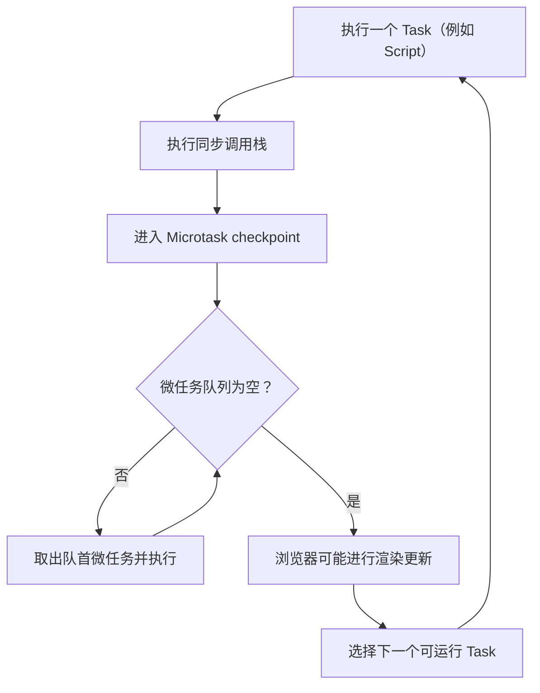

# Day 1 · 第 1 题：JavaScript Event Loop

> 2026-10-24 · 中高级前端 / 全栈 · 题目与标准答案

## 主问题

解释 `Promise.then`、`queueMicrotask`、`setTimeout`、`async/await` 的执行顺序，以及浏览器和 Node.js 事件循环的差别。

## 核心结论

1. 当前 script 同步执行完成后，在微任务检查点依次处理已入队的微任务；微任务内产生的新微任务追加到队尾，而不是插队。
2. `new Promise(executor)` 的 executor 同步执行；`resolve()` 不等于 `return`，不会中止后面的同步语句。
3. `await` 暂停的是当前 async 函数的后续执行，而不是整个线程；即使 `await 100` 也会异步恢复。
4. 无限递归的 `queueMicrotask` 可使事件循环无法推进到定时器和渲染；递归 `setTimeout` 则在各次回调之间交还控制权。
5. `process.nextTick` 属于 Node.js 专用队列；CommonJS 顶层通常先于 Promise 微任务，ESM 顶层顺序不可直接套用。
6. `setImmediate` 属于 Node.js check 阶段：与顶层 `setTimeout(fn, 0)` 的先后不保证；在 I/O 回调中注册时一般先执行 `setImmediate`。
7. `Vue.nextTick` 用于等待 Vue DOM 更新，和 `process.nextTick` 不是同一个概念。
8. `requestAnimationFrame` 在下一次重绘前调用，`requestIdleCallback` 利用空闲时间；React Fiber 的可中断渲染并非任意 JS 代码可被抢占。

## 练习顺序与答案

| 示例 | 主题 | 关键结果 |
| --- | --- | --- |
| [01-basic-order.ts](examples/01-basic-order.ts) | 同步、Promise、queueMicrotask、await、timer | `A E G C D F B` |
| [02-microtask-queue.ts](examples/02-microtask-queue.ts) | 微任务内创建微任务 | `1 7 4 6 5 2 3` |
| [03-microtask-starvation.ts](examples/03-microtask-starvation.ts) | 微任务饥饿 | 无限循环会阻止 timer |
| [04-async-await.ts](examples/04-async-await.ts) | await 普通值 | `3 1 5 2 4` |
| [05-promise-executor.ts](examples/05-promise-executor.ts) | executor 与 resolve | `5 1 2 3 7 4 6` |
| [06-node-nexttick.cjs](examples/06-node-nexttick.cjs) | CommonJS nextTick | `A F D C E B` |
| [07-node-immediate.cjs](examples/07-node-immediate.cjs) | timers、poll、check | 顶层 B/C 不固定；I/O 内 F 在 E 前 |
| [08-browser-scheduling.ts](examples/08-browser-scheduling.ts) | RAF、Idle callback | 回调先后不应视为固定 |

运行 TypeScript 示例：`npx tsx examples/01-basic-order.ts`；CJS 示例：`node examples/06-node-nexttick.cjs`。

**警告：** 第 3 个示例默认不会真正执行无限微任务；除非明确用于隔离环境实验，不要启用死循环。

## 深入讲解

### 事件循环与任务队列

事件循环属于宿主环境与 JS 引擎配合的机制，不能笼统说“V8 只有宏任务/微任务两种异步任务”。当前任务的同步代码运行结束后会处理微任务检查点。在微任务检查点，新排队的微任务继续被处理直到队列清空。定时器只表示满足执行条件后可以被调度，不代表 `setTimeout(fn, 0)` 立即执行。

### `await` 和 `Promise.then`

`await x` 会以 Promise 语义处理 `x`，恢复当前 async 函数的后半段以微任务方式调度。在介绍简单输出顺序时可以近似把后续部分理解为 `Promise.resolve(x).then(...)`，但这不是严格源码等价。

### Node.js 的特殊性

`process.nextTick` 具有独立队列。Node 的事件循环由多个阶段构成（包括 timers、poll、check）；Node 20 起定时器运行时机曾发生变化，因此不要背诵过时的绝对顺序。

### React Fiber 的可中断性

Fiber 把 render 阶段工作组织为可调度单元，允许在合适边界让出主线程；不代表浏览器能在任意同步函数的任意指令处抢占执行，React commit 阶段也不能随意中断。

## 用户回答与逐轮追问

参见 [follow-ups.md](follow-ups.md)。

## 参考资料

- [MDN Microtask guide](https://developer.mozilla.org/en-US/docs/Web/API/HTML_DOM_API/Microtask_guide)
- [MDN await](https://developer.mozilla.org/en-US/docs/Web/JavaScript/Reference/Operators/await)
- [Node.js Event loop](https://nodejs.org/en/learn/asynchronous-work/event-loop-timers-and-nexttick)
- [Node.js process.nextTick](https://nodejs.org/en/learn/asynchronous-work/understanding-processnexttick)
- [MDN requestAnimationFrame](https://developer.mozilla.org/en-US/docs/Web/API/Window/requestAnimationFrame)
- [MDN requestIdleCallback](https://developer.mozilla.org/en-US/docs/Web/API/Window/requestIdleCallback)

---

## 补充：从执行栈理解事件循环



**注意**：图展示浏览器任务模型的主要逻辑，不意味着每个 Task 后一定绘制一帧；微任务检查点在规范定义的其他时机也可能触发。定时器到时只表示任务符合排队条件，不代表马上获得线程。

### 推导题一：原始代码

```ts
console.log("A");
setTimeout(() => console.log("B"), 0);
Promise.resolve().then(() => console.log("C"));
queueMicrotask(() => console.log("D"));
async function test() {
  console.log("E");
  await Promise.resolve();
  console.log("F");
}
void test();
console.log("G");
```

| 阶段 | 同步输出或新入队任务 | 当前微任务队列 |
|---|---|---|
| 执行 Script | A；注册 timer B | [] |
| 注册 then | 入队 C | [C] |
| queueMicrotask | 入队 D | [C,D] |
| 调用 test | 同步打印 E，await 后等待恢复 F | [C,D,F] |
| 结束 Script | 打印 G | [C,D,F] |
| 微任务检查点 | 打印 C、D、F | [] |
| 后续 timers | 打印 B | [] |

输出：**A E G C D F B**。这也是最初回答中遗漏 G 的地方。

### 微任务中的微任务

```ts
Promise.resolve().then(() => {
  console.log(4);
  queueMicrotask(() => console.log(5));
});
queueMicrotask(() => console.log(6));
```

队列依次为 `[4,6] → [6,5] → [5] → []`，因为新创建的 5 加在队尾。它不抢占正在执行的回调。

### Node.js 与浏览器的差别

- 浏览器关注 Task、Microtask checkpoint 和渲染机会。
- Node.js 的 libuv 事件循环组织 timers、poll、check 等阶段，另有 `process.nextTick` 队列；Node 版本及 CommonJS/ESM 顶层差异会影响部分代码顺序。
- `setImmediate` 是 Node 的 check 阶段机制；`requestAnimationFrame` 与 `requestIdleCallback` 是浏览器调度接口，不应视为对等。
- 无限递归微任务会让队列无法清空；递归 setTimeout 每次回调后可以交还事件循环控制权。

### 面试常见误解

| 误解 | 正确理解 |
|---|---|
| Promise 都是异步的 | `new Promise(executor)` 的 executor 同步执行 |
| resolve 会终止代码 | `resolve()` 不等于 `return` |
| await 阻塞整个 JS 线程 | 它暂停 async 函数后续部分 |
| 有新微任务就立刻执行 | 加入队尾，等待当前微任务完成 |
| React Fiber 能抢占任意 JS | 只能在协作式调度边界让出主线程 |
