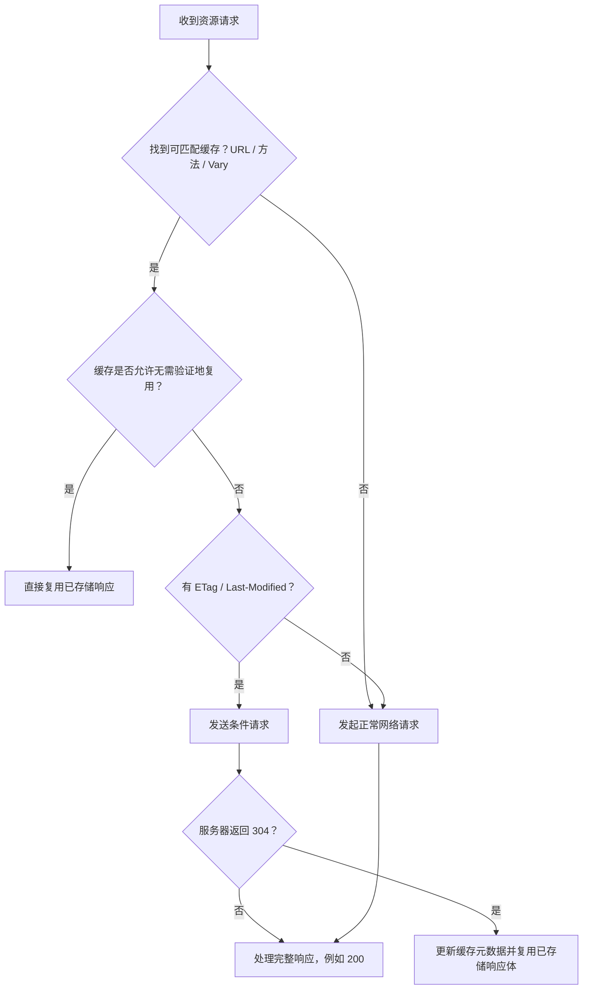
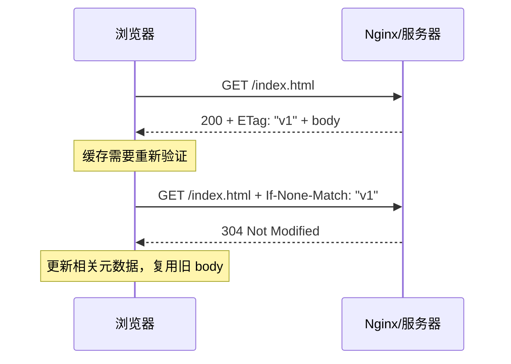

# Day 1 · 第 2 题：HTTP 缓存与 SPA 部署

## 题目
React SPA 上线后部分用户仍见旧版本。说明浏览器缓存查找、Vary、强缓存、协商缓存、304、Nginx 缓存策略，以及动态 import 的 Chunk 失效处理。

## 参考答案
- 首先按请求 URL 和方法等缓存键选择候选响应，并依据 **响应中的 Vary 所指向的原始请求头值** 与当前请求头进行匹配。
- `Cache-Control: no-store` 禁止存储；`no-cache` 允许存储但复用前必须验证；`must-revalidate` 限制过期响应复用，而**不阻止新鲜响应直接使用**。
- 新鲜度通常依显式 `s-maxage`（适用共享缓存）/`max-age`/`Expires` 等判断，需考虑 Age、Date 等；缺少显式新鲜度时，符合条件的响应可能采用启发式新鲜度（例如参考 Last-Modified），**不是 max-age 过期之后再补一次启发式判断**。
- 过期或要求验证时，用 `If-None-Match` 携带 ETag，用 `If-Modified-Since` 携带 Last-Modified（不是 If-None-Modified）。两者同时出现时，服务器优先判断 If-None-Match。304 使客户端复用已存储响应体并更新适用的缓存元数据。
- HTML 入口一般设 `Cache-Control: no-cache`（或更严格的业务策略）；内容哈希资源可设 `Cache-Control: public, max-age=31536000, immutable`。资源内容变化即 URL 变化，无需额外自定义 Vary: build。
- 发布时先上传完整新静态资源，再原子切换 HTML。尽量保留一段时间的旧哈希文件。若旧 SPA 在运行中懒加载已删 Chunk，可能 404 或因返回 HTML 导致模块解析失败；需错误边界/失败提示/一次性刷新保护。
- **HTML 的 no-cache 不能让已打开的 SPA 自动升级**；它只在发生相关 HTTP 请求时生效。必要时设计新版本检测并保护未保存数据；同时考虑 Service Worker、CDN 和多节点一致性。

## 典型响应头

### HTML
```http
Cache-Control: no-cache
ETag: "index-version"
```

### 构建产物（内容哈希文件）
```http
Cache-Control: public, max-age=31536000, immutable
```

## 示例
- [nginx.conf](examples/nginx.conf)：示意型静态资源缓存设置，部署路径需按实际环境调整。
- [version-check.ts](examples/version-check.ts)：SPA 版本检测示例，实际项目应添加未保存数据提示。

## 复习重点
1. `Vary` 比较请求头，非响应头。
2. `must-revalidate` 与 `no-cache` 的区别。
3. 启发式新鲜度触发条件。
4. 304 的语义、ETag / Last-Modified 的优先级。
5. 构建资产的不可变缓存与原子部署。
6. 旧标签页的运行时代码不会因 HTML 的 no-cache 自动更新。

## 参考
- https://www.rfc-editor.org/rfc/rfc9111.html
- https://developer.mozilla.org/en-US/docs/Web/HTTP/Reference/Headers/Cache-Control

---

## 补充：缓存决策流程



**解释**：流程为常见 GET 缓存的教学简化，实际还受缓存指令、请求指令、授权、共享/私有缓存和规范规则影响。`Vary` 取自缓存响应，匹配的是原请求与当前请求的对应请求头值。

### 显式和启发式新鲜度

例如 `max-age=3600` 表示 3600 秒的新鲜度生命周期，不能仅按本地写入时刻计算，要考虑 `Date`、`Age` 等。若没有明确新鲜度且满足启发式缓存条件，可能参考 `Last-Modified` 估算，不是显式新鲜度过期后再启用一次。

| Cache-Control | 新鲜时 | 过期时 |
|---|---|---|
| `max-age=3600` | 可复用 | 通常需要验证或重新获取 |
| `no-cache` | 复用前也需要验证 | 需要验证 |
| `must-revalidate, max-age=3600` | 可直接复用 | 不允许随意复用旧响应 |
| `no-store` | 不应存储此响应 | 不适用 |

### 条件请求时序



### 发布问题

`index.html: no-cache` + `assets/*.hash.js: max-age=31536000, immutable` 是常见策略。先上传新资源，再切换入口；保留旧资源，防止已打开的旧 SPA 动态导入遭遇 404。若已运行页面从不重新请求入口，`no-cache` 不会自动让它更新，需版本检测并提示刷新、保护未保存内容。
