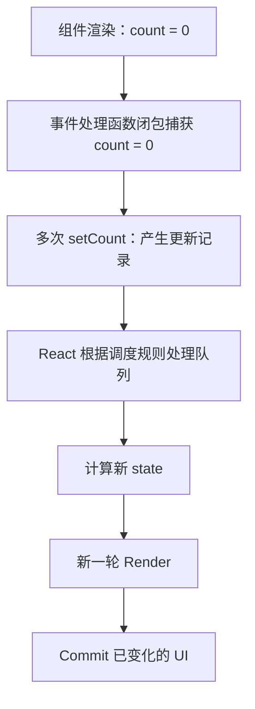

# Day 1 · 第 3 题：React State、Batching 与更新队列

## 题目

React 18+ 中连续调用三次 `setCount(count + 1)` 为什么最后只加一？`setCount(prev => prev + 1)` 有什么区别？React 18 自动批处理相比 React 17 的变化是什么？

## 标准答案

- React 组件每次渲染拥有自己的 state **快照**。事件处理函数闭包中的 `count` 不会因为调用 setter 而立即改变。
- 三次 `setCount(count + 1)`（初始 0）相当于顺序安排三次“设置为 1”，后续一次渲染结果为 **1**；事件处理函数内部 `console.log(count)` 仍为 **0**。
- 三次 `setCount(prev => prev + 1)` 依次使用前一条更新计算后的值，结果为 **3**；同一事件处理函数内读取的 `count` 依旧是 **0**。
- Batching 让 React 收集一批状态更新，尽量合并渲染与提交工作。React 18 在使用 `createRoot` 时，将自动批处理扩展到定时器、Promise 和原生事件等场景；React 17 默认主要在 React 事件处理器里批处理。
- Hooks 内部存在更新队列，源码实现中可用环状链表组织更新；**队列数据结构不等于批处理调度机制**。
- 批处理不代表“只存在一条更新”，也不保证开发模式 StrictMode 下组件函数只调用一次。

## 第二轮混用题

```tsx
const [count, setCount] = useState(0);
const handleClick = () => {
  setCount(count + 1);
  setCount(prev => prev + 1);
  setCount(count + 1);
  setCount(prev => prev + 1);
  console.log(count);
};
```

更新计算：`0 → 1 → 2 → 1 → 2`。最终渲染为 **2**，同步打印 **0**。注意：第三个调用不是在 2 的基础上加 1，而是依据当前渲染快照重新设置为 1。

## 为什么不每次调用都立即渲染

减少重复渲染/DOM 提交，保持同一事件中的快照一致，便于更新调度。频繁渲染可能带来性能问题，但**不必然**造成死循环。

## 代码

参见 [examples/counter.tsx](examples/counter.tsx) 与 [examples/mixed-updates.tsx](examples/mixed-updates.tsx)。

## 参考

- https://react.dev/learn/queueing-a-series-of-state-updates
- https://react.dev/learn/state-as-a-snapshot
- https://github.com/reactwg/react-18/discussions/21

---

## 补充：状态快照、队列和调度



**三个概念不要混淆：**
1. Snapshot：事件处理函数读取的是创建该闭包时的 state。
2. Update Queue：记录“替换为某值”或“应用 updater”的更新，React 按调度规则处理。
3. Batching：使多个更新尽可能合并渲染和提交，减少重复工作。源码中 Hooks 队列的数据结构不是批处理机制本身。

### 混合更新逐条推导

```tsx
setCount(count + 1);        // replace with 1
setCount(prev => prev + 1); // update 1 -> 2
setCount(count + 1);        // replace with 1 again
setCount(prev => prev + 1); // update 1 -> 2
console.log(count);         // 0, still current snapshot
```

| 操作 | 累计待计算状态 |
|---|---:|
| 起始 | 0 |
| 替换为 1 | 1 |
| +1 | 2 |
| 替换为 1 | 1 |
| +1 | 2 |

最终下一轮渲染显示 2，同步日志为 0。

### React 18 自动批处理

```tsx
setTimeout(() => {
  setCount(v => v + 1);
  setFlag(v => !v);
}, 1000);
```

使用 `createRoot` 的 React 18 可在 React 事件以外场景（如定时器、Promise 回调、原生事件）应用自动批处理。不要理解成“React 永远只渲染一次”；同步边界、`flushSync`、更新优先级和 StrictMode 的开发检查会影响实际观察。

### 源码学习建议

先掌握 Snapshot → Queue → Batching → Render/Commit，再学习 Fiber、Lane、Hook queue 的 circular linked list。观察函数组件被调用的次数与 DOM 真正提交的次数并非同一个指标。
