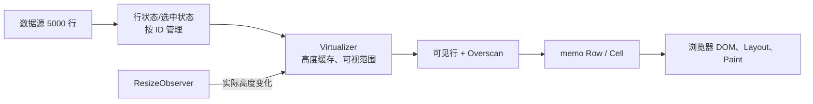

# Day 1 · 第 4 题：React 大表格性能优化

## 面试场景
5000 行 × 20 列可编辑表格，输入单元格与勾选行时卡顿。如何定位瓶颈？如何用 React.memo、useMemo、useCallback 和虚拟列表优化？动态行高、固定列和跨行选择如何设计？

## 排查
- React DevTools Profiler：查看渲染与 commit 耗时、哪些行重复渲染。
- Chrome Performance：检查 JS Long Tasks、style recalculation、Layout 与 Paint，避免先验断定是 React 问题。
- 建立基线：输入延迟、点击耗时、渲染行数、DOM 数量，并在同样数据规模下对照优化前后。

## 核心方案
1. **缩小更新范围**：给行或单元格设置组件边界，使用 React.memo；确保 row 数据引用、回调和其他 Props 对未更新行保持稳定。
2. **稳定引用**：useCallback 缓存回调引用；useMemo 缓存计算结果，不是缓存组件的渲染结果。
3. **虚拟化**：仅挂载视口中的行与少量 overscan，降低实际 DOM 数量。
4. **动态行高**：测量与缓存实际高度（可用 ResizeObserver），使用累计高度与二分查找定位可见行，必要时保持滚动锚点。
5. **固定列**：可考虑 position: sticky，正确处理表头、层级、背景、横向定位。
6. **跨行选择**：在组件之外的稳定状态中按业务行 ID 保存选中集合；虚拟化卸载的行仍能记住选中状态。

## 追问题

给 memo 行组件传入 `onSelect={() => handleSelect(row.id)}`，为什么仍重渲染？

答：Table 每次渲染都会创建新函数对象，React.memo 的默认浅比较会发现 onSelect 引用变化。不是因为 id 变化，也不是 map 本身。

修复：父组件通过 useCallback 定义稳定 `handleSelect(id)`；选中状态使用函数式 setter；直接给各行传入同一个 `handleSelect`。行内调用 `() => onSelect(row.id)` 即可。要求其他 Props 和 Context 不引入额外更新。

## 示例
- [examples/memoized-table.tsx](examples/memoized-table.tsx)

## 参考
- https://react.dev/reference/react/memo
- https://react.dev/reference/react/useCallback
- https://react.dev/reference/react/useMemo

---

## 补充：虚拟表格整体设计



### 先定位而不是先 memo

1. React Profiler 记录勾选一行前后哪些 Row 渲染、耗时为何。
2. Chrome Performance 分开观察 Scripting、Style/Layout、Paint、Long Task。
3. 如果 React commit 很短而 Layout 很长，减少 DOM 及布局依赖；若同步筛选/校验很重，可考虑去抖、增量计算或 Worker。
4. 对比优化前后同一数据集的输入延迟、Commit 耗时、DOM 总数和滚动 FPS。

### 动态行高计算

固定行高：`startIndex = floor(scrollTop / itemHeight)`。动态行高则维护估计/已测量高度和前缀和 `prefix[i]`，找到满足 `prefix[i] <= scrollTop < prefix[i+1]` 的 i（可以二分）；`ResizeObserver` 测量行高并调整缓存，变更时维护视口滚动锚点。

### 固定列和跨行选择

固定列可使用 `position: sticky`，同步列宽、层叠上下文、阴影和左右偏移。虚拟滚动会卸载不可见行，因此选择状态应保存于以业务 ID 为键的持久状态，不应仅依赖 DOM checkbox 的临时状态。Shift 范围选择基于**当前排序/筛选后的逻辑行顺序**，而非当前挂载的 DOM 顺序。

### React.memo 失败原因

```tsx
// 每次父组件渲染都创建新函数，导致 memo 行的 onSelect prop 变更：
<MemoizedRow row={row} onSelect={() => handleSelect(row.id)} />

// 改为稳定回调引用，子组件自己绑定 id：
const handleSelect = useCallback((id: string) => {
  setSelectedIds(prev => {
    const next = new Set(prev);
    next.has(id) ? next.delete(id) : next.add(id);
    return next;
  });
}, []);
<MemoizedRow row={row} onSelect={handleSelect} />
```

只有其他 Props/Context 等也稳定时，未变化的行才通常可以跳过渲染。对大规模表格优先评估成熟虚拟化库，并测试动态高度与键盘可访问性。
