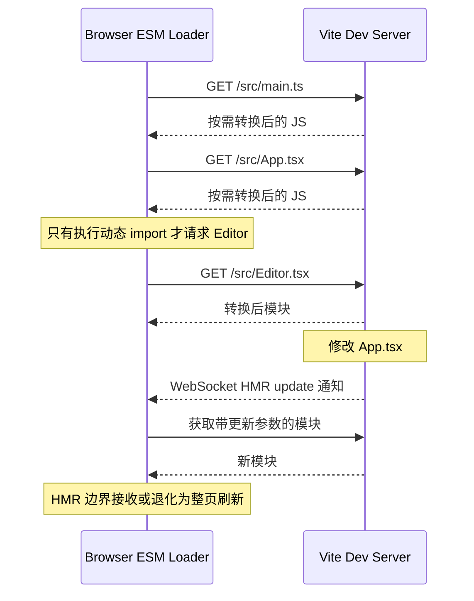

# Day 1 · 第 5 题：Vite 与 Webpack 构建原理

## 题目

1. Vite 在开发环境为何通常比传统 Webpack 启动快？模块加载和 HMR 如何工作？
2. Vite 依赖预构建解决哪些问题？
3. 开发快意味着生产构建一定快吗？

## 参考答案

- Vite 开发模式利用浏览器原生 ESM，不必启动时把全部应用源码打包。浏览器访问模块时，由 Vite 按需转换 TS/TSX 等源码与改写模块导入路径；动态 `import()` 对应的模块通常等到实际执行时加载。
- 依赖预构建与源码按需转换不同：预构建可完成 CommonJS/UMD 依赖的 ESM 兼容转换，并合并依赖内部大量细碎模块以减少开发环境请求数；同时缓存预处理结果。
- HMR：文件变化后开发服务器依据模块依赖图定位受影响模块及可接受更新的 HMR 边界，再通知浏览器请求更新后的模块；React 项目通常配合 Fast Refresh。不能接受热更新的情况可能退化为整页刷新。
- 传统 Webpack 开发模式通常先构建 Bundle，但 Webpack 也支持持久化缓存、增量构建、HMR，以及实验性的 `experiments.lazyCompilation`。
- 生产构建速度取决于模块图、转换、插件、代码分割、Source Map、压缩、I/O 等因素。不要由开发冷启动表现推断生产构建必然更快。
- 版本辨析：早期 Vite 的依赖预构建/部分转换依靠 esbuild（Go），生产构建依靠 Rollup（主要 JS）；Vite 8 转向 Rolldown（Rust）及 Oxc（Rust）构建处理体系。具体行为以项目所用版本为准。

## 可运行示例

- [examples/main.ts](examples/main.ts) — 动态加载入口
- [examples/editor.ts](examples/editor.ts) — 延迟加载模块

在浏览器 ESM 环境下，实际工程可使用 Vite 启动示例。TypeScript 源码需要经过 Vite 等转换后交给浏览器。

## 复习要点

1. 启动快的核心是**开发模式不必预先打包整个应用**，不是“不编译”。
2. 浏览器原生 ESM 的模块请求与 Vite 按需转换一起驱动加载。
3. HMR 依赖模块图与更新边界，不等同于按需加载。
4. 不要把 Rollup、esbuild 和 Rolldown 的实现语言弄混。

## 参考

- https://vite.dev/guide/why.html
- https://vite.dev/guide/dep-pre-bundling.html
- https://vite.dev/guide/api-hmr.html
- https://webpack.js.org/configuration/experiments/#experimentslazycompilation

---

## 补充：Vite 开发加载与 HMR 时序

### 必须区分的三个处理阶段
- **依赖扫描/预构建**：第三方依赖的 CommonJS/UMD 兼容、依赖内部模块合并及缓存，不等同于构建整个应用。
- **开发源码转换**：模块按需请求时转换 TS/TSX 等，浏览器加载 ESM。
- **生产 Bundle**：最终仍需优化依赖图、Chunk、资源输出和压缩。

### 热更新为什么快

Vite 根据模块图找修改模块与 HMR 接受边界，通知浏览器更新对应模块；Fast Refresh 可在满足条件时保留 React 组件状态。**不是所有更新都保留状态，也不是所有变更都不触发全页刷新。** Webpack 同样支持 HMR，不应把二者说成“Vite 有 HMR，Webpack 没有”。

### 工具链版本
早期 Vite 生产使用 Rollup（主要 JavaScript），预构建使用 esbuild（Go）；Vite 8 转向 Rolldown（Rust）与 Oxc（Rust）相关工具链。对比构建速度时必须标注版本、插件集和缓存冷热状态。

### 生产迁移评估
实际迁移要对比冷启动、首页首次转换耗时、HMR p95、生产构建耗时、Chunk 总量、Source Map、插件适配、兼容性和回滚能力。单凭一个冷启动数字不能证明架构迁移值得。
