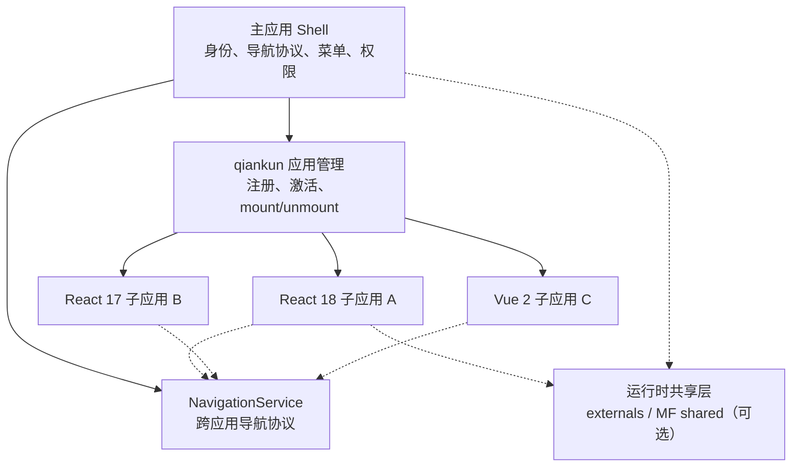
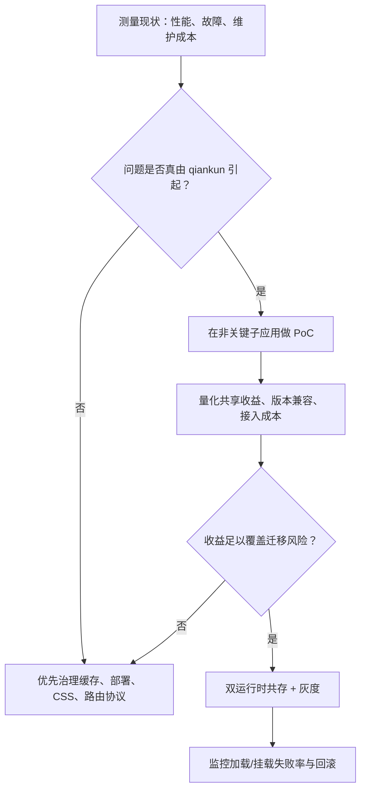

# Day 1 · 第 6 题：qiankun、Module Federation 与微前端治理

## 场景
20 个 React/Vue 子应用，存在样式污染、依赖重复、路由混乱、资源加载失败。是否迁移 Module Federation？如何治理和迁移？

## 标准答案
- **qiankun**：应用级加载、挂载/卸载、沙箱和路由协调；适合异构系统集成。
- **Module Federation**：跨独立构建共享模块及依赖，提供 remote/shared 等运行时机制；不是完整微前端应用生命周期与样式隔离方案。两者可结合。
- **样式隔离**：命名空间、CSS Modules、qiankun 的 experimentalStyleIsolation（选择器作用域）或 strictStyleIsolation（Shadow DOM）；还要处理 Portal、样式继承等。
- **依赖共享**：Monorepo 管理代码与依赖版本，不代表浏览器运行时自动共享。可用 externals 或 Module Federation shared；React 与 react-dom 的版本、实例需配套。
- **路由**：主应用提供统一的导航服务 API、权限与状态协议，子应用内自行路由，避免泄漏宿主路由框架的私有 API。
- **迁移决策**：衡量加载性能、故障率、插件生态、Vue2 等旧技术栈兼容性、团队维护成本、迁移收益及可回滚能力。不是所有问题都需要通过迁移解决。
- **React 运行时**：React 18 应用可评估共享版本兼容实例；React 17/18 不应仅为缩包盲目强制共享。共享的 React Hooks 与渲染器的实例兼容性很重要。
- **线上白屏**：逐层确认资源 404/MIME/publicPath、版本/CDN、bootstrap/mount/unmount、沙箱和依赖实例、路由 basename、异常监控。加载成功不代表挂载成功。
- **发布**：带哈希的不可变静态资源、先资源后入口、保留旧 Chunk、灰度监控和入口版本快速回滚。

## 代码
参见 [examples/navigation-service.ts](examples/navigation-service.ts) 和 [examples/mount-instrumentation.ts](examples/mount-instrumentation.ts)。

## 参考
- https://qiankun.umijs.org/guide
- https://module-federation.io/guide/start/

---

## 补充：微前端架构与发布路径

### qiankun 与 Module Federation 的边界

qiankun 侧重完整应用的加载和生命周期、JS 沙箱、样式隔离等；MF 侧重不同构建产物之间的运行时模块暴露与依赖共享。MF 默认不自动提供完整的微前端路由隔离和应用生命周期。二者可组合，也可替代部分能力。

**Monorepo 统一安装 node_modules 不等于浏览器只有一份 React。** 子应用各自构建后仍可能把依赖打包进去。共享需明确外置或 MF shared 的版本、单实例及回退规则；React 17 和 18 不宜无评估地强制使用同一版本。

### qiankun 沙箱与样式隔离

- JS 沙箱的目标是隔离子应用对全局对象的副作用；不同运行模式下具体隔离与恢复行为不同。
- `experimentalStyleIsolation` 对样式增加作用域选择器；`strictStyleIsolation` 使用 Shadow DOM。二者与 JS 沙箱不等价。
- 弹层 Portal、全局样式、CSS 变量、Body 滚动锁、第三方组件注入的样式，均可能跨越局部隔离预期。

### 渐进迁移决策

### 部署白屏排查
`资源路径 / MIME / CDN / publicPath → bootstrap/mount/unmount 错误 → 路由 basename → React 实例/沙箱 → 权限与业务初始化`。发布采用新资源先上传、保留旧 Hash Chunk、再切换入口和灰度回滚。主子应用的路由协议应稳定，不直接暴露宿主路由库的内部对象。
