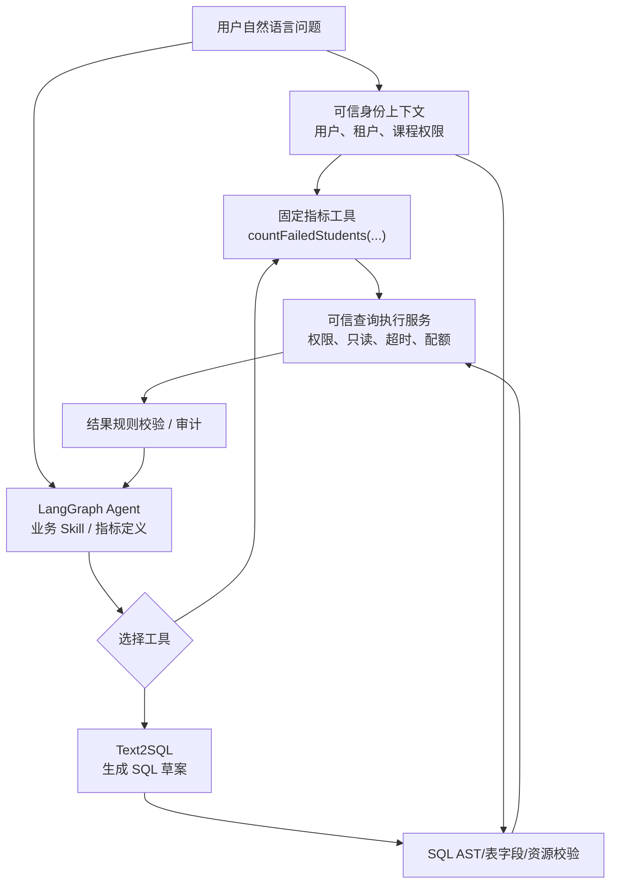
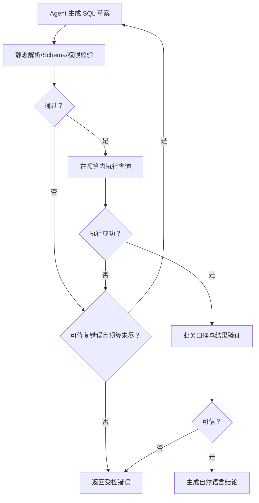

# Day 1 · 第 8 题：LangGraph Agent SQL 纠错、业务口径与查询安全

## 题目
教学分析 Agent 生成的 SQL 可能语法错误、Schema 错误、统计口径错误或超时。如何实现自动纠错、业务准确性以及教师课程级数据权限？如何验证查询结果？

## 参考答案
1. 错误分类：解析/Schema 错误可把结构化错误反馈给模型并提供授权范围内的元数据；业务逻辑错误应依据业务指标规则核验；超时需要资源限额、执行计划分析及终止机制。限制最大尝试次数、总耗时和工具调用预算，相同错误重复发生时提前终止。
2. Skill 可向模型提供表关系、字段语义和指标定义，但 Prompt **不是安全与正确性边界**。对指标使用可维护的语义层、授权查询工具、参数化查询和确定性校验。
3. 在真正执行 SQL 的工具服务端验证已认证身份、租户/课程权限，不接受模型自己声明的授权范围。优先使用限定业务能力的查询工具；如允许自由 SQL，使用 SQL AST 解析、只读数据库账号、表/列白名单、行级权限、超时与成本限制。
4. 只允许 SELECT 或追加 LIMIT 并不足以阻止高成本 JOIN、排序、扫描或函数滥用。可用查询计划、连接并发配额、只读副本/分析库隔离。
5. 返回结果正确性必须结合业务指标规则、已知不变量、统计口径和 Golden Dataset。第二个 LLM 可帮助发现疑点，但不能证明结果正确；离线评测不能替代线上权限控制与数据校验。

## 教师权限场景
教师仅获课程 course_1001 权限。模型生成 `SELECT COUNT(DISTINCT student_id) FROM exam_results WHERE score < 60` 会查询全表的记录，应由服务端强制限定 course_id，而不是靠提示词提醒模型。

## 示例
- [examples/grade-query.ts](examples/grade-query.ts)：带身份范围的受控查询工具示意。
- [examples/retry-policy.ts](examples/retry-policy.ts)：有限重试与错误类别示意。

## 参考
- https://docs.langchain.com/oss/python/langgraph/overview
- https://owasp.org/www-project-top-10-for-large-language-model-applications/

---

## 补充：Text2SQL + 受控工具架构



### 为什么不只靠提示词

Prompt 与 Skill 可指导模型正确理解表关系和统计口径，但提示词会被误读或攻击，模型生成正确 SQL 的概率不等于权限安全。**权限必须在工具执行服务端由可信登录身份决定**，且应从数据库层/业务层约束真正查询到的记录。

### 两种工具的区别

```ts
// 受控业务统计工具：模型只提供经过 Schema 检验的参数，SQL 固定。
countFailedStudents({ courseId: "course_1001", maxScore: 60 });

// 受控自由 SQL：模型生成 SQL，但执行器仍需 AST 校验、可信授权范围、
// 读权限、超时、并发与结果上限；仅 SELECT / LIMIT 并不足以安全。
executeReadOnlySql({ sql: "SELECT ..." });
```

推荐对标准指标使用固定工具，对探索型分析使用自由度更高但保护更严格的 Text2SQL 查询链。

### 有限纠错流程



权限错误不能当成普通 SQL 错误让模型反复绕过。超时也不该自动无限重试，要限制次数、时间、扫描成本及并发。错误信息反馈给模型时应避免泄露敏感 Schema。

### 线上正确性与离线评测
- 线上：课程授权、时间区间、过滤删除数据、去重维度、分母定义、数量界限等确定性约束。
- 离线：用 Golden Dataset 覆盖真实问题、表关系歧义、权限攻击、空集、异常 SQL、业务口径变化与模型回归。
- 第二个 LLM 可以辅助审核，但不能替代服务端数据权限和确定性指标检查。
