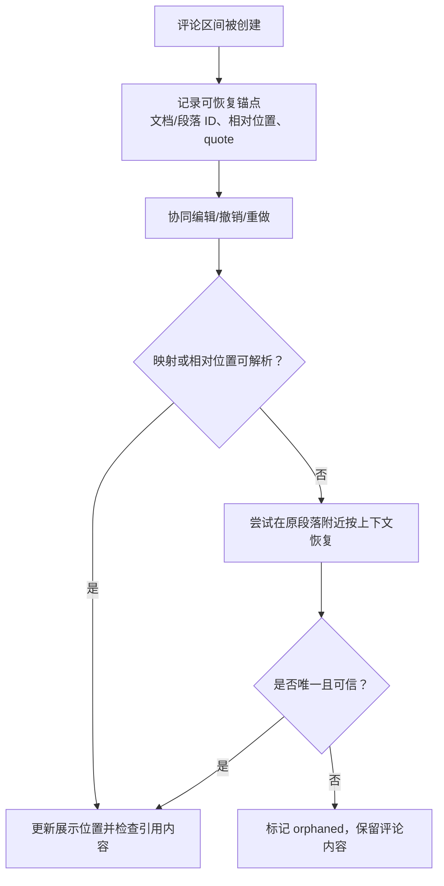

# Day 1 · 第 9 题：ProseMirror + Yjs 协同编辑评论锚点

## 场景
用户 A 对第 20～30 字符添加评论，B 在前方插入字符，随后撤销导致评论位置偏移。如何映射位置、处理并发、恢复失效锚点？

## 标准答案

- 纯字符 offset 无法长期稳定标识富文本范围：插入、删除、节点拆分和合并都会影响位置；ProseMirror Position 还是文档树内的位置，并不总等于纯文本字符索引。
- ProseMirror `Transaction.mapping` 由 StepMap 组成，可把更新前的位置映射到更新后。使用 `mapping.map(pos, assoc)` 时要考虑边界插入的偏向、删除区间等语义。
- Mapping 适合在已知事务链中追踪位置，不是永久有效的跨会话 ID。Yjs RelativePosition、稳定段落 ID 或其他持久锚点可用于协同场景。
- Yjs 是 CRDT 方案，利用内部结构和并发合并规则让多个副本最终收敛；OT 通过转换并发操作保证一致。两者都不能自动保证合并后的业务语义正确。
- 恢复定位顺序：优先使用稳定锚点与映射；其次段落 ID + 相对偏移；最后在附近结合 quote 和上下文回退；若不可靠则标记锚点丢失，避免错误附着。
- 源内容被删除后，不应仅因锚点失效就默认删除评论数据。可保留评论并设置 `orphaned` 状态，具体清理策略按产品业务需求决定。

## 追问
段落：`React 很强大，React 很灵活，React 很流行。` 第二个 React 被删除，又出现一个新的 React。仅凭 paragraphId + quote 搜索会把评论错误挂到其他词上，因此需区分评论数据和评论位置。

## 示例
- [examples/map-comment.ts](examples/map-comment.ts)
- [examples/comment-model.ts](examples/comment-model.ts)

## 参考
- https://prosemirror.net/docs/ref/#transform.Mapping
- https://docs.yjs.dev/api/relative-positions

---

## 补充：评论锚点恢复流程与 CRDT / OT

### ProseMirror Position 与 Mapping

ProseMirror 的 position 是结构化文档树中的位置，不能视为 `string.length` 级的字符偏移。事务里的 `StepMap` 负责映射某次变更前后的位置信息，`Mapping` 可以组合多个变更步骤。边界插入有左右偏向，需要根据评论区间语义选择 `assoc`；删除范围要结合 `mapResult` 的状态判断。

**限制**：跨会话只保留原数字位置不够，事务历史也不一定永久可用。协同编辑中应考虑 Yjs RelativePosition 或持久稳定锚点。

### CRDT 与 OT 对比

| | Yjs（CRDT） | OT |
|---|---|---|
| 核心 | CRDT 数据结构与并发合并规则 | 转换并发操作的位置/意图 |
| 并发相同位置插入 | 使用内部标识和确定性规则收敛 | 通过操作变换调整位置 |
| 离线合并 | 适合，但仍需同步和存储策略 | 依赖具体中心服务及历史转换机制 |
| 保证范围 | 最终结构一致，不保证语义完美 | 操作转换正确时保证一致，不自动解决业务语义 |

### 原文回退为什么危险

原文：`React 很强大，React 很灵活，React 很流行。`。若评论绑定第二个 React，删除后又在尾部新增一个 React，按 `quote='React'` 全文搜索会错误附着到其他出现位置。恢复时结合段落 ID、原位置范围、左右上下文和稳定锚点；存在多处同样候选时不应任意选择。

### 评论是否删除

把评论实体生命周期与锚点生命周期区分开。文本删除后将锚点标记 `orphaned` 比直接丢弃评论更有利于审阅记录、历史版本和人工重定位；具体自动清理策略由业务确认。
