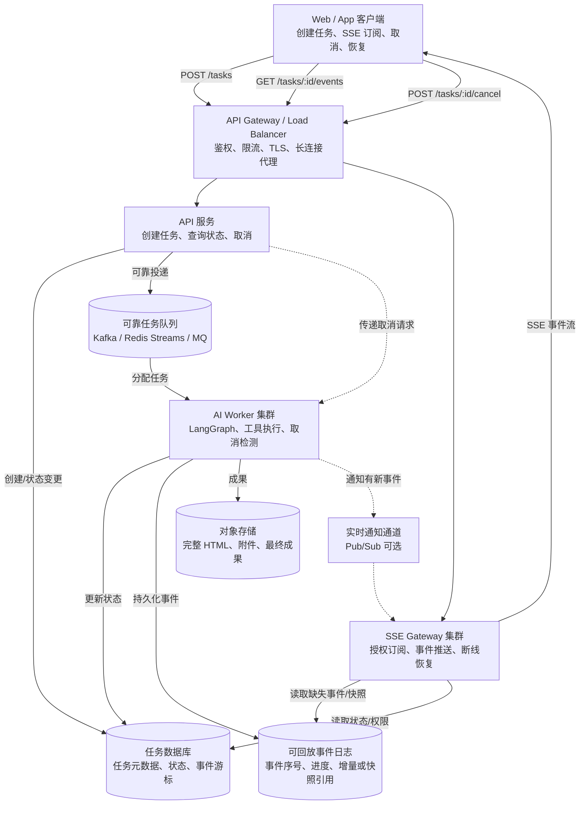
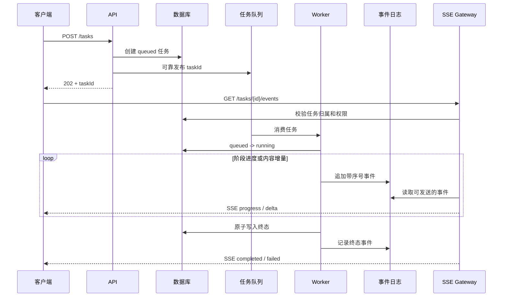
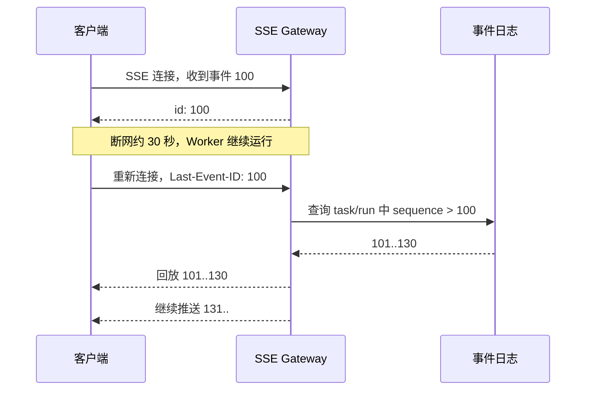
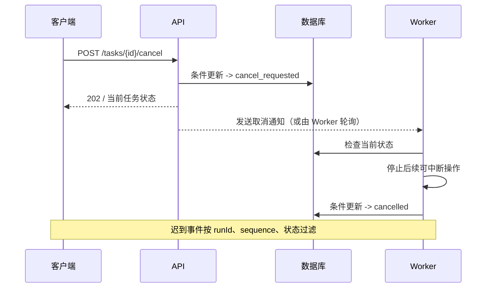

# Day 1 · 第 10 题：设计 10 万在线用户的 AI 任务进度系统

> 高级全栈 / 系统设计 · 2026-10-24  
> 学习目标：理解任务执行、消息分发、长连接、持久化、断线恢复和取消语义之间的职责边界。

## 1. 面试题与需求澄清

10 万用户同时在线；生成任务运行 1～10 分钟；浏览器需要看到阶段进度、增量文本/HTML、成功/失败/取消；刷新或断网 30 秒后继续查看；用户可以主动停止生成。

**先区分两个指标**：10 万在线用户不等于 10 万个同时运行的 Agent。需要向面试官确认实际同时运行任务数、每个任务每秒推送事件数、单事件大小、历史保留时长、恢复延迟和任务是否允许暂停。这些参数直接决定架构容量和成本。

非功能需求：至少一次事件投递可去重、终态一致、租户隔离、可观测性、故障恢复、背压处理、限流与配额。

## 2. 推荐系统架构（Mermaid）

下面是逻辑架构，并不要求每一种中间件都同时部署。GitHub 可以直接渲染 Mermaid。



### 每层职责

| 组件 | 负责 | 不负责 |
| --- | --- | --- |
| Client | 显示进度、保存游标、重连与去重 | 决定最终任务状态 |
| API 服务 | 权限、创建/取消请求、状态查询 | 长时间同步运行全部 Agent |
| 任务数据库 | 任务归属、运行状态、版本、终态 | 高频全文增量推送 |
| 任务队列 | 调度异步 Worker、重试、削峰 | 自动实现业务幂等 |
| Worker | 调用模型/工具、执行任务、响应取消 | 维持每个浏览器长连接 |
| 事件日志 | 可重放的历史事件、序号 | 替代鉴权 |
| SSE Gateway | 管理连接、订阅、过滤、回放和实时推送 | 根据浏览器断开而自动停止任务 |
| 对象存储 | 大型成果和附件 | 低延迟实时通知 |

**注意：** Worker 将事件写入事件日志与向通知通道发布消息之间可能发生故障。因此通知应该只作为“有新事件”的提示，SSE 网关应能根据持久化序号主动补读。若要求严格可靠投递，还要设计 Outbox、事务边界或补偿扫描。

## 3. SSE、WebSocket、轮询选型

| 维度 | SSE | WebSocket | 轮询 |
| --- | --- | --- | --- |
| 通信方向 | 服务器→客户端 | 双向 | 客户端请求后拿响应 |
| 进度/流式文本 | 合适 | 合适 | 实时性、请求开销较差 |
| 重连 | 浏览器 EventSource 可自动重连；fetch 流需自行实现 | 应用自行处理 | 下次请求天然重新开始 |
| 连接资源 | 长连接 | 长连接 | 重复 HTTP 请求 |
| 控制操作 | 独立 POST API | 可用同连接发控制指令 | 独立 POST API |

选择 SSE 是因为主要是**服务器单向持续推送**，不是因为它永远比 WebSocket 节省资源。要支持自定义 POST 流（如同时发送复杂请求体），可以用 fetch streaming，但需要自行处理流解析/重连。

### API 协议

```http
POST /api/tasks
Authorization: Bearer <token>
Content-Type: application/json

{"prompt":"生成教学分析报告"}
```

返回 `202 Accepted` 与 `taskId`，而非让 HTTP 请求保持十分钟。

```http
GET /api/tasks/task-1001/events
POST /api/tasks/task-1001/cancel
GET /api/tasks/task-1001
GET /api/tasks/task-1001/result
```

SSE 事件示例：

```text
id: 42
event: progress
data: {"taskId":"task-1001","runId":"run-2","sequence":42,"stage":"writing","percent":60}

id: 43
event: delta
data: {"taskId":"task-1001","runId":"run-2","sequence":43,"text":"新增段落"}
```

这里 `id` 可编码游标，浏览器 EventSource 重新连接时可携带 `Last-Event-ID`。实际生产要绑定用户权限和任务运行版本；若历史游标已过期，应返回最新快照并续接。

## 4. 完整任务生命周期



真实系统要处理“任务入库成功但队列发布失败”的双写问题。可使用事务 Outbox 或带补偿的调度扫描；消费端必须幂等。

## 5. 断线恢复与消息去重

1. 每条事件有 `taskId`、`runId`、`sequence`；同一 run 的 sequence 单调递增。
2. 前端仅应用尚未处理的事件。对超过预期的序号不能直接当作连续，应发起补读。
3. 恢复时先校验用户/任务权限，再根据 `Last-Event-ID` 或独立游标读取缺失事件；若事件已过保留期，返回内容快照和新的游标。
4. 历史回放与实时流的交界处可能重复，前端和服务端都需要去重。
5. 任务终态之后，不应再把旧 run 的进度写入当前显示状态。



如果增量 HTML 非常大，可按节流频率持久化快照，增量事件只存相对较小的数据。终态返回完整产物 URL，从而减少每个 Gateway 的内存占用。

## 6. 取消任务与并发竞态

定义状态：

```text
queued -> running -> completed
                  -> failed
queued/running -> cancel_requested -> cancelled
```

`cancel_requested` 是控制意图，不保证调用第三方模型/外部工具后立即结束。Worker 应在工具调用前后等检查点读取取消信号，支持 AbortController 或 LangGraph 的中断方式时尽量协作式终止。

关键：**取消与完成并发时，必须有明确终态判定规则，并用原子条件更新（CAS）确保只能有一个有效终态。**

例如数据库状态更新要带期望状态或版本号，检查 affected rows。前端停止展示旧事件属于显示保护，不等于服务器已停止计费/计算。



## 7. 容量估算与水平扩容

10 万在线连接如何分片？

- 假设平均每个 SSE 连接消耗 **20 KiB 的应用态内存**，仅连接相关内存就约 1.9 GiB（示意假设，不包含运行时、代理、TLS、内核 socket 缓冲等）。
- 如果每个连接平均每秒接收 1 KiB，10 万连接总下行约 100 MiB/s（约 819 Mbps），未计 HTTP/TLS 开销与突发。**这是假设下的估算，不是测量结果。**
- 若 10 个 SSE 实例均匀分摊，则每实例约 1 万连接；实例数必须依据压测、弹性余量、单实例限额和高峰分布决定。
- 网关/代理要允许长连接与适当 idle timeout，控制反向代理缓冲。设置每用户连接数/任务数/发送频率上限，低速客户端需要背压处理。

**性能指标建议**：SSE 活跃连接数、每秒事件数、端到端延迟 p95/p99、网关内存、事件日志积压量、Worker 排队时长、任务成功率、重连成功率和取消生效时延。

## 8. 故障演练清单

| 故障 | 期望行为 |
| --- | --- |
| 用户刷新页面 | 根据 taskId + 已处理游标恢复 |
| SSE 实例重启 | 其他实例从持久化日志补发 |
| Worker 进程崩溃 | 任务可重试或标记失败；避免重复执行不可逆副作用 |
| 事件通知丢失 | Gateway 根据持久化日志主动补读 |
| 消息重复消费 | 任务状态转移、写入操作具备幂等性 |
| 用户取消恰逢任务完成 | 原子状态转移确定唯一终态 |
| 大量客户端消费速度慢 | 限速、快照、断开并要求重新同步 |
| 事件历史过期 | 返回最新快照和新游标 |
| 跨租户订阅 taskId | 拒绝访问并审计 |

## 9. 渐进式实现建议

**阶段一（较小规模）**：数据库任务表 + Worker + SSE + 状态轮询兜底，持久化关键状态、最终成果与最近事件。

**阶段二（多实例）**：任务队列和 SSE Gateway 拆分，引入可靠事件日志、网关水平扩容、独立对象存储、幂等消费。

**阶段三（高并发）**：按租户/任务路由分区，限流、容量压测、背压、灰度发布、容灾与跨实例可观测性。

## 10. 今日答题记录与代码

- [follow-ups.md](follow-ups.md)：保留真实回答和点评
- [examples/task-protocol.ts](examples/task-protocol.ts)：任务状态与事件协议
- [examples/event-reducer.ts](examples/event-reducer.ts)：客户端去重、序号检查与终态过滤

以上代码是核心机制示例，并非完整可部署的生产工程；生产实现需要补齐身份验证、数据库、任务队列、事务和监控。

## 11. 参考资料

- [MDN Using server-sent events](https://developer.mozilla.org/en-US/docs/Web/API/Server-sent_events/Using_server-sent_events)
- [Redis Streams](https://redis.io/docs/latest/develop/data-types/streams/)
- [Kafka Documentation](https://kafka.apache.org/documentation/)
- [LangGraph Documentation](https://docs.langchain.com/oss/python/langgraph/overview)
