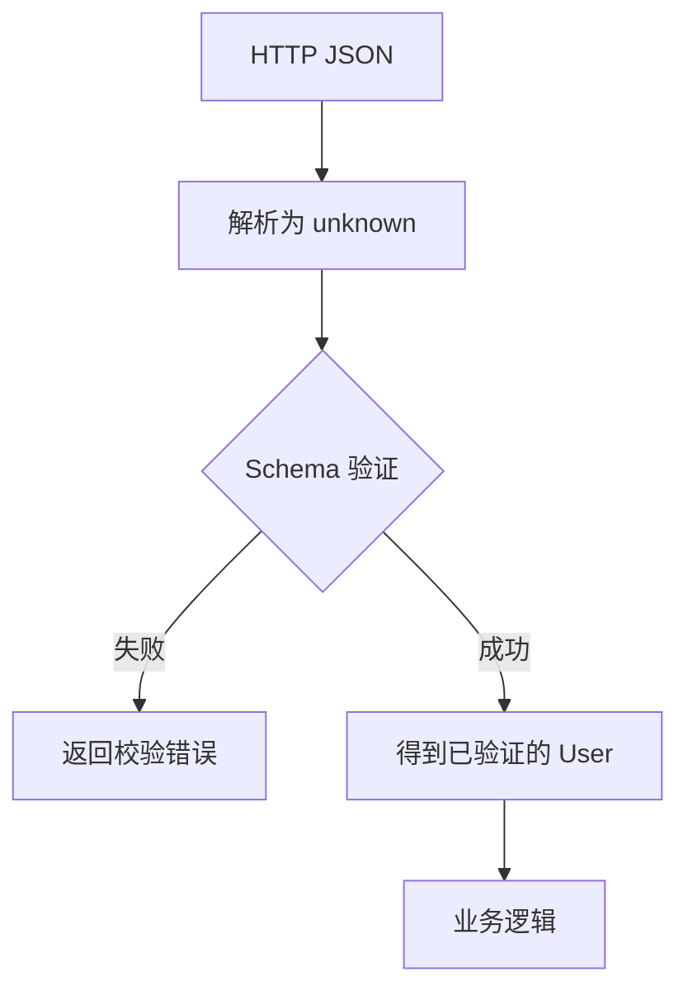

# Day 2 · 第 1 题：TypeScript 类型系统与运行时边界

> 2026-10-25 · JS/TS · 已完成 · 模拟评分 85/100

## 题目
1. 比较 `any`、`unknown`、`never` 的赋值规则和典型用途。
2. 后端 JSON 标注为 `User` 是否保证真实类型正确？为什么？
3. 共享类型、OpenAPI/Swagger 代码生成能解决什么？如何设计运行时安全的请求封装？
4. 追问：为什么 `request<User>()` 能编译却可能在 `user.age.toFixed(2)` 处失败？

## 核心概念

| 类型 | 接收任意值 | 直接作为具体类型使用 | 用途 |
|---|---|---|---|
| `any` | 是 | 通常可以 | 逃逸静态检查，尽量少用 |
| `unknown` | 是 | 不可以，必须收窄 | 未知外部输入 |
| `never` | 不存在普通可取值 | 可赋给任意类型 | 不可能分支、穷尽检查 |

```ts
let a: any = 123;
const s: string = a; // 编译通过，运行时仍可能是 number
let u: unknown = 123;
// const t: string = u; // 编译错误
if (typeof u === "number") console.log(u.toFixed(2));

type Impossible = string & number; // never
type Status = "success" | "failed";
function describe(status: Status) {
  switch (status) {
    case "success": return "成功";
    case "failed": return "失败";
    default: {
      const impossible: never = status;
      return impossible;
    }
  }
}
```

## 为什么泛型不能保证 API 返回值？

```ts
interface User { id: number; name: string; age: number }
async function request<T>(url: string): Promise<T> {
  const response = await fetch(url);
  return response.json();
}
const user = await request<User>("/api/user");
console.log(user.age.toFixed(2));
```

若实际 JSON 为 `{"id":1001,"name":"Tom","age":"25"}`，编译仍通过，运行时 `toFixed` 抛错。

**原因：** TypeScript 泛型是静态类型参数，编译后不会生成 JSON 校验器；DOM 声明中的 `response.json()` 返回 `Promise<any>`，`any` 能流入泛型 `T`。显式 `as User` 同样不执行校验。

## 静态类型、契约和运行时验证

| 层次 | 方法 | 保障 |
|---|---|---|
| 静态约束 | TypeScript interface、泛型、共享类型包 | 编译期调用和字段类型 |
| 契约生成 | OpenAPI/Swagger 生成 TS | 减少前后端定义偏差 |
| 运行时验证 | Zod、Ajv、Valibot、手写守卫 | 检查实际响应数据 |

同一技术栈可共享类型，Java 服务可通过 OpenAPI 生成类型；但两者均不证明服务器实际遵守契约。建议在可信边界解析为 `unknown` 后再验证。



## Zod 示例

```ts
import { z } from "zod";

const UserSchema = z.object({
  id: z.number(),
  name: z.string(),
  age: z.number(),
});
type User = z.infer<typeof UserSchema>;

async function request<T>(url: string, schema: z.ZodType<T>): Promise<T> {
  const response = await fetch(url);
  if (!response.ok) throw new Error(`HTTP ${response.status}`);
  const data: unknown = await response.json();
  return schema.parse(data);
}

const user = await request("/api/user", UserSchema);
```

如果 `age` 是字符串，`schema.parse` 会抛出 ZodError。想自行处理错误可使用 `safeParse`。详见 [可运行示例](examples/request-validation.ts)。

## 工程边界

- `typeof null === "object"`，校验对象要排除 null；数组用 `Array.isArray`。
- `as User` 是类型断言，不是数据转换。
- 严格拒绝未知字段、允许字段转换等规则需要由契约决定。
- 对嵌套对象和数组需要递归校验；对大量数据要评估校验成本。
- HTTP 成功状态与数据契约正确是两件事；异常需要监控与明确的降级处理。

## 答题记录与评分

用户准确说明三种类型的基本作用、编译时类型限制，以及共享 TS 类型或从 Swagger 生成类型；追问中提出 `typeof` 和 Zod。需进一步理解 `Response.json()` 的 any 污染与泛型静态承诺。模拟评分 **85/100**。完整原始回答见 [follow-ups.md](follow-ups.md)。

## 参考资料

- [TypeScript Handbook: Generics](https://www.typescriptlang.org/docs/handbook/2/generics.html)
- [TypeScript Handbook: Everyday Types](https://www.typescriptlang.org/docs/handbook/2/everyday-types.html)
- [MDN: Response.json](https://developer.mozilla.org/en-US/docs/Web/API/Response/json)
- [Zod](https://zod.dev/)
- [OpenAPI Specification](https://spec.openapis.org/oas/latest.html)
