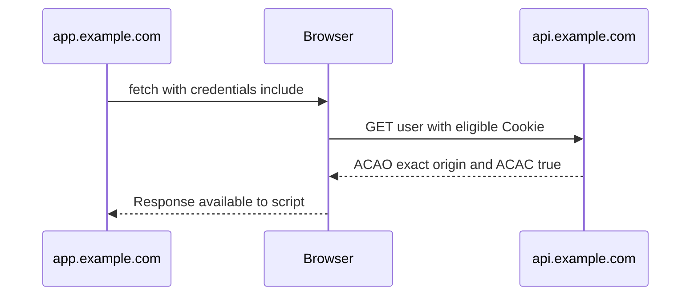
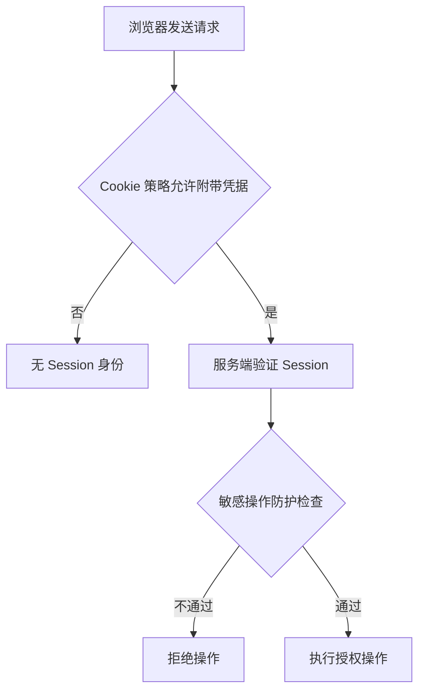

# Day 2 · 第 2 题：跨域登录、Cookie 与 CSRF

> 2026-10-25 · 浏览器 / Web 安全 · 已完成

## 完整题意

前端位于 `https://app.example.com`，API 位于 `https://api.example.com`。浏览器请求返回 401，Postman 正常。解释同源/同站、CORS、Cookie、凭据、跨站请求防护与 iframe 的兼容性。

## 一、同源与同站

- **同源**：scheme、host、port 三者相同。
- **同站**：现代浏览器通常按 schemeful site 判断，即 scheme + 可注册域名（eTLD+1）；子域名可不同。
- `https://app.example.com` 与 `https://api.example.com` **不同源、同站**。
- `http://app.example.com` 与 `https://app.example.com` 不同源，也不同站（schemeful）。

同站不等于同源。即使 SameSite 允许 Cookie，跨源 fetch 仍需满足 CORS 和 fetch 的 credentials 配置。

## 二、浏览器请求与凭据流程



```ts
const response = await fetch("https://api.example.com/api/user", {
  credentials: "include",
});
if (!response.ok) throw new Error(`HTTP ${response.status}`);
const data: unknown = await response.json();
```

Axios 的对应选项是 `withCredentials: true`。fetch 默认 `same-origin`，对跨源 API 不自动发送 Cookie。

后端响应头示例：

```http
Access-Control-Allow-Origin: https://app.example.com
Access-Control-Allow-Credentials: true
Vary: Origin
```

如果有预检，还需正确响应 OPTIONS，配置允许的方法与请求头。带凭据的跨源响应不允许 `Access-Control-Allow-Origin: *`。若按允许列表动态返回 Origin，应验证 Origin，并使用 `Vary: Origin`。

## 三、Cookie 属性与适用范围

```http
Set-Cookie: session=abc123; Path=/; Secure; HttpOnly; SameSite=Lax
```

- `Secure`：通常只在 HTTPS 连接发送（浏览器对 localhost 有特殊处理）。
- `HttpOnly`：禁止页面 JavaScript 直接读取 Cookie；不阻止浏览器自动携带。
- `Domain`：不设置时是 host-only；设置父域名后可覆盖符合规则的子域名。
- `Path`：限制 URL 路径匹配，不是安全隔离边界。
- `SameSite=Strict`：不在跨站请求中携带。
- `SameSite=Lax`：允许部分跨站顶级导航的安全方法（例如 GET）；通常不随跨站表单 POST 发送。
- `SameSite=None`：允许跨站发送，但必须与 `Secure` 配合，且仍受浏览器第三方 Cookie 限制。

**重要边界**：SameSite 的同站判定与 CORS 的同源判定不同。同站子域名间请求也需要注意 CSRF 风险，尤其当不可信子域名可发起请求时。

## 四、CORS 与 CSRF 不是同一种防护

CORS 决定浏览器是否允许脚本读取跨源响应；不代表所有跨源请求都无法发送。浏览器可发送某些不需要预检的表单请求，服务端若仅依赖 Cookie 身份验证，就需要考虑请求是否由用户本意发起。

CSRF 防护常见组合：

1. 对有状态的修改操作验证 CSRF Token。
2. 验证 Origin，必要时结合 Referer 和 Fetch Metadata 请求头。
3. 依据产品场景设置合理的 SameSite；不能把它当作唯一防线。
4. 不要用 GET 执行状态变更；高风险操作增加二次确认。



## 五、为什么 Postman 正常而浏览器 401？

排查顺序：

1. 在 DevTools Network 查看 Request Headers 是否真的携带 Cookie。
2. 检查 `credentials: "include"` 是否配置；确认登录响应是否成功存储 Cookie。
3. 检查 Cookie 的 host/domain/path/secure/samesite/过期时间，注意浏览器第三方 Cookie 策略。
4. 检查跨源响应是否返回精确的 ACAO 与 ACAC；预检 OPTIONS 是否正常。
5. 检查反向代理、TLS、重定向、负载均衡、会话存储和服务器日志。
6. 区分 **401（服务端认证失败）** 与 **浏览器 CORS 拒绝脚本读取响应**，两者不是同一错误。

第三方 iframe 中可能遭遇 Cookie 分区、阻止第三方 Cookie、Storage Access API 及嵌入策略（CSP frame-ancestors）等限制；不应假设 `SameSite=None` 一定足够。

## 六、常见错误

- 误把 SameSite 当作 CORS 属性。
- 把 Axios `withCredentials` 直接写进 fetch 选项。
- 用 `Access-Control-Allow-Origin: *` 搭配凭据请求。
- 认为 CORS 拒绝读取响应就等于服务器不会执行操作。
- 认为 `HttpOnly` 能防止 CSRF；它主要降低脚本读取 Cookie 的风险。
- 认为同站子域名请求就是同源请求。

## 七、真实答题与资料

本题用户正确判断两个子域名不同源、同站；指出 Cookie 的跨站携带问题，并在追问中正确判断 Strict 不会在跨站请求附带 Cookie。其余待巩固内容见 [follow-ups.md](follow-ups.md)。

权威参考：
- [MDN: CORS](https://developer.mozilla.org/en-US/docs/Web/HTTP/Guides/CORS)
- [MDN: Request.credentials](https://developer.mozilla.org/en-US/docs/Web/API/Request/credentials)
- [MDN: Set-Cookie](https://developer.mozilla.org/en-US/docs/Web/HTTP/Reference/Headers/Set-Cookie)
- [MDN: Same-origin policy](https://developer.mozilla.org/en-US/docs/Web/Security/Same-origin_policy)
- [OWASP: CSRF Prevention Cheat Sheet](https://cheatsheetseries.owasp.org/cheatsheets/Cross-Site_Request_Forgery_Prevention_Cheat_Sheet.html)
