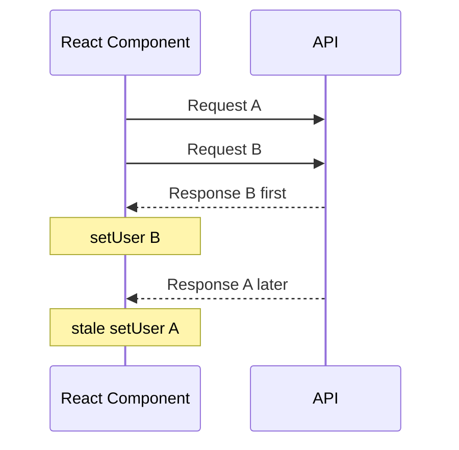
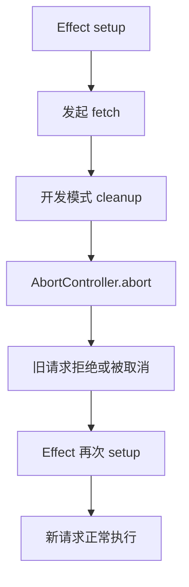

# Day 2 · 第 3 题：React useEffect 与异步请求竞态

> 2026-10-25 · React · 已完成 · 模拟评分 80/100

## 完整题目

组件在 `useEffect` 中按 `userId` 发请求。先请求 A（2 秒），再请求 B（200 毫秒），旧请求最后返回。问：最终显示什么、如何避免旧结果覆盖、AbortController 是否能解决所有竞态？追问 React 18 StrictMode 开发环境重复请求，以及取消后的 Promise 状态。

## 一、根因：异步完成顺序不保证等于发起顺序

A 先发，B 后发，但 B 先完成并调用 setUser，A 最后完成又调用 setUser，最终错误显示 A。仅把 Promise 链改成 async/await 不改变不同请求之间的完成顺序。



## 二、解决方案比较

| 方案 | 原理 | 适用边界 |
|---|---|---|
| cleanup 中的 ignore 标志 | 旧 Effect 失效后禁止提交状态 | 不取消网络流量 |
| AbortController | 取消支持 AbortSignal 的请求和响应体读取 | 自定义异步任务未必支持取消 |
| 请求版本号 | 只有最新版本允许写状态 | 适合复杂多来源异步任务 |
| TanStack Query / SWR | 请求缓存、去重、状态管理 | 仍需正确使用查询 key、理解取消语义 |

### ignore 标记

```tsx
useEffect(() => {
  let ignore = false;
  async function load() {
    try {
      const response = await fetch(`/api/users/${userId}`);
      if (!response.ok) throw new Error(`HTTP ${response.status}`);
      const data: User = await response.json();
      if (!ignore) setUser(data);
    } catch (error) {
      if (!ignore) console.error(error);
    }
  }
  void load();
  return () => { ignore = true; };
}, [userId]);
```

React 会在依赖变化时先清理旧 Effect，再执行新的 Effect。因此旧闭包中的 ignore 会变为 true。

### AbortController + 状态保护

```tsx
useEffect(() => {
  const controller = new AbortController();
  async function load() {
    try {
      const response = await fetch(`/api/users/${userId}`, {
        signal: controller.signal,
      });
      if (!response.ok) throw new Error(`HTTP ${response.status}`);
      const data: User = await response.json();
      if (!controller.signal.aborted) setUser(data);
    } catch (error) {
      if (controller.signal.aborted) return;
      console.error(error);
    }
  }
  void load();
  return () => controller.abort();
}, [userId]);
```

注意：请求完成后继续执行的自定义 Promise、CPU 计算等不会因为调用 abort 自动停止。要在异步边界后检查 `signal.aborted`，或使用请求序号；生产代码还要维护 loading/error/empty 状态，切换用户时避免展示旧用户数据。

## 三、StrictMode 开发模式行为

当根节点启用 StrictMode，React 开发模式会额外执行 Effect 的 setup → cleanup → setup 检查，以发现缺失的清理逻辑。看到第一轮请求被取消、第二轮请求正常，不是 Bug。生产模式不执行这一轮额外检查。StrictMode 若只包裹局部子树，初次挂载时额外执行 Effect 的行为有差异，不应一概而论。



## 四、Promise 状态与取消的边界

对尚未完成的 fetch，调用 abort 通常会使 Promise rejected，异常名为 `AbortError`；不是 resolved。若 fetch 已 fulfilled，不能改变已完成 Promise 的状态；但读取响应体时仍可能因为取消而失败。

```ts
const controller = new AbortController();
const pending = fetch("/api/user", { signal: controller.signal });
controller.abort();
try {
  await pending;
} catch (error) {
  if (error instanceof DOMException && error.name === "AbortError") {
    console.log("已取消");
  } else {
    throw error;
  }
}
```

取消请求不等于服务端撤销已经执行的业务操作；不能依赖 abort 保证服务端无副作用。请求失败应区分网络错误、HTTP 非成功状态和取消错误。

## 五、实践建议与边界

- Effect 依赖数组要包含实际使用的响应式依赖；不要通过删除依赖来掩盖竞态。
- 如果用户切换 ID，旧请求可能在网络层已经完成，但后续转换仍在执行。
- 请求缓存需按 userId 区分 key；缓存去重、数据新鲜度、重试和取消是不同维度。
- 请求版本号可在多个并发来源共用同一状态时防止旧数据覆盖。
- React StrictMode 下应实现正确的清理逻辑，而不是为了消除开发时双请求而关闭 StrictMode。
- 对有副作用的 POST 不应依赖 Effect 自动重试或 StrictMode 的执行次数保证幂等。

## 六、答题记录

用户正确判断旧请求 A 最终覆盖 B，提出 AbortController，理解 StrictMode 的开发调试目的；误认为 abort 后 Promise 会 resolve。模拟评分 80/100。真实原文见 [follow-ups.md](follow-ups.md)。

## 参考资料

- [React: Synchronizing with Effects](https://react.dev/learn/synchronizing-with-effects)
- [React: useEffect](https://react.dev/reference/react/useEffect)
- [React: StrictMode](https://react.dev/reference/react/StrictMode)
- [MDN: AbortController](https://developer.mozilla.org/en-US/docs/Web/API/AbortController)
- [MDN: Fetch API](https://developer.mozilla.org/en-US/docs/Web/API/Fetch_API)
