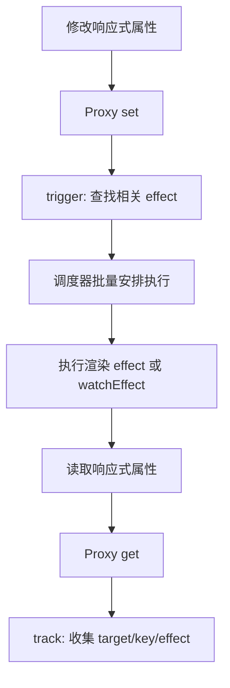

# Day 2 · 第 4 题：Vue 3 响应式系统原理

> 2026-10-25 · Vue · 已完成 · 模拟评分 70/100

## 面试题

```ts
import { reactive, ref, computed, watch } from "vue";
const user = reactive({ name: "Tom", age: 20 });
const { age } = user;
const count = ref(0);
const double = computed(() => count.value * 2);
watch(() => user.age, (n, o) => console.log(n, o));
user.age = 21;
count.value++;
```

解释 Vue 3 的 Proxy 响应式原理、解构后的响应性、ref/reactive/computed/watch；追问 watchEffect 的依赖粒度与 computed 的惰性求值。

## 一、为什么使用 Proxy

Vue 2 基于 Object.defineProperty 拦截已有属性的 getter/setter。它不是不能处理数组，而是对新增/删除属性、数组索引赋值和 length 修改等情况有局限，需要额外 API 或数组方法劫持。Proxy 可以拦截对象的 get/set/deleteProperty/has/ownKeys 等操作，适合统一处理对象、数组、Map、Set 等响应式场景（集合类型另有专门的代理处理逻辑）。

Proxy 不会自动产生依赖图。Vue 还需要 effect、track、trigger 和 scheduler 协作。

### 核心模型



可用简化的依赖关系理解：

```ts
// 概念模型，不是 Vue 内部源码的精确结构
type Dep = Set<() => void>;
type DepMap = Map<PropertyKey, Dep>;
const targetMap = new WeakMap<object, DepMap>();
```

- target 是原始目标对象，key 是访问的属性。
- 在 effect 执行期间，get 会把当前 effect 与属性关联。
- set 等操作触发 trigger，只通知与对应属性相关的 effect。
- 渲染 effect 通常由调度器批量安排，不是每次 set 都立刻同步重绘。
- 对象迭代、数组长度、集合类型等还有特殊依赖规则。

### 极简演示（非 Vue 源码）

```ts
const dependencies = new Map<string, Set<() => void>>();
let activeEffect: (() => void) | undefined;

function effect(fn: () => void) {
  const runner = () => {
    activeEffect = runner;
    try { fn(); } finally { activeEffect = undefined; }
  };
  runner();
}

const state = new Proxy({ count: 0, name: "Tom" }, {
  get(target, key, receiver) {
    if (activeEffect) {
      const dep = dependencies.get(String(key)) ?? new Set();
      dep.add(activeEffect);
      dependencies.set(String(key), dep);
    }
    return Reflect.get(target, key, receiver);
  },
  set(target, key, value, receiver) {
    const previous = Reflect.get(target, key, receiver);
    const ok = Reflect.set(target, key, value, receiver);
    if (ok && !Object.is(previous, value)) {
      dependencies.get(String(key))?.forEach((runner) => runner());
    }
    return ok;
  },
});

effect(() => console.log(state.count));
state.name = "Jerry"; // 不触发这个 effect
state.count++; // 触发
```

这个演示省略了 effect 栈、动态依赖清理、递归调度、数组/集合处理等生产机制。

## 二、解构为何丢失响应性

```ts
const user = reactive({ age: 20 });
const { age } = user; // 得到普通 number，脱离 Proxy
user.age = 21;
console.log(age); // 20
```

基本类型属性解构后，后续访问不再经过 Proxy。解决：

```ts
import { reactive, toRef, toRefs } from "vue";
const user = reactive({ name: "Tom", age: 20 });
const ageRef = toRef(user, "age");
const { age } = toRefs(user);
user.age = 21;
console.log(ageRef.value, age.value); // 21 21
age.value = 22;
console.log(user.age); // 22
```

不要误以为所有解构都等价：解构出嵌套的响应式对象与解构出基本类型不同。Vue 单文件组件中部分编译器宏的响应式解构也有单独规则。

## 三、四个核心 API

| API | 输入/输出 | 主要用途 | 注意 |
|---|---|---|---|
| ref | 任意值 → Ref 对象 | 基本类型、对象状态、模板引用 | JS 中读写 .value；对象值通常深层响应式 |
| reactive | 对象 → Proxy | 结构化对象状态 | 不能直接替换原代理变量来保持所有引用；基本类型不适用 |
| computed | getter → 只读 computed ref | 派生状态、缓存计算 | 默认惰性求值；可定义 getter/setter |
| watch | 显式 source + callback | 请求、日志、与外部系统同步 | 默认 lazy；可配置 immediate、deep、flush 等 |

`computed` 与 React `useMemo` 都能避免无谓计算，但不是完全等价：computed 基于 Vue 响应式依赖自动追踪，且默认惰性；React useMemo 由依赖数组控制，且是性能优化提示，不应当成持久语义保证。

### computed 与 watch 的区别

```ts
const count = ref(1);
const double = computed(() => count.value * 2);
watch(count, (next, prev) => {
  console.log({ next, prev });
});
```

- computed：返回一个可以被其他响应式消费者读取的派生值，getter 应尽量保持纯函数。
- watch：观察显式来源并执行副作用，可读取新旧值；默认不会在注册时立即运行。
- watchEffect：立即运行并自动收集其同步执行期间访问的响应式依赖；没有显式 source 参数。

## 四、追问一：watchEffect 的依赖粒度

```ts
const state = reactive({ count: 1, name: "Tom" });
watchEffect(() => {
  console.log("effect", state.count);
});
state.name = "Jerry"; // 不触发：未读取 name
state.count = 2; // 触发：依赖 count
```

依赖是按实际读取的响应式属性建立，而不是“这个对象任意属性更新就执行”。对异步 watchEffect，自动依赖追踪通常只覆盖首次 await 之前的同步读取部分。

React `useEffect` 使用显式依赖数组；Vue `watchEffect` 自动追踪读取的依赖。两者的执行调度与生命周期细节也不同，不能简单视为同一 API。

## 五、追问二：computed 的惰性与缓存

```ts
const count = ref(1);
const double = computed(() => {
  console.log("computed 执行");
  return count.value * 2;
});
count.value = 2; // 不会仅因此执行 getter
console.log(double.value); // 首次执行：4
console.log(double.value); // 缓存：4
count.value = 3; // 使派生结果失效
console.log(double.value); // 重新计算：6
```

若从未读取 double.value，也没有其他 effect 消费它，getter 不会仅因创建 computed 或组件其他更新而执行。

## 六、生产实践与边界

1. 将可派生的值交给 computed，不要为了维护冗余派生状态而滥用 watch。
2. 用 watch 做异步请求时，要处理旧请求清理与竞态，可使用 onCleanup / onWatcherCleanup（注意 Vue 版本和调用时机）。
3. watch(() => state.age, cb) 是有效的 getter source；直接 watch(state.age, cb) 传入的是普通数字，不是响应式来源。
4. 深度 watch 可能遍历较大对象，注意性能；直接 watch(reactiveObject, cb) 的行为与 watch(() => reactiveObject, cb) 不完全相同。
5. 避免将 reactive 基本类型属性直接解构成普通变量；优先 toRef/toRefs 或保留原对象访问。
6. 不要把所有更新都理解为“组件完整重新渲染 DOM”；Vue 还会调度、批处理和进行精细化 DOM patch。

## 七、答题反馈

用户掌握 API 的大体职责和 Proxy 相比 defineProperty 的优势；未能说明 track/trigger、watchEffect 依赖粒度与 computed 惰性求值。模拟评分 70/100。原始回答见 [follow-ups.md](follow-ups.md)。

## 官方资料

- [Vue: Reactivity Fundamentals](https://vuejs.org/guide/essentials/reactivity-fundamentals.html)
- [Vue: Reactivity in Depth](https://vuejs.org/guide/extras/reactivity-in-depth.html)
- [Vue: Computed Properties](https://vuejs.org/guide/essentials/computed.html)
- [Vue: Watchers](https://vuejs.org/guide/essentials/watchers.html)
- [Vue: Reactivity API Core](https://vuejs.org/api/reactivity-core.html)
- [Vue: Reactivity API Utilities](https://vuejs.org/api/reactivity-utilities.html)
