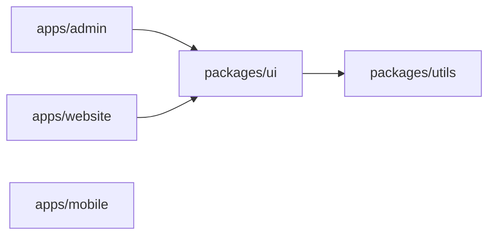
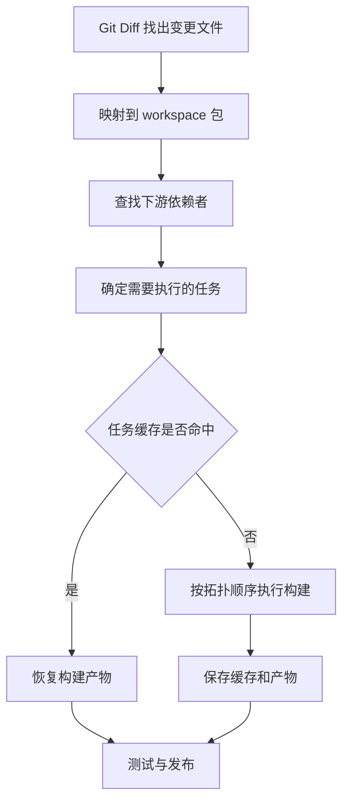

# Day 2 · 第 5 题：前端 Monorepo 与 CI 增量构建

> 日期：2026-10-25（北京时间） · 分类：工程化 · 状态：已完成 · 模拟评分：75/100

## 场景与目标

30 个 React + TypeScript + Vite 应用共享 UI 与工具库，使用 pnpm，CI 每次全量构建耗时约 20 分钟。要求：设计 workspace、按依赖图确定受影响项目、保证缓存正确性，并解释取舍。

## 一、Monorepo 与 Polyrepo

Monorepo 是多个相关项目共用一个 Git 仓库，并不与 Single Repository 对立。Polyrepo 则把不同应用或库放在多个仓库。

| 维度 | Monorepo | Polyrepo |
|---|---|---|
| 跨包改动 | 可一次提交原子修改 | 往往跨仓库协调 |
| 依赖升级 | 统一发现与迁移方便 | 每个仓库独立演进 |
| CI | 需增量执行与缓存 | 天然按仓库隔离 |
| 权限 | 需更精细的代码所有权和流水线控制 | 仓库权限边界清晰 |
| 规模 | 大仓库可能增加工具复杂度 | 仓库数量多，治理成本上升 |

Monorepo 的重点是共享代码与配置、工作区包链接、依赖图、统一工具链及增量任务，而非简单将相同版本依赖抽离。

## 二、pnpm workspace 结构

```text
company/
├── apps/
│   ├── admin/
│   ├── website/
│   └── mobile/
├── packages/
│   ├── ui/
│   ├── utils/
│   ├── tsconfig/
│   └── eslint-config/
├── pnpm-workspace.yaml
├── pnpm-lock.yaml
└── package.json
```

```yaml
# pnpm-workspace.yaml
packages:
  - "apps/*"
  - "packages/*"
```

```json
{
  "name": "@company/admin",
  "private": true,
  "scripts": { "build": "vite build" },
  "dependencies": {
    "@company/ui": "workspace:*",
    "@company/utils": "workspace:*"
  }
}
```

`workspace:*` 要求从工作区解析包；工作区源码变化与是否发布新版本是不同概念。生产包发布时可以按需要转换 workspace 协议。

## 三、依赖图与受影响项目

给定：
- admin → ui → utils
- website → ui → utils
- mobile 不依赖 ui（可能独立依赖 utils）

箭头表示“左边依赖右边”。



修改 `packages/ui/src/Button.tsx` 后：

| 项目 | 是否受影响 | 原因 |
|---|---|---|
| packages/ui | 是 | 自身源码变化 |
| apps/admin | 是 | 依赖 ui |
| apps/website | 是 | 依赖 ui |
| packages/utils | 否 | 上游依赖未变，可复用已有产物 |
| apps/mobile | 否 | 不依赖 ui |

**区分两个集合**：执行 ui 的构建任务可能需要先确保 utils 的产物可用；但是源码变更导致的失效集合是 ui 与其下游依赖者。构建工具可以先检查 utils 的缓存，而不是无条件重新执行。

pnpm filter 常用命令：

```bash
# 单个包
pnpm --filter @company/admin build

# admin 及其依赖
pnpm --filter "@company/admin..." build

# ui 及依赖 ui 的项目
pnpm --filter "...@company/ui" build

# 在选中的包中运行脚本；复杂项目还应使用任务图调度
pnpm --filter "...@company/ui" -r build
```

注意 pnpm 的过滤选择与构建任务的拓扑执行是不同层面；命令的选择器还支持按 Git 变更范围筛选。具体脚本需要根据包之间的构建产物依赖进行验证。

## 四、从 Git Diff 到增量 CI



应特殊处理根配置变化、锁文件变化、公共 TS 配置、构建工具配置和全局环境变量。这些变化可能影响大量项目，不能仅用“改动发生在哪个目录”判断。

变更范围应基于正确的基准提交（如 PR merge base），并确保 CI 有足够的 Git 历史；浅克隆和错误的比较基准可能导致漏构建。

## 五、构建缓存的正确性

可将任务缓存键理解为以下输入的组合 Hash：

```text
hash(
  task name,
  project source and relevant config,
  dependency graph and upstream task outputs,
  lockfile / dependency versions,
  runtime and toolchain versions,
  build flags and relevant environment variables
)
```

**Hash 并非只计算源码**。对 Vite 来说，`import.meta.env.VITE_*` 通常在构建时被静态替换，因此环境变量影响最终 dist。

```ts
const apiUrl = import.meta.env.VITE_API_URL;
```

假设测试环境构建时使用 `VITE_API_URL=https://test-api.example.com`，若生产环境复用这份 dist，生产页面可能继续请求测试 API。

解决思路：

1. **构建时配置**：将影响输出的环境变量纳入任务缓存键，区分不同环境构建产物。
2. **运行时配置**：部署时提供 `config.json` 等独立配置，前端启动时加载；可以实现 build once, deploy many，但需处理加载失败、缓存控制、配置版本和安全边界。

注意 Vite 客户端可见的 `VITE_*` 变量会进入前端代码，不能放入密钥。

### 缓存系统还需考虑

- 缓存产物路径（如 dist），否则命中任务但没有实际输出。
- 不应缓存不稳定或含有敏感数据的产物。
- 任务之间的依赖和缓存失效传递。
- 本地缓存与远程共享缓存的权限、隔离和可信性。
- 不可重复构建（时间戳、随机值、外部服务）会降低缓存可靠性。

## 六、工具选型

pnpm 负责依赖安装、workspace 管理、过滤选择；Turborepo、Nx 等可进一步管理任务依赖图、缓存、受影响任务和远程缓存。并非所有项目都必须引入额外工具：规模较小、构建脚本简单时 pnpm + CI 脚本也可实现基础增量构建。

## 七、面试常见错误

1. 将 Monorepo 与单仓库当作对立概念。
2. 修改下游包时无条件重新构建所有上游依赖。
3. 认为锁定包版本就意味着工作区源码变化不会影响应用。
4. 只 Hash 当前项目源码，忽略上游产物和构建环境。
5. 构建时环境变量变化后复用旧 dist。
6. 将 VITE_API_URL 之类的公开配置与真正的服务器密钥混淆。

## 八、真实作答与参考资料

本题用户能指出共享依赖、pnpm -F、Hash 与下游重建，追问中混淆了 utils 是否需要重建，以及 VITE_API_URL 失效的具体原因。模拟评分 75/100。原文见 [follow-ups.md](follow-ups.md)。

权威资料：
- [pnpm: Workspaces](https://pnpm.io/workspaces)
- [pnpm: Filtering](https://pnpm.io/filtering)
- [Turborepo: Caching](https://turborepo.com/docs/crafting-your-repository/caching)
- [Turborepo: Configuring Tasks](https://turborepo.com/docs/crafting-your-repository/configuring-tasks)
- [Vite: Env Variables and Modes](https://vite.dev/guide/env-and-mode)
- [Nx: Affected](https://nx.dev/ci/features/affected)
