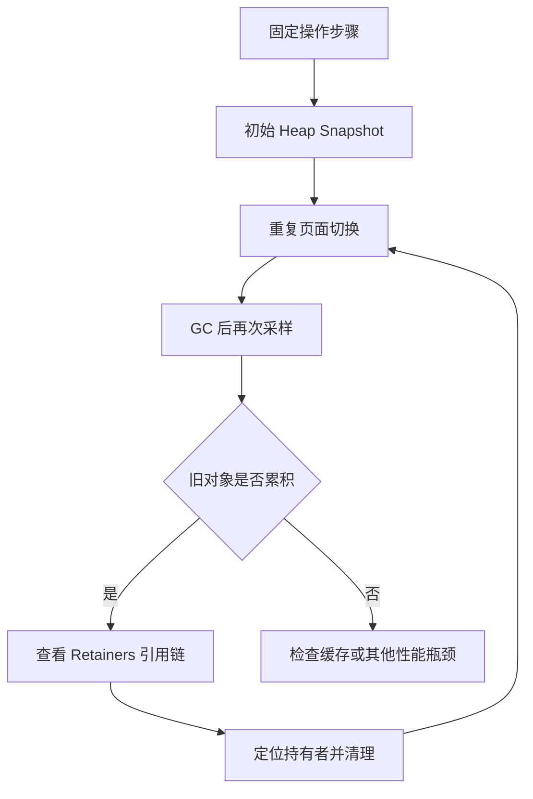
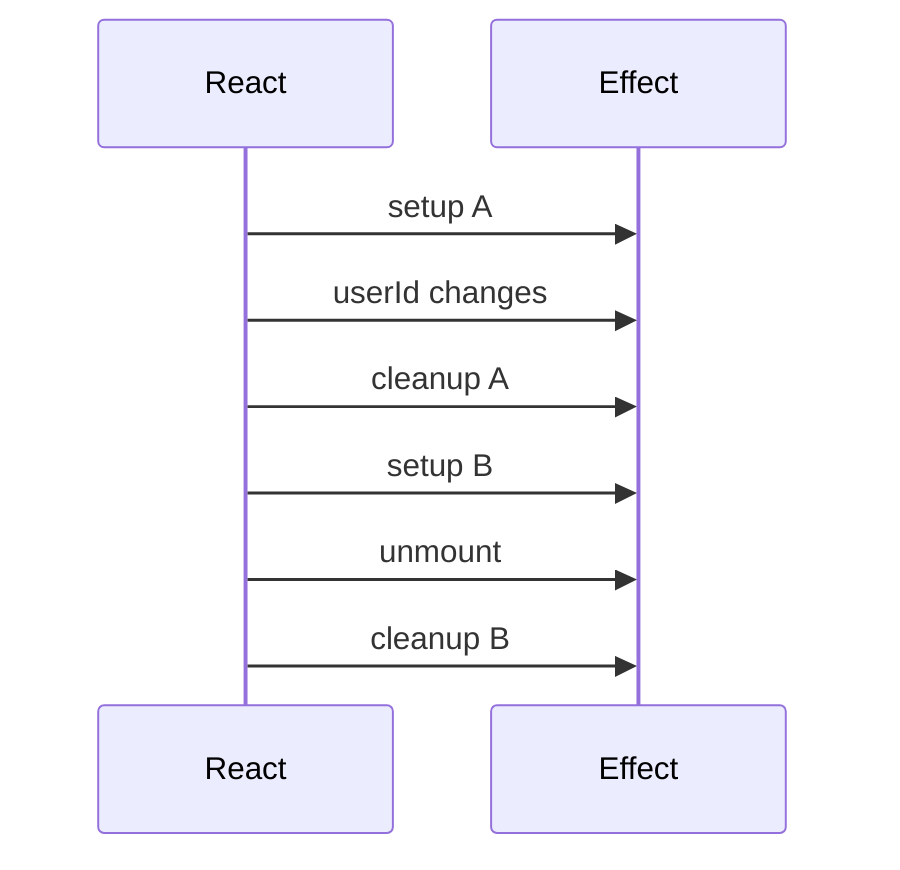

# Day 2 · 第 6 题：线上内存泄漏与性能排障

> 2026-10-25 · 已完成 · 模拟评分 72/100

## 场景

React SPA 运行两小时后变卡、内存增长，刷新恢复。考察 DevTools 诊断、泄漏来源、Effect 清理、事件监听器引用和依赖变化时的 cleanup。

## 一、内存泄漏与 OOM

内存泄漏指不再需要的对象仍被引用而无法回收。OOM 指资源耗尽，两者并不等价。内存增长也可能来自正常缓存、延迟垃圾回收、数据加载或运行时优化，不能仅凭任务管理器的内存曲线认定泄漏。

## 二、DevTools 排查流程

1. 固定复现路径：反复进入和离开页面，例如 20 次。
2. 使用 Performance 的 Memory 曲线观察 JS Heap、DOM Nodes、Listeners 等变化。
3. 在 Memory 中采集初始 Heap Snapshot，重复操作后触发 GC 再采集。
4. 使用 Comparison 比较对象数量和大小，寻找不再需要却持续增长的对象。
5. 检查 Retainers（引用链）定位全局监听器、定时器、缓存、闭包等持有者。
6. 查找 Detached DOM；节点脱离页面不必然是泄漏，只有被意外保留时才是问题。
7. 用 Allocation instrumentation on timeline 辅助定位分配与存活，修复后在相同条件下复测。



### 重要术语

- Shallow Size：对象本身占用的内存。
- Retained Size：对象被释放时可能连带释放的内存范围，需结合共享引用理解。
- GC Roots：垃圾回收的根引用；仍可从根到达的对象通常不会被回收。
- Detached DOM：已不在文档树中、但仍被 JavaScript 持有的节点。

## 三、常见来源及清理

| 来源 | 典型风险 | 清理方式 |
|---|---|---|
| 全局事件监听器 | 闭包意外持有页面对象 | removeEventListener |
| setInterval / setTimeout | 回调长期存活 | clearInterval / clearTimeout |
| WebSocket | 连接、消息回调与重连逻辑存活 | close、移除监听器、停止重连 |
| 图表、地图、编辑器 | 内部订阅和 DOM 未释放 | dispose / destroy |
| Store / Event Bus | 订阅和历史数据无限累积 | unsubscribe、控制缓存大小 |
| Detached DOM | 脱离页面的节点仍被引用 | 查 Retainers 并释放引用 |

闭包本身不是泄漏；未清理资源也不一定造成永久泄漏，要看是否超出预期生命周期并保留不再需要的对象。

## 四、Effect cleanup 的触发时机

React 在依赖变化时会先运行旧 Effect 的 cleanup，再运行新 setup；组件卸载也会 cleanup。根 StrictMode 开发环境可能额外执行 setup → cleanup → setup 检查。



### 正确清理监听器和定时器

```tsx
import { useEffect } from "react";

export function Dashboard({ userId }: { userId: string }) {
  useEffect(() => {
    const handleResize = () => console.log(window.innerWidth);
    const timer = window.setInterval(() => {
      console.log("user", userId);
    }, 1000);

    window.addEventListener("resize", handleResize);

    return () => {
      window.clearInterval(timer);
      window.removeEventListener("resize", handleResize);
    };
  }, [userId]);

  return <div>Dashboard</div>;
}
```

注册与移除时必须使用相同的函数对象，并确保 capture 选项匹配。两次书写的匿名箭头函数即使内容一样，也不是同一个引用。

### WebSocket 示例

```tsx
useEffect(() => {
  const socket = new WebSocket("wss://example.com/events");
  const onMessage = (event: MessageEvent) => console.log(event.data);
  socket.addEventListener("message", onMessage);

  return () => {
    socket.removeEventListener("message", onMessage);
    socket.close(1000, "cleanup");
  };
}, []);
```

实际项目还要清理心跳、重连定时器和外部订阅。异步请求取消可使用 AbortController，但异步回调并非必然导致永久内存泄漏。

## 五、答题总结

用户掌握 Chrome Memory、useEffect cleanup、clearInterval 与函数引用问题；需要强化 Heap Snapshot、Retainers 和依赖变化时 cleanup 的执行时机。评分 72/100，原文见 [follow-ups.md](follow-ups.md)。

## 官方资料

- [Chrome: Fix memory problems](https://developer.chrome.com/docs/devtools/memory-problems)
- [Chrome: Heap snapshots](https://developer.chrome.com/docs/devtools/memory-problems/heap-snapshots)
- [React: useEffect](https://react.dev/reference/react/useEffect)
- [React: Synchronizing with Effects](https://react.dev/learn/synchronizing-with-effects)
- [MDN: removeEventListener](https://developer.mozilla.org/en-US/docs/Web/API/EventTarget/removeEventListener)
- [MDN: clearInterval](https://developer.mozilla.org/en-US/docs/Web/API/Window/clearInterval)
- [MDN: WebSocket.close](https://developer.mozilla.org/en-US/docs/Web/API/WebSocket/close)
