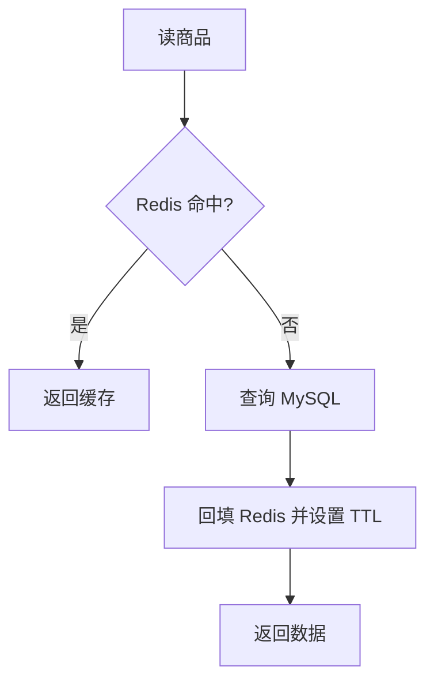
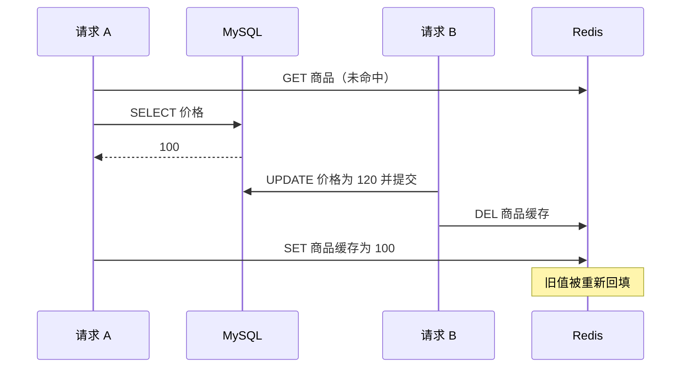

# Day 2 · 第 7 题：Redis 缓存与数据库一致性

> 2026-10-25 · 后端 / 分布式 · 已完成 · 模拟评分 60/100

## 场景

商品价格以 MySQL 为准，Redis 缓存商品详情。管理员修改价格后偶尔读到旧值。讨论 Cache Aside、并发回填、缓存穿透/击穿/雪崩，以及热点 Key 缓存失效时的处理。

## 一、Cache Aside（旁路缓存）

读取：
1. 查询 Redis，命中直接返回。
2. 未命中则查询 MySQL，写入 Redis（通常设置 TTL），返回结果。

写入：
1. 更新 MySQL，等待事务成功提交。
2. 删除 Redis 对应缓存 Key。
3. 下次读取重新从数据库加载。



为什么通常采用**更新数据库后删除缓存**，而非更新数据库后更新缓存？

- 数据库是事实来源，缓存应尽量作为可重建副本。
- 更新整个商品详情可能涉及其他字段、派生数据和并发覆盖；删除缓存更简单。
- 缓存更新和数据库更新不能天然构成原子操作；直接更新缓存同样存在并发顺序问题。

注意：先更新数据库再删除缓存也不是强一致性协议。删除失败必须考虑补偿，如重试、可靠事件或消息队列；短 TTL 可以限制错误缓存存活时间，但不能保证立刻一致。

## 二、旧读请求回填竞态

假设旧价格为 100，新价格为 120：



常见策略与局限：

| 策略 | 作用 | 边界 |
|---|---|---|
| TTL | 限制错误数据持续时间 | 无法立即消除旧值 |
| 延迟双删 | 第二次删除可能清理迟到的旧回填 | 时间窗口不确定，不能保证正确 |
| 版本号/条件写入 | 阻止旧版本覆盖新版本 | 版本比较需可靠且原子化 |
| 串行化/分布式锁 | 协调同 Key 的关键操作 | 相关路径都需遵守锁协议，成本较高 |
| 可靠失效事件 | 删除失败后继续补偿 | 仍可能有短暂不一致窗口 |

Redis 锁不是万能方案：只锁缓存回填而不协调数据库更新和缓存删除，仍可能发生竞态。涉及强一致要求的价格结算，不能单纯相信可能过期的商品详情缓存，应在订单确认时以权威数据和业务事务规则校验。

## 三、TTL（Time To Live）

Redis 中通常指 Key 的剩余生存时间。

```bash
SET product:1001 '{"price":100}' EX 3600
TTL product:1001
```

`EX 3600` 设置 3600 秒过期；`TTL` 返回剩余秒数。返回 `-1` 表示 Key 存在但没有过期时间，`-2` 表示 Key 不存在。过期时间能限制陈旧缓存的最长存活期，但具体还受写入与重新续期影响。

## 四、缓存穿透、击穿、雪崩

| 问题 | 定义 | 典型方案 |
|---|---|---|
| 穿透 | 查询根本不存在的数据，缓存与数据库都未命中 | 参数校验、缓存空值、布隆过滤器、限流 |
| 击穿 | 单个热点 Key 过期，大量请求同时回源 | 单飞、互斥锁、热点主动刷新、逻辑过期 |
| 雪崩 | 大量 Key 同时过期，或缓存服务大范围不可用 | TTL 抖动、分批预热、多级缓存、限流降级、高可用 |

### 布隆过滤器（Bloom Filter）

布隆过滤器由位数组与多个哈希函数构成，插入元素时设置对应位；查询时如果任意对应位为 0，则可判断元素**肯定不在集合中**。所有位为 1 只能说明**可能存在**，因为不同元素可能碰撞。

普通布隆过滤器支持概率型误判（假阳性），不适合直接删除单个元素。必须正确维护新增元素，避免业务同步错误导致误拦截。

### TTL 随机抖动

```ts
const ttlSeconds = 3600 + Math.floor(Math.random() * 600);
await redis.set(key, JSON.stringify(product), { EX: ttlSeconds });
```

避免批量创建的缓存在同一时刻集中失效。但 Redis 整体故障时，TTL 抖动无能为力。

### 分批预热与多级缓存

- **预热**：在热点访问到来之前，提前将商品数据装入缓存。
- **分批预热**：按批次、按时间段加载，避免同时压垮数据库或 Redis。
- **多级缓存**：例如 CDN / 浏览器 → Node.js 进程内缓存 → Redis → MySQL；降低回源开销，但需要解决多层失效与一致性。

## 五、Singleflight（单飞）与热点回源

单飞的目标是：同一个 Key 在同一时间只有一个真实加载任务，其他请求共享其 Promise 结果。它主要解决**同进程内重复请求合并**，并不自动跨服务器实例生效。

```ts
const inFlight = new Map<string, Promise<unknown>>();

async function singleflight<T>(
  key: string,
  loader: () => Promise<T>,
): Promise<T> {
  const pending = inFlight.get(key);
  if (pending) return pending as Promise<T>;

  const task = Promise.resolve().then(loader);
  inFlight.set(key, task);

  try {
    return await task;
  } finally {
    inFlight.delete(key);
  }
}
```

调用示例：

```ts
const product = await singleflight("product:1001", () =>
  queryProductFromMySQL(1001),
);
```

上述代码是单进程的任务合并示例；生产中还需考虑异常传播、超时、请求取消、请求高峰与多实例协同。

### Redis 分布式锁下，没拿到锁的请求怎么办？

1. 请求 A 获得锁，回源 MySQL 并填充 Redis。
2. 其余请求短暂等待并带退避重试 Redis，或由上层单飞机制合并等待。
3. 回填完成后直接读取 Redis。
4. 等待超时则按业务要求限流、返回允许的陈旧值或失败，不应让所有请求同时直连 MySQL。

锁本身还需设置租约、用唯一 token 校验解锁所有权，并处理锁超时、持锁者崩溃、重试风暴等边界。分布式锁不自动解决所有数据库/缓存一致性问题。

## 六、面试答题框架

1. 先明确数据库是事实来源，描述 Cache Aside 的读写路径。
2. 解释“更新 DB 后删除缓存”为什么常用，以及并发回填竞态。
3. 说明删除失败补偿、TTL 与一致性等级。
4. 准确区分穿透（不存在）、击穿（单热点失效）、雪崩（大面积失效）。
5. 热点回源优先考虑请求合并与等待控制，结合业务决定是否需要分布式锁。

## 七、真实回答与参考

用户首轮选择更新数据库再更新缓存，提出 Redis 锁但不清楚异常场景；追问中正确识别缓存击穿，知道不能让所有请求同时回源，并主动询问 TTL、布隆过滤器、单飞、分批预热和多级缓存。评分 60/100，详见 [follow-ups.md](follow-ups.md)。

参考：
- [Redis: EXPIRE](https://redis.io/docs/latest/commands/expire/)
- [Redis: TTL](https://redis.io/docs/latest/commands/ttl/)
- [Redis: SET](https://redis.io/docs/latest/commands/set/)
- [Redis: Distributed locks](https://redis.io/docs/latest/develop/use/patterns/distributed-locks/)
- [Google Go: singleflight](https://pkg.go.dev/golang.org/x/sync/singleflight)
- [Microsoft: Cache-Aside pattern](https://learn.microsoft.com/en-us/azure/architecture/patterns/cache-aside)
