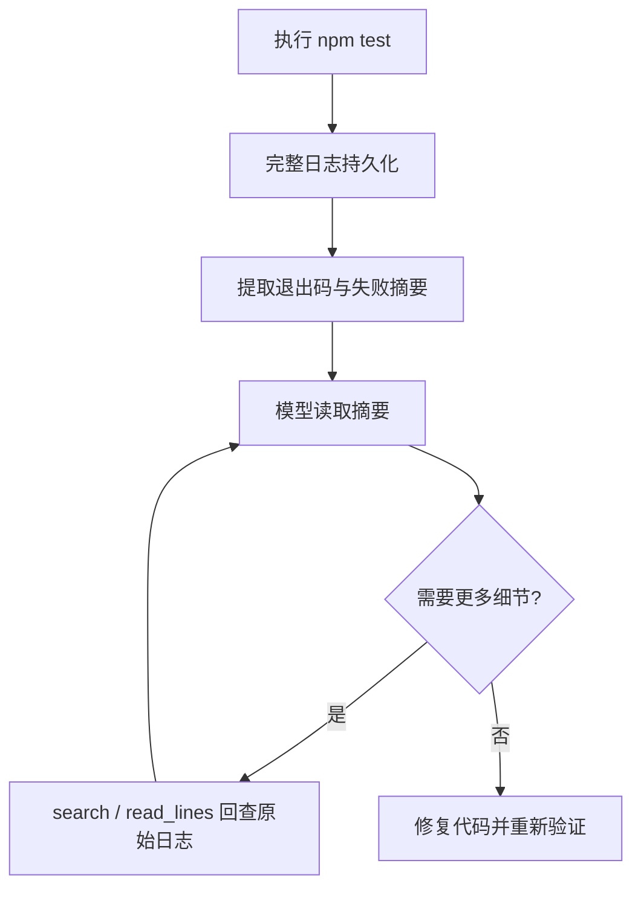
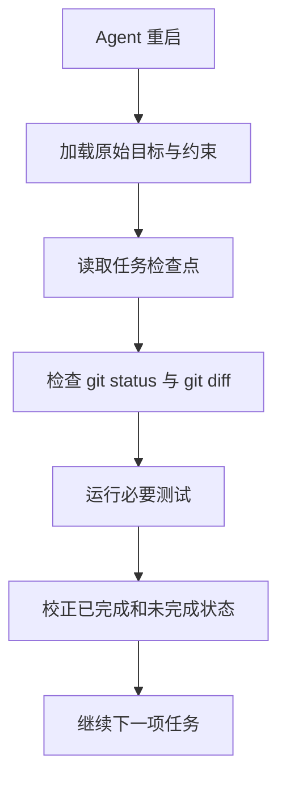

# Day 2 · 第 8 题：AI Agent 上下文管理与记忆系统

> 2026-10-25 · AI Agent / 系统设计 · 已完成 · 模拟评分 82/100

## 一、题目与核心目标

编程 Agent 执行 Express → NestJS 迁移，50 次工具调用后上下文接近上限，开始忘记最初要求并重复读取文件。要求设计上下文压缩、短期与长期记忆、测试日志处理和任务恢复。

核心原则：**上下文是工作区，不是可靠的持久化数据库；压缩是节省 Token，不应成为丢失任务约束的理由。**

## 二、Context Window 与上下文预算

Context Window 是模型单次推理可使用的输入/输出 Token 范围，具体限制由模型和 API 决定。Agent 应用负责组装用户消息、系统约束、工具调用与工具结果、摘要和检索内容。

建议按重要性分层：

| 信息 | 优先级 | 处理 |
|---|---|---|
| 原始用户目标与不可违反的约束 | 最高 | 单独持久化，每轮关键步骤重新注入 |
| 当前计划、已完成项和待办 | 高 | 结构化状态文件与上下文摘要 |
| 重要设计决策与证据 | 高 | 简短决策记录，关联源码或日志路径 |
| 最近必要的工具结果 | 中 | 保留关键片段 |
| 重复文件读取、冗长日志 | 低 | 外部存储、摘要、按需检索 |

**最近 ≠ 最重要**：40 分钟前的 API 兼容约束，可能比刚刚打印的 10,000 行日志更重要。

## 三、结构化压缩与防止摘要漂移

简单截断历史会丢失关键决策；反复让 LLM 对上一次摘要再总结，也可能逐轮丢失约束。推荐将不可丢失的规则与可压缩历史分离。

```yaml
# .agent/task.yaml
task: express-to-nestjs
constraints:
  - id: api-contract
    rule: Preserve API paths and request/response schemas
  - id: payment-errors
    rule: Preserve payment error codes
progress:
  auth: verified
  users: verified
  orders: in-progress
current:
  module: orders
  next: run compatibility tests
```

压缩时：

1. 从持久化任务约束读取不可丢失项。
2. 汇总当前进度、已验证结果、未解决错误。
3. 将冗长工具输出转换成可追溯的摘要，保留原始日志路径。
4. 将摘要与约束重新组装进下一轮上下文。
5. 通过约束 ID 或规则校验，检查摘要是否遗漏关键要求；必要时回查原始用户需求。

不要把摘要当成唯一事实来源，尤其是安全、兼容性、数据迁移和不可逆操作约束。

## 四、短期记忆、长期记忆与存储位置

| 内容 | 生命周期 | 常见实现 |
|---|---|---|
| 当前工具调用与下一步操作 | 当前轮 / 当前任务 | 活跃上下文、进程内存 |
| 当前任务待办与检查点 | 当前任务，需可恢复 | JSON、SQLite、数据库 |
| 项目架构和约定 | 跨会话、项目级 | 仓库文档、代码索引 |
| 用户长期偏好 | 跨项目、用户级 | 配置、记忆存储 |
| 历史源码和测试日志 | 按需检索 | 文件系统、对象存储、日志数据库 |

短期/长期描述的是**使用范围与生命周期**，不等于“本地文件”或“远程数据库”。本地 CLI 可以使用 SQLite 或文件，云端 Agent 也可以将任务状态存到服务器。模型自身不会自动将每次上下文变成持久化存储。

记忆还应考虑作用域、更新时间、来源、过期、权限、敏感信息和用户更正机制。跨项目复用的信息不能无条件覆盖项目特定规则。

## 五、工具输出：完整保存 + 摘要 + 按需读取

一次 `npm test` 输出 20,000 行，不应全部直接放入活跃上下文，也不应只截取最后 100 行。错误可能在日志中间。



建议保留：
- 命令、工作目录、退出码、开始和结束时间。
- 原始 stdout/stderr 文件位置。
- 失败测试名称、错误堆栈、关键上下文行号。
- 与本次工具调用关联的稳定 ID，方便回溯。

### TypeScript 示例：日志摘要数据结构

```ts
type ToolRunSummary = {
  runId: string;
  command: string;
  exitCode: number | null;
  logPath: string;
  errorExcerpts: Array<{
    startLine: number;
    endLine: number;
    text: string;
  }>;
  nextAction?: string;
};

function formatForContext(run: ToolRunSummary): string {
  const errors = run.errorExcerpts
    .map((e) => `lines ${e.startLine}-${e.endLine}: ${e.text}`)
    .join("\n");
  return [
    `run=${run.runId}`,
    `command=${run.command}`,
    `exitCode=${run.exitCode}`,
    `fullLog=${run.logPath}`,
    errors,
  ].join("\n");
}
```

这是摘要的数据结构示例，真正提取错误仍需要测试框架的机器可读输出、日志解析或按需搜索工具。

## 六、Agent 重启后的恢复机制

不能假设重启后可以读取模型隐藏的 Chain of Thought。应使用可见对话、工具记录、明确写出的计划和持久化状态。



**不能仅相信任务状态文件**：例如写入“订单模块完成”后进程崩溃，代码可能尚未保存或测试未通过。恢复时应以文件系统、Git 变更和验证结果交叉检查。

重要任务状态不应仅放在容易清理的临时目录；可以用明确的持久化目录、数据库或检查点存储。必要时采用原子写入与版本号防止部分写入。

### 幂等与重复执行

- 修改前先检查当前文件是否已达到目标状态。
- 记录任务 ID、关联提交与验证结果。
- 避免把“已调用工具”当成“操作已成功”。
- 对不可逆操作（迁移数据库、发布、删除）设计确认、检查点和补偿。

## 七、面试常见陷阱

1. 把最近历史等同于最重要信息。
2. 反复压缩摘要却没有独立的不可丢失约束。
3. 将短期记忆误认为一定存储在内存、长期记忆一定存储在磁盘。
4. 将 20,000 行日志全部塞入上下文，或只保留尾部导致漏掉真正错误。
5. 把隐藏推理过程当作重启后可恢复的任务状态。
6. 只看任务清单，不检查真实代码和测试结果。

## 八、作答记录与参考

用户提出保留目标、区分任务级与跨项目记忆、将日志作为附件按需检索、使用设计文档持久化进度，方向正确；需要补充关键约束校验与恢复时的真实状态核对。模拟评分 82/100，原话见 [follow-ups.md](follow-ups.md)。

参考：
- [Anthropic: Context engineering for AI agents](https://www.anthropic.com/engineering/effective-context-engineering-for-ai-agents)
- [Anthropic: Building effective agents](https://www.anthropic.com/engineering/building-effective-agents)
- [LangGraph: Persistence](https://docs.langchain.com/oss/javascript/langgraph/persistence)
- [OpenAI: Conversation state](https://platform.openai.com/docs/guides/conversation-state)
