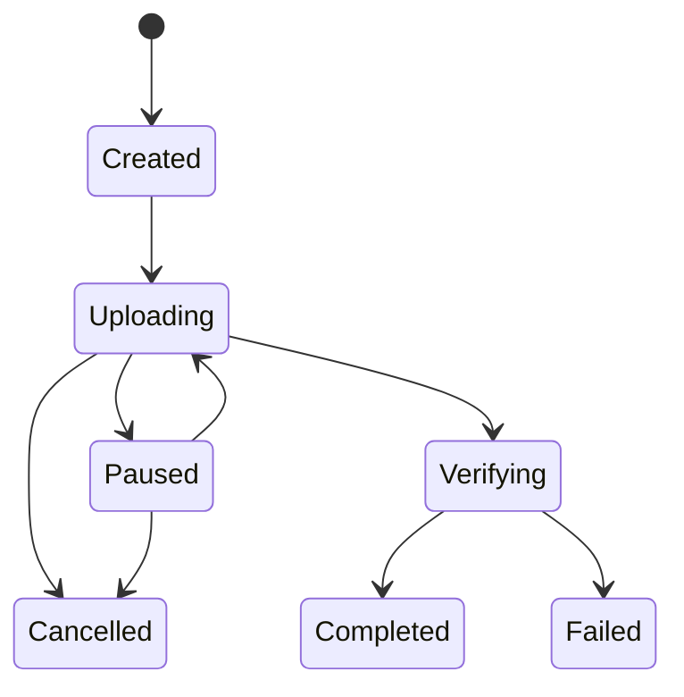
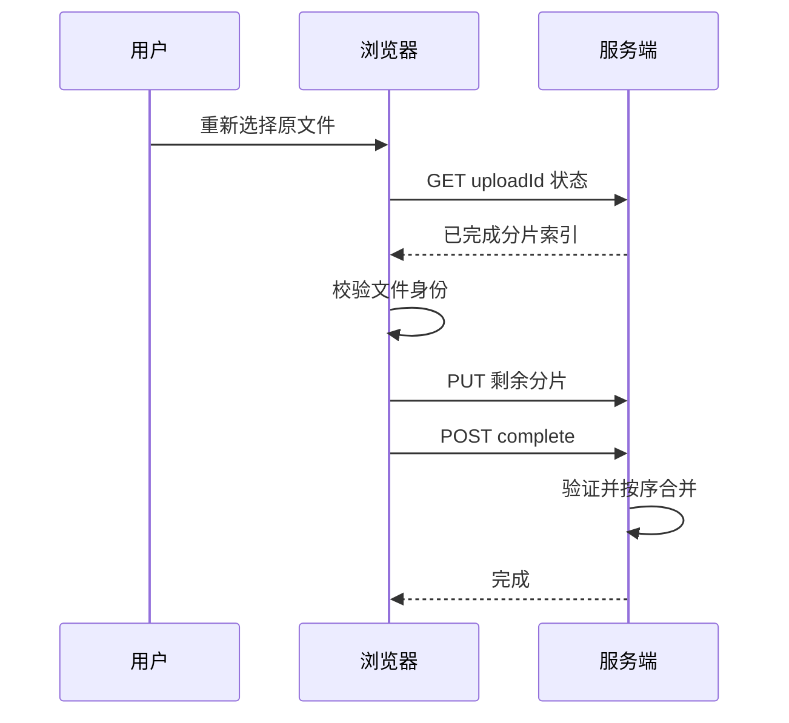

# Day 2 · 第 9 题：20 GB 文件分片上传与断点续传

> 2026-10-25 · 场景 / 系统设计 · 已完成 · 模拟评分 76/100

## 一、需求与设计原则

最大 20 GB 文件，支持并发分片、暂停、继续、刷新后恢复、失败重试、秒传；保证最终文件完整性、权限隔离和临时文件回收。

推荐将**上传任务**与**分片**分开管理：上传任务负责文件元数据、身份、状态和最终完成；分片记录负责索引、大小、校验和存储位置。

## 二、前端：File.slice、并发与内存

`File` 继承自 `Blob`，可用 `file.slice(start, end)` 创建分片。slice 通常不会立即把整片读入 JS 堆；`arrayBuffer()` 会读取数据到内存，因此不应把 20 GB 文件一次性读取进内存。

```ts
function* chunks(file: File, chunkSize: number) {
  for (let index = 0, start = 0; start < file.size; index++, start += chunkSize) {
    yield {
      index,
      blob: file.slice(start, Math.min(start + chunkSize, file.size)),
    };
  }
}

const chunkSize = 16 * 1024 * 1024;
const concurrency = 3;
```

16 MiB 和并发 3 只是示例；实际应依据网络、延迟、失败重传成本、对象存储限制、设备内存和服务端吞吐调优。100 MiB 分片也可以使用。20 GiB 文件若按 100 MiB 切分，共 205 片（204 片完整，最后一片 80 MiB）。

浏览器常见的同源 HTTP/1.1 连接数限制不能简单理解为单 Tab 最多 6 个并发上传；HTTP/2、HTTP/3 支持多路复用。应用仍应主动控制并发和重试。

### 暂停和恢复

- 停止调度新的分片。
- 用 `AbortController` 取消进行中的请求。
- 以服务端确认的已完成分片列表为准，不能仅信任前端标记。
- 恢复时跳过已完成分片，重试未确认分片。
- 取消请求与服务端接收完成可能竞态，因此重试必须幂等。

```ts
async function uploadChunk(
  uploadId: string,
  index: number,
  chunk: Blob,
  signal: AbortSignal,
): Promise<void> {
  const res = await fetch(`/api/uploads/${uploadId}/chunks/${index}`, {
    method: "PUT",
    body: chunk,
    signal,
  });
  if (!res.ok) throw new Error(`chunk ${index}: HTTP ${res.status}`);
}

const controller = new AbortController();
// 将 controller.signal 传给当前批次的 uploadChunk
// 用户暂停时 controller.abort()；恢复时新建 controller
```

## 三、上传协议与任务状态机

| 接口 | 作用 |
|---|---|
| `POST /uploads` | 初始化任务，提交文件大小、分片大小、文件摘要等 |
| `GET /uploads/:id` | 查询状态、已完成分片、服务端元数据 |
| `PUT /uploads/:id/chunks/:index` | 上传单片，附带大小与校验值 |
| `POST /uploads/:id/complete` | 验证分片齐全并完成合并 |
| `DELETE /uploads/:id` | 取消任务并安排回收 |



**不要用最后一个分片名 `end` 来判定全部完成**。并发上传可能先完成末尾分片。必须在服务端检查所有索引 `0..chunkCount-1` 已存在且验证通过，再允许 complete。

## 四、服务端存储、乱序与幂等

逻辑唯一键为 `(uploadId, chunkIndex)`。文件分片可按如下路径存储：

```text
uploads/
  abc123/
    000000.part
    000001.part
    000002.part
    ...
```

- 分片乱序到达无妨，最终按 `chunkIndex` 升序合并。
- 已存在同索引且大小、内容 Hash 一致：返回成功，支持幂等重试。
- 同索引但内容不同：拒绝冲突或按严格版本协议处理，不能静默覆盖。
- 并发上传同索引时先写独立临时文件，校验后通过原子提交或存储层条件写入发布；不能直接让两个请求同时覆盖最终分片文件。
- 分片校验应根据服务端实际收到的字节计算，不能只信任客户端提交的 Hash。
- complete 必须防止重复合并、重复创建文件记录，通常需要状态条件更新或任务锁。

### 合并与最终校验

1. 检查所有预期分片已完成，数量、索引、大小与元数据一致。
2. 按索引顺序流式合并，避免把整个 20 GB 文件载入内存。
3. 校验合并后文件总大小及全文件摘要（如 SHA-256）。
4. 通过后原子发布最终文件，任务状态变为 completed。
5. 异常时保留可恢复状态或标记失败，定期回收过期临时分片。

使用 S3 等对象存储 Multipart Upload 时，通常由对象存储根据分片编号、上传返回的标识和 Complete 请求组装，不必由应用服务器自己拼接。

## 五、刷新浏览器后如何恢复？

**仅有 uploadId 不够**：浏览器刷新或关闭后，原来的 `File` 对象通常不再可用；应用不能仅凭本地路径绕过用户授权读取文件。

通用恢复方案：

1. 在 localStorage 或 IndexedDB 保存 uploadId、文件大小、名称、必要的摘要等任务元数据。
2. 用户重新选择同一文件。
3. 校验文件身份，查询服务端已完成分片。
4. 只发送剩余分片。

在支持 File System Access API 的环境中，可以在授权后将文件句柄存入 IndexedDB；重启后仍需检查读取权限，文件可能已被移动、删除或修改，不能保证完全自动恢复。



## 六、秒传与完整性

文件摘要（如 SHA-256）可以用于识别内容相同的文件，但必须考虑：

- 计算 20 GB 全文件 Hash 可能耗时，宜流式或分片处理；可放入 Worker 减少主线程卡顿。
- 客户端 Hash 是候选标识，不是可信的服务端完整性证明。
- 服务端应确认真实存储内容与摘要一致，且请求用户对目标文件拥有合法访问权限。
- 秒传不能泄露其他用户是否存有某个私有文件，不能仅凭知道 Hash 就绕过权限。
- 分片 Hash 保障单片完整性；文件 Hash 和大小保障合并结果，不能只对比分片数量。

## 七、异常与生产边界

| 异常 | 处理 |
|---|---|
| 分片网络超时 | 指数退避重试、幂等写入 |
| 用户暂停 | 停止调度并取消进行中的请求 |
| 上传中途刷新 | 恢复任务元数据并重新获得本地文件 |
| 重复上传相同索引 | 内容一致则幂等成功 |
| 同索引不同内容 | 拒绝冲突 |
| 最后分片先到达 | 不代表任务完成 |
| 完成请求重复 | 状态机与条件写入保证幂等 |
| 文件一直未完成 | TTL/后台清理任务回收临时数据 |
| 20 GB 校验与合并耗时 | 异步后台任务、状态查询、流式处理 |

## 八、答题记录与权威参考

用户提出 100 MB 分片、并发 3、任务接口、index-hash、暂停重试与服务端校验；追问中认识到恢复需要原始文件，以及分片唯一性的重要性。需要进一步掌握浏览器文件权限、服务端原子写入和最终合并校验。模拟评分 76/100；真实回答见 [follow-ups.md](follow-ups.md)。

- [MDN: Blob.slice](https://developer.mozilla.org/en-US/docs/Web/API/Blob/slice)
- [MDN: File](https://developer.mozilla.org/en-US/docs/Web/API/File)
- [MDN: AbortController](https://developer.mozilla.org/en-US/docs/Web/API/AbortController)
- [MDN: File System Access API](https://developer.mozilla.org/en-US/docs/Web/API/File_System_API)
- [AWS S3: Multipart upload overview](https://docs.aws.amazon.com/AmazonS3/latest/userguide/mpuoverview.html)
