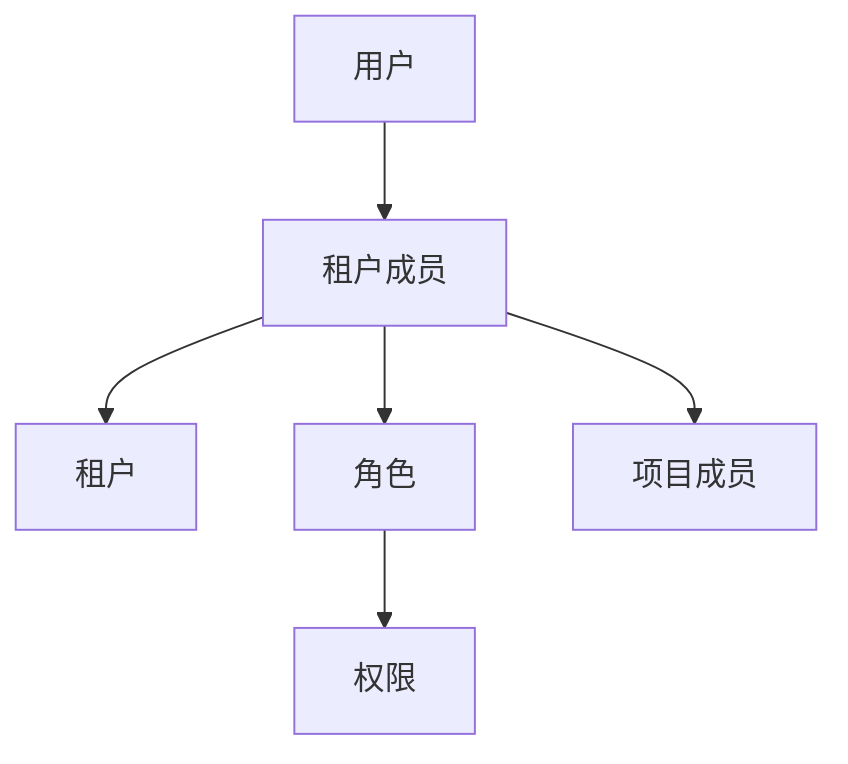

# Day 2 · 第 10 题：多租户 SaaS 权限系统设计

> 2026-10-25 · 已完成 · 模拟评分 78/100

## 一、RBAC

用户与租户通常是多对多关系：同一个人在企业 A 可以是管理员，在企业 B 可以是普通成员。角色应绑定租户成员身份，而不是用户全局属性。



简化表：`users`、`tenants`、`tenant_members(tenant_id,user_id)`、`roles(tenant_id)`、`member_roles`、`permissions`、`role_permissions`、`projects(tenant_id)`、`project_members`。需要约束成员和角色属于同一租户。

## 二、跨租户授权

JWT 有效只证明身份，不能证明用户可以操作项目。删除项目 100 前必须检查：用户是租户 B 的有效成员；项目 100 属于 B；用户具有项目访问和删除权限。客户端传入的 tenantId 不可直接信任。

```ts
type Scope = { userId: string; tenantId: string; projectId: string };

async function canDeleteProject(s: Scope): Promise<boolean> {
  const member = await findActiveMember(s.userId, s.tenantId);
  if (!member) return false;
  const project = await findProject(s.projectId, s.tenantId);
  if (!project) return false;
  return hasPermission(member.id, project.id, "project:delete");
}
```

示例中的查询函数由具体应用实现。敏感操作应在事务或适当的并发控制下完成授权与修改，防止检查通过后权限变化。

## 三、缓存与权限撤销

JWT 若包含静态角色信息，数据库更新不会自动改变旧令牌。Redis 权限缓存应包含租户作用域。

| 方案 | 局限 |
|---|---|
| 主动删除缓存 | 可能失败，或被并发请求回填 |
| TTL | 到期前仍可能使用旧权限 |
| 可靠失效事件 | 传播需要时间 |
| 权限版本号 | 需要可信最新版本用于比对 |
| 敏感操作查数据库 | 成本较高，但可减少旧缓存风险 |

例如数据库权限版本由 v5 更新到 v6，Redis 仍缓存 v5。只有从可信的最新版本来源读到 v6，才能识别旧缓存；若版本号也只在过期 Redis 中，则无法识别。

## 四、工程实践

最小权限、默认拒绝、租户隔离、审计日志。测试跨租户资源访问、成员移除、权限撤销、缓存失效失败及并发竞态。必要时使用数据库行级安全策略。

## 复盘

用户对租户级角色、资源归属和操作权限的理解正确；权限缓存一致性需要加强。原始回答与追问见 [follow-ups.md](follow-ups.md)。

参考：[OWASP Authorization](https://cheatsheetseries.owasp.org/cheatsheets/Authorization_Cheat_Sheet.html) · [NIST RBAC](https://csrc.nist.gov/projects/role-based-access-control) · [PostgreSQL RLS](https://www.postgresql.org/docs/current/ddl-rowsecurity.html)
