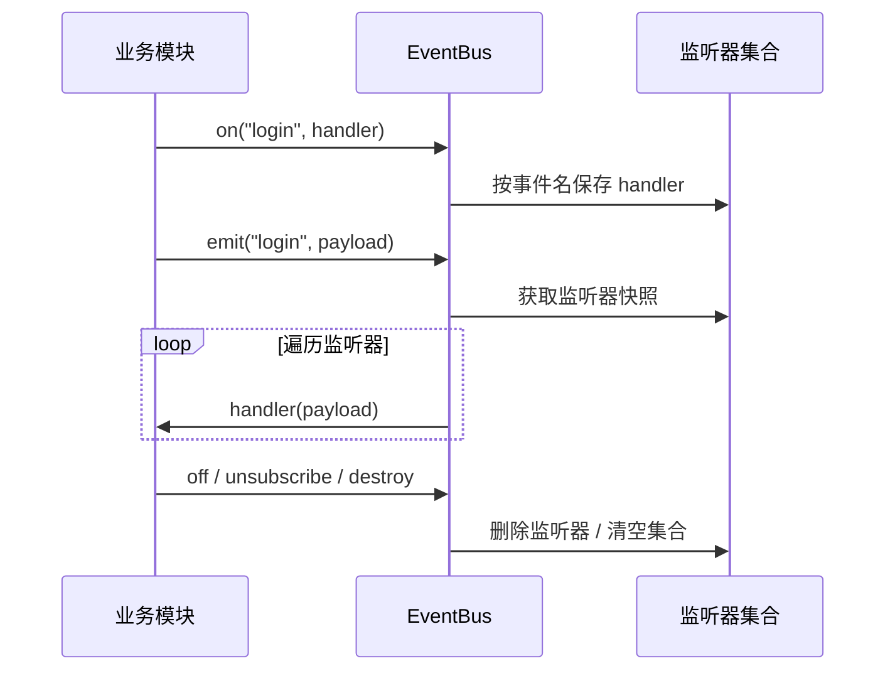
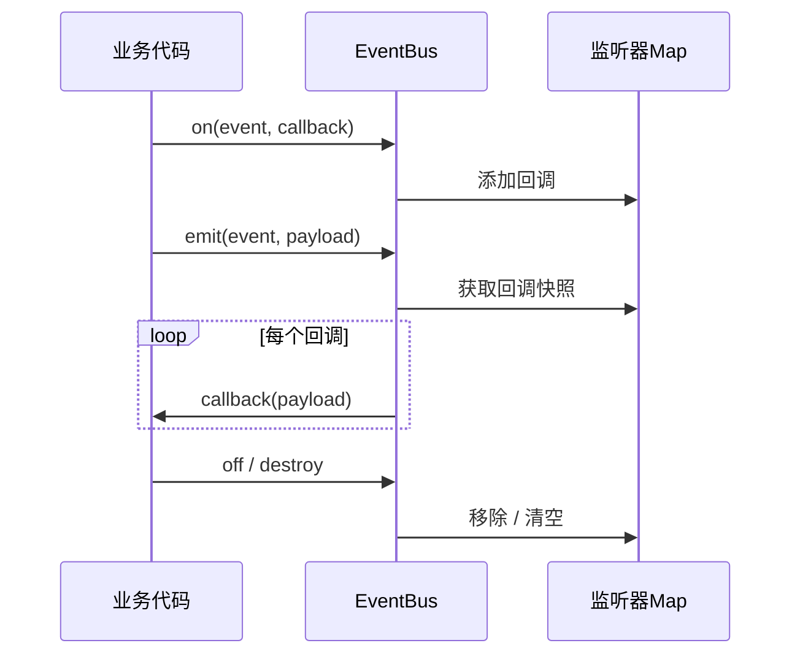

# TypeScript 泛型与类型安全事件总线

> 日期：2026-10-26 · 第 3 天 · 题号 01 · 方向：JS/TS · 难度：★★★★☆

**状态：已完成两轮追问，最终评价 65/100（教学式评分）**

## 题目背景

为 SaaS 平台设计通用事件总线：不同事件有不同参数结构，支持 `on`、`off`、`once`、`emit`，讨论运行时校验与扩展方式。

```ts
interface Events {
  login: { userId: string; token: string };
  logout: { userId: string };
  orderCreated: { orderId: number; amount: number };
}
```

## 主问题

1. 如何使用泛型和 `keyof` 约束事件名和参数？
2. 如何让 `emit("login", ...)` 只能接受对应结构？
3. 如何实现 `on`、`off`、`once`？
4. TypeScript 的静态检查能保证运行时数据合法吗？
5. 如何允许不同模块扩展事件类型？

## 核心原理

```ts
type EventName = keyof Events;
// "login" | "logout" | "orderCreated"

type EventPayload<K extends keyof Events> = Events[K];

type LoginPayload = EventPayload<"login">;
// { userId: string; token: string }
```

- `keyof T` 从类型中提取属性名联合类型。
- `T[K]` 获取键 `K` 对应的属性类型。
- `K extends keyof Events` 限制合法事件名；`payload: Events[K]` **关联**事件名称与载荷。
- `Events[keyof Events]` 是所有载荷类型的联合；如果分别将事件名与载荷写为两个独立联合类型，关联关系会丢失。

```ts
function badEmit(event: keyof Events, payload: Events[keyof Events]) {}

badEmit("login", { userId: "u1" }); // 可能通过，但 payload 是 logout 的形状

function goodEmit<K extends keyof Events>(event: K, payload: Events[K]) {}

goodEmit("login", { userId: "u1", token: "t1" }); // 正确
// @ts-expect-error login 缺少 token
goodEmit("login", { userId: "u1" });
// @ts-expect-error register 不是事件名
goodEmit("register", { userId: "u1" });
```

注意：当 `event` 本身是联合类型变量时，普通泛型 `K` 也可能被推导为联合类型，使关联检查变宽；严格要求动态调用的成对关联时，可进一步使用判别联合/映射元组并在调用处进行缩窄。

## 可执行实现（TypeScript）

以下实现保持对外 API 的类型安全，内部使用 `unknown` 统一存储不同事件的监听器，并在存取时进行受控类型断言：

```ts
type Listener = (payload: unknown) => void;

export class EventBus<E extends object> {
  private readonly listeners = new Map<keyof E, Set<Listener>>();

  on<K extends keyof E>(
    event: K,
    handler: (payload: E[K]) => void,
  ): () => void {
    let handlers = this.listeners.get(event);
    if (!handlers) {
      handlers = new Set();
      this.listeners.set(event, handlers);
    }

    handlers.add(handler as Listener);
    return () => this.off(event, handler);
  }

  off<K extends keyof E>(
    event: K,
    handler: (payload: E[K]) => void,
  ): void {
    const handlers = this.listeners.get(event);
    if (!handlers) return;

    handlers.delete(handler as Listener);
    if (handlers.size === 0) this.listeners.delete(event);
  }

  once<K extends keyof E>(
    event: K,
    handler: (payload: E[K]) => void,
  ): () => void {
    const wrapped = (payload: E[K]): void => {
      this.off(event, wrapped); // 先解绑，防止回调重入导致多次触发
      handler(payload);
    };
    return this.on(event, wrapped);
  }

  emit<K extends keyof E>(event: K, payload: E[K]): void {
    // 快照：监听器在回调中增删，不影响本轮迭代集合
    for (const handler of [...(this.listeners.get(event) ?? [])]) {
      handler(payload);
    }
  }

  destroy(): void {
    this.listeners.clear();
  }
}

interface Events {
  login: { userId: string; token: string };
  logout: { userId: string };
  orderCreated: { orderId: number; amount: number };
}

const bus = new EventBus<Events>();

const unsubscribe = bus.on("login", (payload) => {
  console.log(payload.userId, payload.token);
});

bus.emit("login", { userId: "u1", token: "t1" });
unsubscribe();

bus.once("logout", ({ userId }) => console.log("once:", userId));
bus.emit("logout", { userId: "u1" });
bus.emit("logout", { userId: "u1" }); // 不会再次调用 once 回调
bus.destroy();
```

### 设计权衡与边界

- `off` 按 **事件名 + 函数引用** 精确解绑；`destroy` 清空整个实例，不能混为一谈。
- `once` 可以使用包装函数；为避免重入，调用用户回调之前先解绑。
- `Set` 避免同一函数在同一事件中重复注册；是否允许重复注册应由产品约定。
- 快照遍历意味着：在一次 `emit` 中途调用 `off`，该回调仍可能在本轮快照内被执行；如需不同语义，应调整遍历策略。
- 同步 `emit` 中监听器抛异常会中断后续调用；生产级实现可定义错误聚合、隔离或异步分发策略。
- `destroy()` 只清理本总线监听器，不会自动取消外部网络请求、计时器。
- 示例内部 `handler as Listener` 是有意的类型擦除边界：外部 `on/emit` 保证同一事件类型匹配；不应向外暴露内部 Map 以免绕过约束。

## 静态类型与运行时校验

TypeScript 类型在编译后被擦除，无法阻止 JavaScript 调用方、`any`、不可信 JSON、跨 iframe 消息或后端返回非法数据。外部数据进入系统时应在边界做运行时 Schema 校验（如 Zod、JSON Schema/Ajv 或手写类型守卫），并将验证后的类型传入总线。

## 模块扩展事件定义

一种方式是组合模块定义：

```ts
interface AuthEvents {
  login: { userId: string; token: string };
  logout: { userId: string };
}
interface OrderEvents {
  orderCreated: { orderId: number; amount: number };
}
type AppEvents = AuthEvents & OrderEvents;
const appBus = new EventBus<AppEvents>();
```

也可以使用接口声明合并或模块增强，但需要避免事件名冲突、模块依赖耦合和全局事件命名混乱。大规模系统建议采用事件命名空间、事件版本与清晰的生命周期约定。

## 执行流程



## 面试作答回顾

- 初答：手写字符串联合类型、枚举、`once` 标志位，未形成事件名与载荷的泛型关联。
- 基础追问：正确回答 `keyof User`、`User["name"]`、`User["id" | "active"]`，3/3。
- 最终追问：判断 D 报错，但遗漏 B；对泛型 `K` 关联作用仍不清晰。
- 最终评价：**65/100**。建议复习 `keyof`、索引访问类型、泛型约束及回调注册/解绑。

用户原话与追问完整记录见 [follow-ups.md](./follow-ups.md)。

## 权威参考

- [TypeScript Handbook — Keyof Type Operator](https://www.typescriptlang.org/docs/handbook/2/keyof-types.html)
- [TypeScript Handbook — Indexed Access Types](https://www.typescriptlang.org/docs/handbook/2/indexed-access-types.html)
- [TypeScript Handbook — Generics](https://www.typescriptlang.org/docs/handbook/2/generics.html)
- [TypeScript Handbook — TypeScript for the New Programmer](https://www.typescriptlang.org/docs/handbook/typescript-from-scratch.html)
## 作答与评审状态

- 用户已完成主问题与两轮追问；最终评价 **65/100**。
- 原始回答、追问和点评：[follow-ups.md](./follow-ups.md)。

## 标准答案：类型约束

```ts
type EventName = keyof Events;
type Payload<K extends keyof Events> = Events[K];

function emit<K extends keyof Events>(event: K, payload: Events[K]) {}
emit("login", { userId: "u1", token: "t1" });
// @ts-expect-error 缺少 token
emit("login", { userId: "u1" });
// @ts-expect-error 不存在的事件
emit("register", { userId: "u1" });
```

- `keyof Events` 提取合法事件名的联合类型。
- `Events[K]` 获取特定事件的参数类型。
- 泛型 `K` 将事件名和参数类型绑定；若两个参数分别使用 `keyof Events` 与 `Events[keyof Events]`，就会丢失这种关联。

## 可执行实现

```ts
type Listener = (payload: unknown) => void;

class EventBus<E extends object> {
  private listeners = new Map<keyof E, Set<Listener>>();

  on<K extends keyof E>(event: K, fn: (payload: E[K]) => void): () => void {
    let set = this.listeners.get(event);
    if (!set) {
      set = new Set();
      this.listeners.set(event, set);
    }
    set.add(fn as Listener);
    return () => this.off(event, fn);
  }

  off<K extends keyof E>(event: K, fn: (payload: E[K]) => void): void {
    const set = this.listeners.get(event);
    set?.delete(fn as Listener);
    if (set?.size === 0) this.listeners.delete(event);
  }

  once<K extends keyof E>(event: K, fn: (payload: E[K]) => void): () => void {
    const wrapped = (payload: E[K]): void => {
      this.off(event, wrapped); // 先解绑，防止重入
      fn(payload);
    };
    return this.on(event, wrapped);
  }

  emit<K extends keyof E>(event: K, payload: E[K]): void {
    for (const fn of [...(this.listeners.get(event) ?? [])]) fn(payload);
  }

  destroy(): void {
    this.listeners.clear();
  }
}

const bus = new EventBus<Events>();
const unsubscribe = bus.on("login", ({ userId }) => console.log(userId));
bus.emit("login", { userId: "1001", token: "abc" });
unsubscribe();
bus.once("logout", ({ userId }) => console.log(userId));
bus.emit("logout", { userId: "1001" });
bus.destroy();
```

内部监听器存储统一为 `unknown` 参数，使用类型断言实现存储；对外 API 保留 `E[K]` 关联约束。该例采用同步分发；监听器抛错会中断后续分发，生产环境需约定错误隔离策略。

## 边界与设计取舍

1. `off` 移除某个事件的指定函数；`destroy` 清空实例内所有监听器。
2. `once` 使用包装函数，调用前解绑，防止递归触发重复执行。
3. 使用快照遍历监听器意味着本轮触发期间的移除不影响快照中已存在的回调。
4. `Set` 会去重同一事件的同一函数引用。
5. `emit` 的类型检查只发生在编译时。运行时从 JSON、网络、插件或 JS 调用方收到的数据仍需做 Schema 校验。
6. 若事件名参数本身是联合类型变量，泛型 `K` 也可能推断为联合；需要更严格的成对约束时可用映射元组联合与控制流缩窄。
7. 扩展事件类型可使用接口组合：`type AppEvents = AuthEvents & OrderEvents`；大型系统应避免事件名冲突，约定命名空间与版本。

## 流程示意



## 权威参考

- [TypeScript: keyof](https://www.typescriptlang.org/docs/handbook/2/keyof-types.html)
- [TypeScript: Indexed Access Types](https://www.typescriptlang.org/docs/handbook/2/indexed-access-types.html)
- [TypeScript: Generics](https://www.typescriptlang.org/docs/handbook/2/generics.html)
