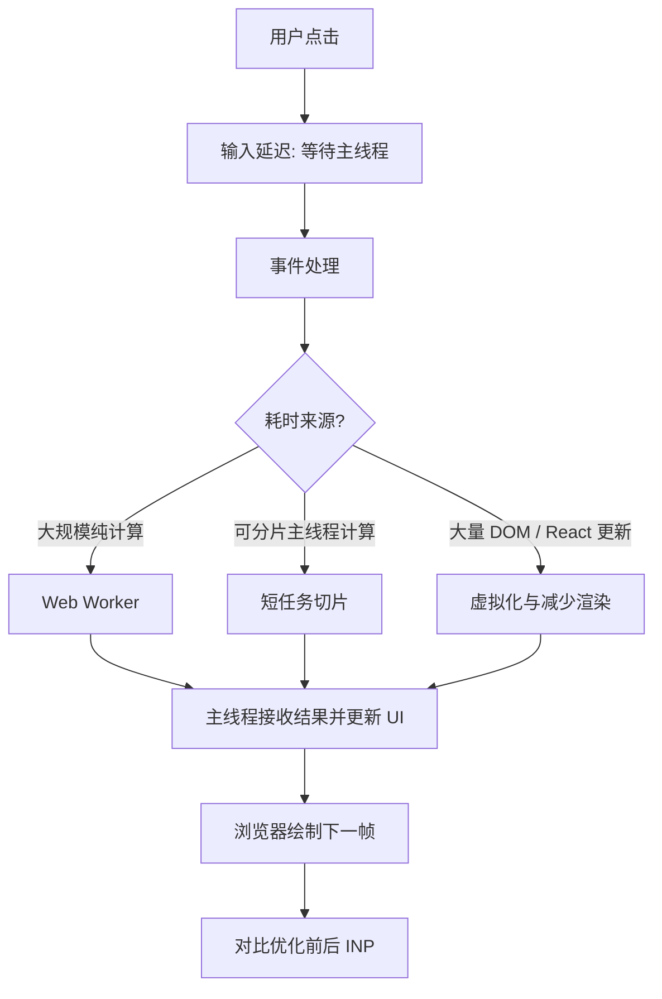

# 浏览器 INP 与 Long Task 优化

> 日期：2026-10-26 · 第 3 天 · 题号 02 · 方向：浏览器 · 难度：★★★★☆

**状态：已作答并完成两轮追问，最终评分 80/100**

## 场景与问题

React 后台首屏正常，但点击“展开全部”后，处理大表格和复杂计算约需 800ms。Performance 中出现 Long Task。要求说明 INP、主线程、调度方案及诊断流程。

用户的原始回答、两轮追问和点评见 [follow-ups.md](./follow-ups.md)。

## 1. INP 是什么

**Interaction to Next Paint（INP）** 是衡量页面响应交互的 Core Web Vital 指标。一次交互可能包含多个事件处理器；交互耗时可拆为：

1. **输入延迟（Input delay）**：用户输入到事件处理开始，可能因主线程繁忙而等待。
2. **处理耗时（Processing duration）**：相关事件回调执行时间。
3. **呈现延迟（Presentation delay）**：回调结束到浏览器绘制下一帧的时间。

INP 关注页面整个访问生命周期中的交互响应，通常以接近最慢的交互作为代表值，并对交互次数做离群值处理。经验阈值：**≤200ms 良好，>200ms～500ms 需改进，>500ms 较差**。这不是“点击到请求完成”的时间，也不等于单纯的 JS 执行耗时。

与其他指标对比：

| 指标 | 关注点 |
| --- | --- |
| FCP | 页面首次绘制文本或图像等内容的时间 |
| LCP | 视口中最大内容元素完成绘制的时间 |
| INP | 用户交互到下一次绘制的响应性 |
| TTI | 历史上的实验室指标，衡量页面达到可交互状态的时间；不是现行 Core Web Vital |

## 2. Long Task 与事件循环

浏览器主线程通常执行 JS、样式计算、布局和部分绘制工作。**Long Task 通常指占用主线程超过 50ms 的任务**；过长的任务会让输入事件等待，也会延迟渲染机会。

```js
button.addEventListener("click", () => {
  status.textContent = "处理中...";
  heavyCalculation(); // 同步执行 800ms
  status.textContent = "完成";
});
```

这里的 DOM 修改并不保证立即呈现在屏幕上；通常需等待主线程释放并到达浏览器渲染机会。

`Promise.then` 是**微任务**，回调仍在主线程运行。当前任务结束后，浏览器通常先执行微任务检查点再渲染，因此将 800ms 计算移入 Promise 并不解决阻塞。

`setTimeout(fn, 0)` 将计算安排到后续任务，使浏览器**可能**在两个任务之间绘制，但不能保证先绘制，也不能消除新任务中的 800ms 阻塞。

## 3. 调度方案比较

| 方案 | 是否脱离主线程 | 优势 | 限制与适用场景 |
| --- | --- | --- | --- |
| `Promise.then` | 否 | 排队微任务 | 不能让出绘制机会，不能用于解决 CPU 长任务 |
| `setTimeout` | 否 | 安排后续任务，适合简单分片 | 单个回调过长仍卡顿；定时器有延迟与节流 |
| `requestAnimationFrame` | 否 | 绘制前同步视觉更新 | 回调过长会直接延迟该帧，不适合重计算 |
| `requestIdleCallback` | 否 | 空闲时执行低优先级任务 | 空闲时间不保证充足；需检查 `timeRemaining()` 并考虑超时 |
| `scheduler.yield()` | 否 | 在支持的环境中主动让出主线程 | 需兼容性检测与降级 |
| `Web Worker` | **是** | 适合纯计算与大量 CPU 工作 | 不能直接操作 DOM；消息传递有成本 |

### C：分批计算（可执行 JavaScript）

下面的实现按时间预算处理，尽量控制每片占用主线程的时长；它仍无法保证绝对流畅。

```js
function processInChunks(items, processOne, onDone) {
  let index = 0;
  const budgetMs = 6;

  function runChunk() {
    const start = performance.now();

    while (index < items.length && performance.now() - start < budgetMs) {
      processOne(items[index], index);
      index++;
    }

    if (index < items.length) {
      setTimeout(runChunk, 0); // 让出主线程，后续任务继续
    } else {
      onDone?.();
    }
  }

  setTimeout(runChunk, 0);
}

// 用法
processInChunks(
  Array.from({ length: 100_000 }, (_, i) => i),
  (value) => Math.sqrt(value),
  () => console.log("完成"),
);
```

实际项目还应考虑取消、进度反馈、每项处理耗时波动、页面隐藏时的定时器节流，以及是否必须保持计算顺序。每批任务过短也会增加调度开销。

### D：Web Worker（两个文件）

```js
// main.js
const worker = new Worker(new URL("./compute.worker.js", import.meta.url), {
  type: "module",
});

worker.onmessage = ({ data }) => {
  if (data.type === "done") {
    console.log("计算结果", data.result);
    worker.terminate();
  }
};

worker.onerror = (error) => console.error("Worker 错误", error);
worker.postMessage({ type: "compute", values: [1, 2, 3, 4] });
```

```js
// compute.worker.js
self.onmessage = ({ data }) => {
  if (data.type !== "compute") return;
  const result = data.values.reduce((sum, value) => sum + value * value, 0);
  self.postMessage({ type: "done", result });
};
```

Worker 无法直接读写页面 DOM；对于大型 `ArrayBuffer` 可以考虑 Transferable 转移所有权，避免不必要的复制。还要设计取消、错误处理、进度上报和组件卸载时终止 Worker 的生命周期。

## 4. React 场景

React 的 **Render** 阶段计算 UI 更新；**Commit** 阶段将变更提交到 DOM；浏览器通常在之后的渲染机会中绘制。DOM 变更不等于用户已看到画面。`useLayoutEffect` 中的同步逻辑通常会在绘制前运行，也可能阻塞绘制。

`useTransition` 与 `useDeferredValue` 可以帮助安排**可中断的 React 渲染更新**，但**不会自动把普通的 800ms 同步计算切片或搬到工作线程**。如果大表格渲染是瓶颈，可进一步使用虚拟列表、避免无意义重渲染、稳定 key、拆分组件与合理缓存；若瓶颈是数据计算，则优先考虑任务切片或 Worker。

## 5. 如何定位、优化和验证

1. **复现**：在 Chrome DevTools Performance 录制一次真实点击；必要时设置 CPU 降速以稳定复现。
2. **定位**：查看 Main 线程火焰图、Long Task、Event Log/调用栈；区分事件处理、脚本计算、样式计算、布局和绘制时间。
3. **归因**：判断是 JS 同步计算、React 大量提交、布局抖动、频繁 DOM 读写还是第三方脚本；不要仅凭 Long Task 数量推断 INP 原因。
4. **选择方案**：减少无用计算/渲染，分片、虚拟化或 Worker；视觉更新优先保证下一帧及时绘制。
5. **验证**：优化前后在同设备、同数据量和相近环境下比较 INP、交互耗时、长任务分布、帧率与 CPU 占用；生产环境可用 `web-vitals` 采集真实用户 INP。注意实验室录制与真实用户数据可能不同。

## 6. 常见误区

- “浏览器是单线程”：不准确；浏览器有多个进程/线程，但页面 JS 与许多渲染工作共享主线程。
- “Promise 是异步，所以不阻塞”：错误；微任务中的同步计算仍阻塞。
- “setTimeout(0) 一定先绘制”：错误；只能安排后续任务，不能保证绘制顺序。
- “分片一定无感”：错误；每片仍可能过长，且有调度成本。
- “Web Worker 直接更新 DOM”：错误；需要主线程负责 UI。
- “React Commit 完成就已经显示”：错误；DOM 更新与绘制是不同阶段。

## 7. 流程图



## 8. 权威参考

- [web.dev — INP](https://web.dev/articles/inp)
- [web.dev — Optimize long tasks](https://web.dev/articles/optimize-long-tasks)
- [MDN — Using Web Workers](https://developer.mozilla.org/en-US/docs/Web/API/Web_Workers_API/Using_web_workers)
- [MDN — requestAnimationFrame](https://developer.mozilla.org/en-US/docs/Web/API/Window/requestAnimationFrame)
- [MDN — requestIdleCallback](https://developer.mozilla.org/en-US/docs/Web/API/Window/requestIdleCallback)
- [React — useTransition](https://react.dev/reference/react/useTransition)
