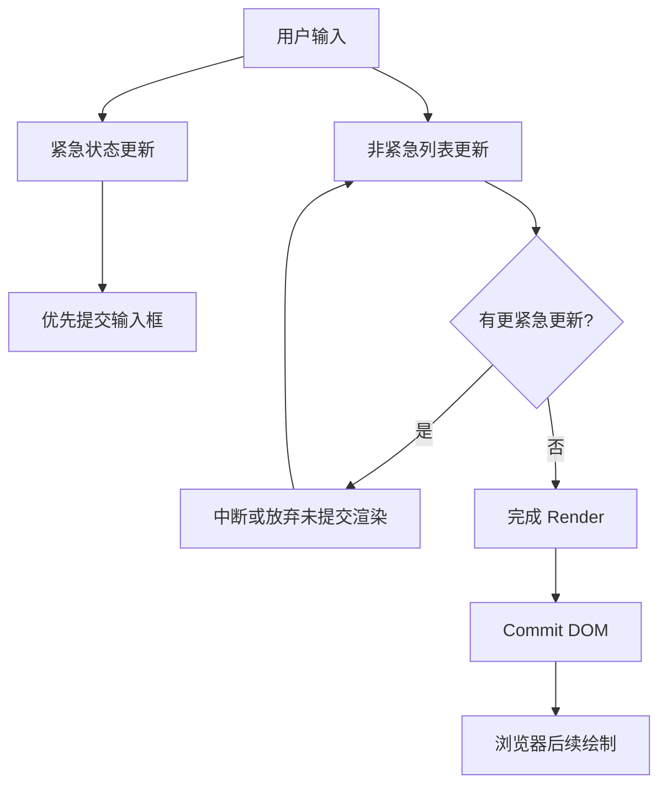

# React Suspense、并发渲染与 Transition

> 日期：2026-10-26 · 第 3 天 · 题号 03 · 方向：React · 难度：★★★★★

**状态：已完成；最终评分 80/100**

## 场景与问题

搜索页有输入框、筛选条件、复杂图表及大量结果。输入要保持流畅，结果允许稍晚更新。

用户原始回答、追问与最终点评见 [follow-ups.md](./follow-ups.md)。

## 1. useTransition 与 useDeferredValue 的区别

| 维度 | useTransition | useDeferredValue |
| --- | --- | --- |
| 控制对象 | 某次 React 状态更新的优先级 | 某个值在依赖它的 UI 中的更新时机 |
| 典型形式 | `startTransition(() => setQuery(value))` | `const deferredQuery = useDeferredValue(query)` |
| 适用场景 | 自己控制 setState，标记非紧急更新 | 拿到 props/状态值，允许消费者滞后 |
| 状态反馈 | `isPending` | 比较原值与延迟值 |
| 是否新线程 | 否 | 否 |

### useTransition：主动标记更新

```tsx
import { useState, useTransition } from "react";

function SearchPage() {
  const [input, setInput] = useState("");
  const [query, setQuery] = useState("");
  const [isPending, startTransition] = useTransition();

  function handleChange(e: React.ChangeEvent<HTMLInputElement>) {
    const next = e.target.value;
    setInput(next); // 紧急更新
    startTransition(() => setQuery(next)); // 非紧急更新
  }

  return (
    <>
      <input value={input} onChange={handleChange} />
      {isPending && <span>更新中</span>}
      <HeavyList keyword={query} />
    </>
  );
}
```

不能用 Transition 控制受控输入框本身的更新；`startTransition` 的回调立即运行，标记的是其中同步调度的状态更新，而非把任意同步计算放到后台线程。

### useDeferredValue：让值的消费者稍后更新

```tsx
import { memo, useDeferredValue, useState } from "react";

const HeavyList = memo(function HeavyList({ keyword }: { keyword: string }) {
  return <div>搜索：{keyword}</div>; // 真实项目替换为列表
});

function SearchPage() {
  const [keyword, setKeyword] = useState("");
  const deferredKeyword = useDeferredValue(keyword);
  const isStale = keyword !== deferredKeyword;

  return (
    <>
      <input value={keyword} onChange={e => setKeyword(e.target.value)} />
      {isStale && <span>结果更新中</span>}
      <HeavyList keyword={deferredKeyword} />
    </>
  );
}
```

如果 `keyword` 是父组件传入的 props、子组件无法控制其 `setState`，则 `useDeferredValue(keyword)` 特别合适。延迟值没有固定时间间隔，不等于 debounce 或 throttle；它也不自动减少请求数量。

当父组件重新渲染但延迟值未变化时，`React.memo` 有助于让慢列表跳过重复渲染。React 允许中断延后渲染，但不能中断正在执行的普通 JS 同步函数。

## 2. 并发渲染不是多线程

React 的 Scheduler 与协调机制让部分渲染工作按优先级执行、让出主线程，并在更紧急更新出现时中断、重做或放弃尚未提交的渲染工作。这并不是只在浏览器空闲时才执行，更不是把 React 组件函数放进其他线程。



**Render 与 Commit 分离**：组件函数执行完成不代表 DOM 一定更新。未提交的 Render 可能被中断或放弃。Commit 本身不能像并发 Render 那样任意中断。

## 3. 800ms 同步计算的边界

```tsx
startTransition(() => {
  expensiveSyncCalculation(); // 仍阻塞主线程
  setQuery("new");
});
```

`useTransition` 和 `useDeferredValue` 都不能把普通的 800ms 同步计算转移到 Worker，也不能自动拆开一个不可中断的 JS 调用栈。若瓶颈是大列表渲染，可结合列表虚拟化、memo、拆分组件；若瓶颈是 CPU 密集计算，应考虑任务切片或 Web Worker。要先用 React Profiler 和浏览器 Performance 定位真实瓶颈。

## 4. Suspense 的边界

`<Suspense fallback={...}>` 会在子树使用**支持 Suspense 的数据源**发生挂起时显示后备 UI，例如 React.lazy、支持 Suspense 的框架数据读取或通过 `use` 读取 Promise。**普通的 `useEffect(() => fetch(...))` 并不会自动触发 Suspense**；需要显式管理加载状态，或采用支持 Suspense 的数据获取方案。

如果某次延后渲染触发挂起，React 可保留旧内容，避免急于显示 fallback。对首次加载、已显示内容更新和 Transition 更新，Suspense 的呈现行为需分别理解。

## 5. 常见错误与实践建议

1. 把“后台渲染”误解为 Web Worker：React 并发渲染仍通常在主线程。
2. 认为 Transition 会异步执行包裹的所有代码：错误；`startTransition` 回调同步调用。
3. 认为 `useDeferredValue` 是固定延迟的防抖：错误；React 按调度优先级安排更新。
4. 忽视 `React.memo`：紧急更新时父组件仍会渲染，慢子组件可能做无意义工作。
5. 认为组件 Render 执行后 DOM 一定变化：错误；只有被提交的结果才会进入 Commit。
6. 把普通 `useEffect` 请求误认为 Suspense 自动接管：错误。
7. 只靠优先级调度解决所有性能问题：应先消除不必要计算与渲染，再考虑并发特性。

## 官方参考

- [React useTransition](https://react.dev/reference/react/useTransition)
- [React useDeferredValue](https://react.dev/reference/react/useDeferredValue)
- [React Suspense](https://react.dev/reference/react/Suspense)
- [React memo](https://react.dev/reference/react/memo)
