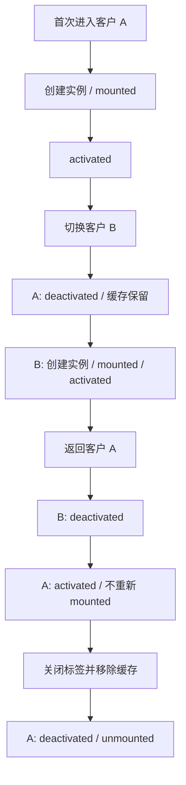

# Vue KeepAlive 与多标签缓存

> 日期：2026-10-26 · 第 3 天 · 题号 04 · 方向：Vue · 难度：★★★★☆

**状态：已完成；最终评分 75/100**

## 场景与主问题

SaaS 后台有客户列表、不同客户详情、订单列表、审批详情等标签页；切换保留表单与滚动位置，关闭标签时释放资源。要求解释缓存原理、生命周期、不同客户的实例隔离、服务端数据过期及资源清理。

用户原始回答、两轮追问和点评见 [follow-ups.md](./follow-ups.md)。

## 1. KeepAlive 到底缓存什么

`<KeepAlive>` 是 Vue 内置抽象组件。它通过缓存组件对应的 **VNode 和组件实例**，并保留 DOM 子树，使动态组件切换时可以从失活状态恢复，而不是每次都创建新实例。不是只缓存 HTML，也不是把所有业务数据永久保存。

- **首次出现**：创建组件实例、挂载 DOM。
- **切换离开**：实例失活，DOM 被移动到非活动存储位置；实例状态得以保留。
- **再次出现**：复用原有实例并激活；通常不重新运行 `setup` / `mounted`。
- **缓存淘汰/真正销毁**：实例卸载，状态与相关 DOM 释放。
- `max` 限制最多缓存多少实例；超出后按最近最少使用（LRU）策略淘汰。

```vue
<RouterView v-slot="{ Component, route }">
  <KeepAlive :max="10">
    <component :is="Component" :key="route.fullPath" />
  </KeepAlive>
</RouterView>
```

注意：`route.fullPath` 包含 query/hash，可能因为分页参数或过滤参数变化而产生过多缓存条目。缓存键应根据产品对“一个标签页”的定义设计。

## 2. 四个生命周期

| 生命周期 | 首次进入 | 切换离开（仍缓存） | 再次进入 | 最终销毁 |
| --- | --- | --- | --- | --- |
| `onMounted` | ✓ | — | — | — |
| `onActivated` | ✓ | — | ✓ | — |
| `onDeactivated` | — | ✓ | — | ✓ |
| `onUnmounted` | — | — | — | ✓ |

上表针对被 `KeepAlive` 管理的组件；`onActivated` 和 `onDeactivated` 也会传播到缓存树中的后代组件。最终卸载时可能先有失活回调，再有卸载回调，清理函数应做到**幂等**。



`onShow` 并不是 Vue 3 标准的组件生命周期 Hook；它常见于 uni-app 等框架的页面生命周期，不能与 `onActivated` 混用。

## 3. 客户 A/B 共用组件时，如何避免错误复用

```ts
const routes = [
  { path: "/customer/:id", name: "customer-detail", component: CustomerDetail },
];
```

Vue Router 对同一条动态路由不同参数，通常会复用组件实例。若希望每个客户有**独立的未提交表单草稿**，需给渲染出来的组件稳定、唯一的 `key`。

```vue
<RouterView v-slot="{ Component, route }">
  <KeepAlive :max="20">
    <component
      :is="Component"
      :key="String(route.name) + ':' + String(route.params.id ?? 'list')"
    />
  </KeepAlive>
</RouterView>
```

- `customer-detail:1001` 与 `customer-detail:1002` 分别缓存。
- 业务上允许同一客户打开多个不同草稿时，还需要把 **tabId** 纳入 key。
- 不是所有页面都适合按 `route.params.id` 生成 key；应定义集中、稳定的缓存键策略。
- 如果不需要每个 ID 独立缓存，也可以监听路由参数变化并重置/加载数据，但不要把这种方式误认为独立实例缓存。
- `<KeepAlive :include="...">` / `:exclude` 主要按**组件名称**筛选，而不是按动态路由的 `key` 筛选。对同名 `CustomerDetail` 的单个客户标签，不能仅通过从 `include` 删除一个 ID 就精准删除缓存。

### 关闭标签页时的缓存清理

**关闭标签页 UI ≠ 必然销毁 KeepAlive 缓存。**

生产环境需要一个统一的标签页/缓存管理器：

1. 记录每个标签的稳定 `tabId` / cache key。
2. 标签关闭时停止对应页面的定时器、订阅和在途任务。
3. 从可缓存集合移除对应条目，并确保实际缓存实例被淘汰或卸载。
4. 当页面组件名相同而 key 不同时，`include/exclude` 不支持直接按 key 精准删除；需要实现有明确 key 级淘汰能力的缓存管理方案，或调整路由/容器设计。不能只从 Tab 数组删除就假设缓存被释放。
5. 对 `max` 淘汰、登出、权限变更和刷新等边界情况同样做清理与状态恢复设计。

不要直接修改 Vue 内部 `KeepAlive` 缓存 Map 或依赖私有实现细节。

## 4. 失活时清理定时器和订阅

**错误示例**：仅在 `onUnmounted` 清理定时器。普通标签切换只失活不卸载，轮询仍可能继续。

```vue
<script setup lang="ts">
import { onActivated, onDeactivated, onUnmounted } from "vue";

let timer: ReturnType<typeof setInterval> | undefined;

function stopPolling() {
  if (timer !== undefined) {
    clearInterval(timer);
    timer = undefined;
  }
}

function startPolling() {
  if (timer !== undefined) return; // 防止重复启动

  // 实际项目调用异步刷新函数并捕获错误
  timer = setInterval(() => {
    console.log("刷新订单数据");
  }, 5000);
}

// 仅在该组件确实被 KeepAlive 管理时使用此模式
onActivated(startPolling);
onDeactivated(stopPolling);
onUnmounted(stopPolling);
</script>
```

首次挂载缓存组件时也会触发 `onActivated`，所以不应不加保护地在 `onMounted` 和 `onActivated` 都创建同一个 interval。页面真正卸载时保留 `onUnmounted` 兜底。

对于 `window.addEventListener`、WebSocket、事件总线、ResizeObserver、IntersectionObserver、轮询请求，也应明确哪些资源失活后应暂停，哪些是应用级共享连接应继续保留。若请求不再需要，可用 `AbortController` 取消；避免失活后的异步回调覆盖新页面数据。

## 5. 缓存恢复时服务端数据过期怎么办

缓存保留的是**本地组件状态**，并不意味着服务器数据仍是最新的。要区分：

- **草稿/滚动位置**：通常希望恢复，不应重新获取数据后直接覆盖。
- **订单状态、审批状态**：可能在失活期间被其他用户修改，重新激活时应考虑重新验证。

一个简化的重新激活刷新示例：

```vue
<script setup lang="ts">
import { ref, onActivated, onDeactivated } from "vue";

const orders = ref<unknown[]>([]);
let controller: AbortController | undefined;
let lastFetchedAt = 0;
const staleMs = 30_000;

async function refreshIfStale() {
  if (Date.now() - lastFetchedAt < staleMs) return;

  controller?.abort();
  const current = new AbortController();
  controller = current;

  try {
    const response = await fetch("/api/orders", { signal: current.signal });
    if (!response.ok) throw new Error("加载订单失败");
    const result: unknown[] = await response.json();

    if (!current.signal.aborted) {
      orders.value = result;
      lastFetchedAt = Date.now();
    }
  } catch (error) {
    if (!current.signal.aborted) console.error(error);
  }
}

onActivated(() => { void refreshIfStale(); });
onDeactivated(() => controller?.abort());
</script>
```

实际生产中可采用查询缓存库的 stale-while-revalidate 策略，或基于 WebSocket/SSE 的服务端失效通知。对于编辑表单，重新获取服务端数据前应检查 `dirty` 状态、版本号/ETag，并在冲突时提示用户，不能盲目覆盖未保存草稿。

## 6. 常见面试陷阱

1. “KeepAlive 只缓存 DOM”——错误；核心是组件实例及其 VNode，相关 DOM 得以保留。
2. “切走页面就执行 unmounted”——错误；通常只触发 deactivated。
3. “返回缓存页会重新执行 mounted”——错误；通常只触发 activated。
4. “路由 ID 变了肯定新建实例”——错误；动态路由参数变化可能复用同一组件。
5. “加了 max 就能精确关闭某个标签”——错误；max 是容量控制，不是业务标签级淘汰 API。
6. “include 能按 key 精准移除同名详情页”——错误；include/exclude 基于组件名。
7. “缓存数据永远最新”——错误；应设计重新验证和草稿冲突处理。
8. “只在 onUnmounted 清理订阅就够了”——错误；失活页面仍可能消耗资源。

## 参考资料

- [Vue — KeepAlive](https://vuejs.org/guide/built-ins/keep-alive.html)
- [Vue — Composition API: Lifecycle Hooks](https://vuejs.org/api/composition-api-lifecycle.html)
- [Vue Router — RouterView Slot](https://router.vuejs.org/guide/advanced/router-view-slot.html)
- [Vue Router — Dynamic Route Matching](https://router.vuejs.org/guide/essentials/dynamic-matching.html)
