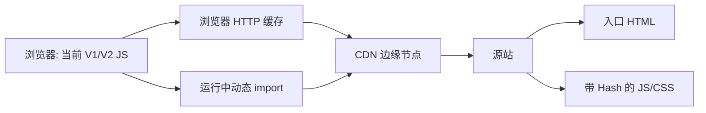
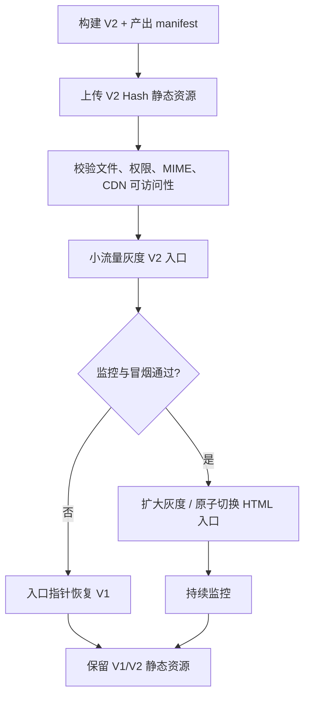
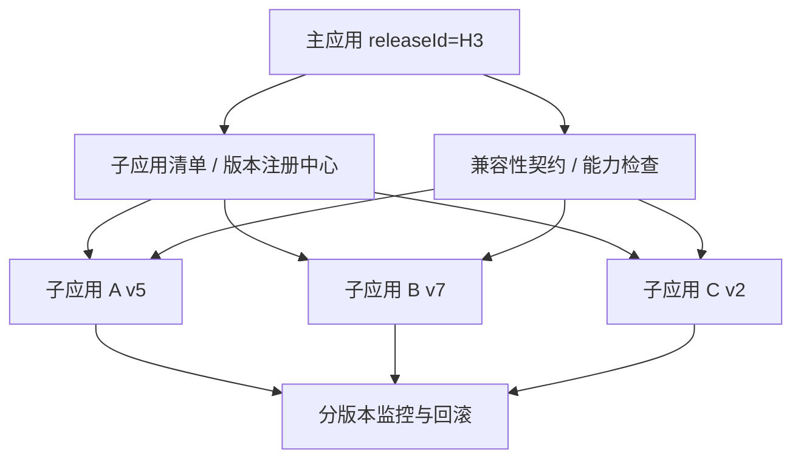

# 前端灰度发布、CDN 缓存与回滚

> 日期：2026-10-26 · 第 3 天 · 题号 05 · 方向：工程化/架构 · 难度：★★★★★

**状态：已完成；最终评分 85/100**

## 题目背景与作答记录

10 多个独立部署的微前端子应用发布后部分用户白屏，存在新 HTML、旧 JS、CDN 节点更新不一致及主子应用不兼容等情况。

用户原始回答、两轮追问和点评均记录于 [follow-ups.md](./follow-ups.md)，此处给出扩展的工程实践与标准答案。

## 一、为何 HTML、JS、CSS 版本不一致

前端发布并不是一个天然原子事务，至少涉及：

- **浏览器缓存**：浏览器可能强缓存静态资源，也可能对 HTML 进行条件请求；已经打开的页面继续运行旧 JS，不会因部署自动热更新。
- **CDN 缓存**：不同边缘节点可能暂时缓存不同版本的 HTML，或 CDN 尚未拉取新文件。
- **源站/部署顺序**：先更新 HTML、后上传资源，可能出现新 HTML 引用不存在的 Chunk，导致 404。
- **清理时序**：旧页面通过 `import()` 懒加载旧 Chunk，但部署清理了旧文件，出现 `ChunkLoadError`。
- **Service Worker**：若启用离线缓存，可能额外持有旧资源清单；需要设计 SW 升级、版本激活和缓存清理策略。
- **微前端独立发布**：主应用与子应用依赖的 SDK、全局变量、路由或共享协议不兼容。



**区分两类故障**：

1. **版本陈旧**：返回的文件有效但不是预期版本。
2. **资源不可用**：404/403、跨域失败、MIME 类型错误、SRI 校验失败、加载超时等。不能把所有白屏都归咎于缓存。

## 二、HTTP 缓存策略

### HTML：每次使用前验证

常见响应：

```http
HTTP/1.1 200 OK
Content-Type: text/html; charset=utf-8
Cache-Control: no-cache
ETag: "release-v2-html"
```

- `no-cache` **允许存储**，但复用前须重新验证；条件请求可能返回 304。
- `no-store` 要求缓存不存储，适用于需要更严格禁止存储的场景，但牺牲复用。
- HTML 的 CDN 共享缓存规则可能由 `s-maxage`、`CDN-Cache-Control`（若供应商支持）或 CDN 控制台规则决定；浏览器策略与 CDN 策略应分别验证。
- 回滚时应确认 `/`、`/index.html`、SPA 深层路由 fallback、地区/语言入口等实际 HTML URL 都能获取正确版本。

### 带内容 Hash 的静态资源：长缓存、不可变

```http
HTTP/1.1 200 OK
Content-Type: text/javascript
Cache-Control: public, max-age=31536000, immutable
```

例如 `/assets/app.7a9f3e.js`。内容变更产生新 URL；**禁止在相同 Hash URL 下覆盖内容**。长缓存策略仅适用于真正不可变的文件，不能无差别用于 `config.js`、`remoteEntry.js` 或其他可变入口清单。

**特别注意**：微前端的远程入口 `remoteEntry.js` 若路径固定且内容可变，通常不应使用一年不可变缓存；可使用短 TTL、`no-cache`，或改为带版本/Hash 的 URL 并由可验证的清单进行定位。

## 三、可靠发布顺序与原子切换

**正确顺序：先资源，后入口。**



**工程约束**：

1. V1、V2 静态资源上传到版本化或内容 Hash 地址，互不覆盖。
2. 上传后进行产物完整性、HTTP 200、正确 MIME/CORS/CSP/SRI（如适用）、CDN 回源验证。
3. HTML 入口通过**原子切换**（对象存储版本、负载均衡路由、指针/符号链接等）发布，避免写入一半时被请求。
4. 灰度期间要有**用户/会话粘性**，避免同一会话多次请求落到不同版本的可变入口；多节点需统一路由规则。
5. 确认发布的回滚路径和静态资源保留策略；不要依赖临时手工复制文件。

### 部署/回滚伪代码

```bash
#!/usr/bin/env bash
set -euo pipefail

RELEASE="v2"
# 以下命令为示意：需替换为具体对象存储/CDN/发布平台 CLI。
upload_immutable_assets "./dist/assets" "/releases/$RELEASE/assets"
verify_asset_manifest "./dist/manifest.json" "/releases/$RELEASE"
switch_html_pointer "$RELEASE" # 必须是原子操作或受控切换
verify_entry_version "$RELEASE"

# 发生严重故障时：
# switch_html_pointer "v1"
# invalidate_cdn_html "/" "/index.html"
# verify_entry_version "v1"
# 不要立即删除 v2 的带 Hash 资源。
```

以上命令是流程示意，不是可直接执行的标准 CLI。实际项目应通过发布平台提供的原子部署 API 实现。

## 四、ChunkLoadError 与多版本资源共存

V1 用户打开页面后，即使服务端发布 V2，旧 `main.v1.js` 中的 `import("./page.v1.js")` 仍会请求 V1 Chunk。立即删除 V1 资源会导致 404。

**解决策略**：

- 保留多个发布版本的 JS/CSS/Chunk（按活跃会话最长时间、离线支持及运维成本设定清理周期）。
- HTML 入口可变，静态资源路径不可变；避免不同版本共享同一个可变 Chunk URL。
- 可在捕获 Chunk 加载错误时提示用户保存工作并刷新，但**刷新不是保留旧 Chunk 的替代品**，更不能无限自动重试。
- 监控具体失败 URL、资源 HTTP 状态、当前运行版本和部署版本，区分 404、网络断连和跨域错误。

## 五、如何正确回滚 V2 到 V1

错误做法：

- **直接删除 V2 HTML**：稳定入口可能返回 404。
- **把 `main.v2.js` 重定向到 `main.v1.js`**：可能产生模块/API 不兼容、SRI 失败。
- **删除全部 V2 资源**：仍打开 V2 的用户可能懒加载失败。

推荐做法：

1. 暂停灰度扩容和后续部署，确认故障范围。
2. 把稳定 HTML 入口或部署指针恢复到 **V1 HTML**。
3. 失效 CDN 的 **HTML 入口缓存**，确认多地域/多节点回源结果；保留 V1/V2 带 Hash 静态资源。
4. 验证新访问用户的入口、关键 JS、登录与核心业务路径。
5. 对已打开的 V2 页面，根据严重程度采用版本提示或受控刷新；对表单草稿、事务中操作、刷新循环做好保护。
6. 继续监控错误率和核心业务指标，直到故障恢复。

**注意**：HTML/CDN 回滚不会替换浏览器内存中已经运行的 V2 JS。若涉及服务端接口或数据结构变更，回滚前还必须确认 API/数据库向后兼容。

## 六、灰度发布与自动回滚

### 灰度维度

- 内部员工 → 1% → 5% → 20% → 100%，分阶段扩大。
- 按账号/租户/会话做**稳定分桶**，避免用户在 V1/V2 之间随机跳动。
- 监控分版本、分地区、分浏览器的白屏率、JS 错误率、资源加载失败率、API 失败率、页面可交互性和关键转化。
- 为每个前端产物注入 `releaseId`，在日志/监控上报中带上版本、宿主版本、子应用版本和页面路径。

### 自动回滚条件

例如：灰度组白屏率显著高于对照组、关键业务成功率下降、核心接口失败率越过预设阈值。阈值需结合真实基线、样本量和误报成本设定，不宜使用脱离业务的固定数字。

自动回滚需有熔断、人工确认策略（视故障等级）、操作审计和防抖机制，避免版本来回切换。

## 七、微前端主子应用独立部署的兼容性治理

版本兼容不仅是文件缓存问题，更是**协议兼容问题**。

- **明确契约**：主子应用的生命周期、路由、全局事件、鉴权上下文、共享 SDK、跨应用通信定义版本化接口。
- **声明兼容矩阵**：例如主应用 V3 支持子应用 V5～V7；不兼容版本禁止灰度或启用回退。
- **能力协商**：子应用声明 `requiredHostCapabilities`，宿主按能力而非仅靠版本号判定是否可加载。
- **独立回滚**：支持只回滚某个子应用入口，而不强制回滚全部宿主；但必须保证兼容性。
- **运行时隔离**：CSS、全局事件、依赖单例、共享模块版本、公共 SDK 应明确边界。
- **发布前矩阵测试**：覆盖“新宿主 + 旧子应用”“旧宿主 + 新子应用”“新宿主 + 新子应用”等关键组合。
- **渐进式 API 演进**：先扩展接口再切换消费者，保留旧契约至兼容窗口结束。



## 八、排障检查清单

- HTML 实际来自浏览器缓存、Service Worker、CDN 还是源站？
- `Cache-Control`、`ETag`、`Age`、`Vary`、CDN 命中状态是什么？
- HTML 引用的 JS/CSS URL 是否全部存在且 MIME 正确？
- `remoteEntry`、manifest 等可变入口是否误用了长强缓存？
- 报错发生在初次加载还是动态 import？
- 当前页面运行的 `releaseId` 与 CDN HTML 版本是否一致？
- 主子应用共享协议、SDK 与后端 API 是否兼容？
- 回滚后，新会话和已打开的旧会话是否分别验证过？

## 官方参考资料

- [MDN — HTTP caching](https://developer.mozilla.org/en-US/docs/Web/HTTP/Guides/Caching)
- [MDN — Cache-Control](https://developer.mozilla.org/en-US/docs/Web/HTTP/Reference/Headers/Cache-Control)
- [MDN — ETag](https://developer.mozilla.org/en-US/docs/Web/HTTP/Reference/Headers/ETag)
- [web.dev — Love your cache](https://web.dev/articles/love-your-cache)
- [Cloudflare — Purge cache](https://developers.cloudflare.com/cache/how-to/purge-cache/)
