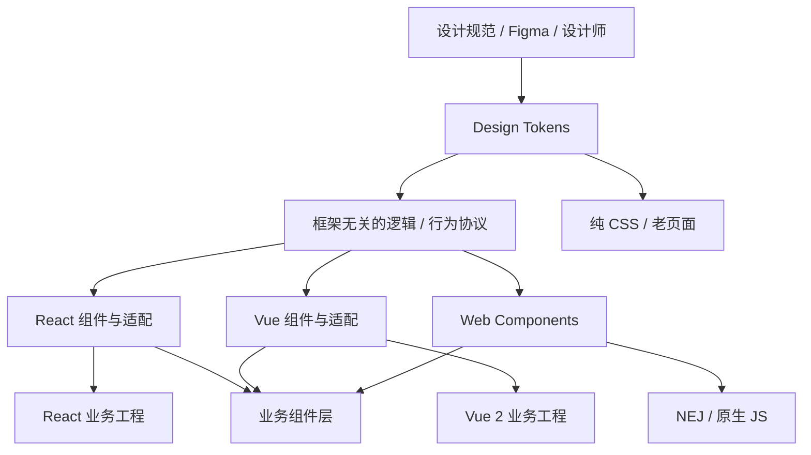

# 跨技术栈组件库与设计系统治理

> 日期：2026-10-26 · 第 3 天 · 题号 06 · 方向：工程化/架构 · 难度：★★★★☆

**状态：已完成；最终评分 75/100**

## 题目背景与作答记录

公司有 Vue 2 SaaS、React 18、NEJ 老系统和多个独立业务工程，希望统一按钮、弹窗、表格、主题和业务组件。用户原始回答、两轮追问及点评详见 [follow-ups.md](./follow-ups.md)。

## 一、Design System 的分层

设计系统不只是组件库，还包括视觉规范、可访问性、交互规范、设计资产、文档、质量保障和版本治理。



### Design Token 三层

| 层级 | 用途 | 示例 |
| --- | --- | --- |
| Primitive（原始值） | 基础色板、间距、字号、圆角等 | `color.blue.500`、`spacing.8` |
| Semantic（语义） | 主题/用途，支持暗色与品牌切换 | `color.primary`、`color.surface` |
| Component（组件） | 单个组件的可定制视觉语义 | `button.primary.background` |

```css
:root {
  --blue-500: #1677ff;
  --color-primary: var(--blue-500);
  --button-primary-bg: var(--color-primary);
  --radius-md: 6px;
}
[data-theme="dark"] {
  --color-primary: #69b1ff;
}
.company-button {
  background: var(--button-primary-bg);
  border-radius: var(--radius-md);
}
```

建议保留 JSON 等结构化 Token 作为单一数据源，自动生成 CSS 变量、JS/TS 常量及设计工具需要的格式，避免各框架手工复制数值。要注意颜色对比度、字号缩放、焦点状态和无障碍规范。

### 基础组件、业务组件、适配层

- **基础组件**：Button、Input、Modal、Notification、Table、Pagination；依赖交互和视觉规范，不绑定业务接口。
- **业务组件**：CustomerSelector、ApprovalFlow、PermissionButton；与领域模型、权限、接口或业务流程耦合。Header/Sidebar 可能是通用布局，也可能是业务组件，取决于内容。
- **框架无关层**：验证器、日期/数据格式化、状态机、表格排序过滤、ARIA 行为协议、Design Token 等。
- **框架适配层**：处理 React props/children/callback、Vue props/slots/emit、NEJ 的 DOM API、挂载/卸载、响应式数据桥接。
- **构建发布层**：产物打包、ESM/UMD、类型声明、npm 包发布、CDN 资源、source map 和兼容测试。**不是框架适配层本身**。

## 二、React 组件跨 Vue 2/NEJ 复用：方案比较

| 方案 | 原理 | 优点 | 局限与适用 |
| --- | --- | --- | --- |
| 各框架原生实现 + 共享 Tokens/逻辑 | React/Vue 分别渲染 | 最佳框架体验、易做 SSR/表单/类型 | 维护多个渲染实现；适合核心基础组件 |
| Web Components | Custom Elements + 可选 Shadow DOM | 标准 DOM API，跨框架 | 事件、对象属性、样式、SSR、表单等集成成本 |
| React SDK / mount | React 渲染到宿主指定 DOM 容器 | 可复用现有 React 组件，老项目易接入 | 运行时体积、隔离、生命周期、清理 |
| iframe | 独立页面通过 postMessage 通信 | 强隔离、可独立发布 | 高交互成本、布局/主题/性能不便 |

**不能直接把 React 函数组件当作 Vue 2 组件使用**。Web Component 包装可复用其渲染，但需要负责 React 根节点、属性映射、事件转发和卸载。

### SDK 挂载示例（React 18，TypeScript）

```tsx
import { createRoot, type Root } from "react-dom/client";
import { ConfirmDialog } from "./ConfirmDialog";

type Options = {
  container: HTMLElement;
  onConfirm: (id: number) => void;
};

export function mountConfirmDialog(options: Options) {
  const root: Root = createRoot(options.container);
  let destroyed = false;

  root.render(
    <ConfirmDialog onConfirm={options.onConfirm} />,
  );

  return {
    destroy() {
      if (destroyed) return;
      destroyed = true;
      root.unmount();
    },
  };
}
```

工程上还应处理异步请求取消、全局事件/定时器清理、弹窗 Portal 容器、重复挂载、React 运行时共享策略及版本冲突。Vue 2/NEJ 只需要调用 `mountConfirmDialog({ container, onConfirm })`，不需要直接理解 React 组件树。

## 三、Web Components 三项核心技术

1. **Custom Elements**：`customElements.define()` 注册自定义元素，提供 `connectedCallback`、`disconnectedCallback`、`attributeChangedCallback` 等生命周期。
2. **Shadow DOM**：可选的 DOM 封装与样式隔离；不等于所有 Web Components 都有 Shadow DOM。
3. **HTML Template**：`<template>` 与 `<slot>` 可用于复用模板和内容投影。

### 可运行的 Custom Element 示例

```ts
class CompanyButton extends HTMLElement {
  static observedAttributes = ["variant"];

  private readonly root: ShadowRoot;
  private readonly button: HTMLButtonElement;

  constructor() {
    super();
    this.root = this.attachShadow({ mode: "open" });
    this.root.innerHTML = `
      <style>
        button {
          background: var(--company-button-bg, #1677ff);
          color: white;
          border: 0;
          border-radius: 6px;
          padding: 8px 16px;
        }
      </style>
      <button part="button" type="button"><slot></slot></button>
    `;
    this.button = this.root.querySelector("button")!;
  }

  private onClick = () => {
    this.button.dispatchEvent(new CustomEvent("confirm", {
      detail: { id: 123 },
      bubbles: true,
      composed: true,
    }));
  };

  connectedCallback() {
    this.button.addEventListener("click", this.onClick);
  }

  disconnectedCallback() {
    this.button.removeEventListener("click", this.onClick);
  }

  attributeChangedCallback() {
    this.button.dataset.variant = this.getAttribute("variant") ?? "default";
  }
}

if (!customElements.get("company-button")) {
  customElements.define("company-button", CompanyButton);
}
```

宿主：

```html
<company-button id="save" variant="primary">保存</company-button>
<style>
  company-button { --company-button-bg: rebeccapurple; }
  company-button::part(button) { font-weight: bold; }
</style>
<script type="module">
  import "./company-button.js";
  document.querySelector("#save").addEventListener("confirm", (event) => {
    console.log(event.detail.id); // 123
  });
</script>
```

注：该示例是基础演示；真实生产组件还应处理禁用态、焦点、键盘交互、无障碍状态、异步更新和安全的内容渲染。

### 样式边界

普通选择器 `company-button button` 无法选择 Shadow Root 内部按钮。对外定制可通过：

- HTML 属性：`variant="danger"`、`size="large"`，适合有限预设。
- **CSS 自定义属性**：`--company-button-bg` 可继承进入 Shadow DOM，适合主题 Token。
- **`::part(button)`**：通过内部 `part="button"` 暴露指定元素的样式定制面。
- 插槽 `<slot>`：允许宿主提供内容，但应明确哪些内容可被定制。

### 事件边界：bubbles vs composed

```ts
internalButton.dispatchEvent(
  new CustomEvent("confirm", {
    detail: { id: 123 },
    bubbles: true,  // 沿事件路径冒泡
    composed: true, // 允许穿过 Shadow DOM 边界
  }),
);
```

- 默认 `bubbles: false`、`composed: false`；从内部按钮派发时，宿主上的普通冒泡监听器通常收不到。
- `bubbles: true` 不等于可以跨 Shadow DOM 边界；`composed: true` 是另一维度。
- **细节**：`composed: true` 的非冒泡事件，宿主仍可能在边界上以目标阶段接收；但要让祖先正常接收冒泡事件，公共事件通常两个选项都为 `true`。
- 如果 `this.dispatchEvent(...)` 直接由自定义元素宿主派发，宿主自身的监听器无需 `bubbles`/`composed` 即可收到。
- Shadow DOM 事件存在 **retargeting（重定向目标）**：外部看到的 `event.target` 可能是宿主元素；必要时用 `event.composedPath()` 分析传播路径，但封闭 Shadow Root 有封装限制。

### 属性、Property 与表单

- HTML Attribute 是字符串，适合 `variant="primary"`、`disabled` 等简单状态。
- 复杂对象应通过 JS Property 传递：`element.data = { ... }`；不能假定 HTML Attribute 能无损传递对象。
- React/Vue 对 Custom Element 的属性、事件绑定行为与版本有关，最好提供框架专用包装层，统一类型和 API。
- 自定义表单控件需要考虑 `ElementInternals`/form-associated custom elements、焦点、校验、label、键盘与屏幕阅读器支持，不能仅依赖自定义标签。
- SSR/水合、Declarative Shadow DOM、浏览器支持范围需要单独评估。

## 四、版本冲突与多项目治理

### 依赖与注册冲突

- **Custom Elements 名称是同一 Window 下全局注册的**；同一个标签名不能重复 `customElements.define()`。避免多个版本同时注册同名元素。
- 若必须并存重大版本，可考虑 `company-button-v2` 这样的版本化标签，或统一由宿主加载一份受控版本。
- npm 包采用 SemVer：兼容修复 patch、向后兼容功能 minor、破坏性变更 major；重大变更配迁移指南。
- Design Token 的变更也可能是破坏性变更：删除或重命名 Token 要有弃用期。
- 微前端共享依赖需声明 `peerDependencies`/共享策略、兼容矩阵；避免无意识地加载多个不兼容运行时或样式基线。

### 推荐仓库组织

```text
packages/
  tokens/             # JSON token 与 CSS/TS 产物
  core/               # 框架无关逻辑
  react/              # React 组件及 hooks
  vue2/               # Vue 2 适配与组件
  web-components/     # Custom Elements
  legacy-sdk/         # NEJ/原生 DOM 挂载接口
  docs/               # Storybook/示例/迁移指南
```

可以使用 monorepo 统一开发，但各包应能独立构建、测试、发布；不必强制所有业务工程同步升级。

## 五、自动化测试与渐进迁移

1. **视觉一致性**：多主题、暗色、高对比度、不同密度/字号、响应式截图回归。
2. **行为一致性**：Button/Modal/Select 的键盘、焦点、禁用态、事件契约和边界行为测试。
3. **跨框架契约测试**：React 18、Vue 2、NEJ 页面分别加载并验证 Attribute/Property、CustomEvent、卸载。
4. **无障碍**：语义、ARIA、键盘导航、焦点圈、颜色对比度。
5. **构建兼容**：ESM/UMD、CSS 加载顺序、旧浏览器、CSP、微前端多实例/多版本。
6. **迁移顺序**：先统一 Tokens 与 CSS 基线 → 迁移低风险基础组件 → 建立适配层 → 逐步替换复杂组件 → 最后迁移业务组件。
7. **治理指标**：组件覆盖率、旧组件使用量、版本分布、设计偏差、回归问题数、无障碍问题数。

### 常见错误

- 误以为 React 组件可直接导入 Vue 2 模板。
- 误以为 Web Components 天然具有 Shadow DOM，或 Shadow DOM 彻底阻断所有外部样式。
- 仅通过属性传 JSON，忽视类型和序列化边界。
- 只设置 `bubbles: true`，忘记 `composed: true`。
- SDK 挂载后忘记 `destroy()`，造成事件、定时器、React Root 泄漏。
- 同一页面多个版本重复注册同名 Custom Element。
- 将业务权限/网络请求直接写进所有基础组件。

## 官方参考资料

- [MDN — Web Components](https://developer.mozilla.org/en-US/docs/Web/API/Web_components)
- [MDN — Using custom elements](https://developer.mozilla.org/en-US/docs/Web/API/Web_components/Using_custom_elements)
- [MDN — Using shadow DOM](https://developer.mozilla.org/en-US/docs/Web/API/Web_components/Using_shadow_DOM)
- [MDN — ::part()](https://developer.mozilla.org/en-US/docs/Web/CSS/::part)
- [MDN — Event.composed](https://developer.mozilla.org/en-US/docs/Web/API/Event/composed)
- [MDN — CustomEvent](https://developer.mozilla.org/en-US/docs/Web/API/CustomEvent)
- [W3C Design Tokens Community Group](https://www.designtokens.org/)
