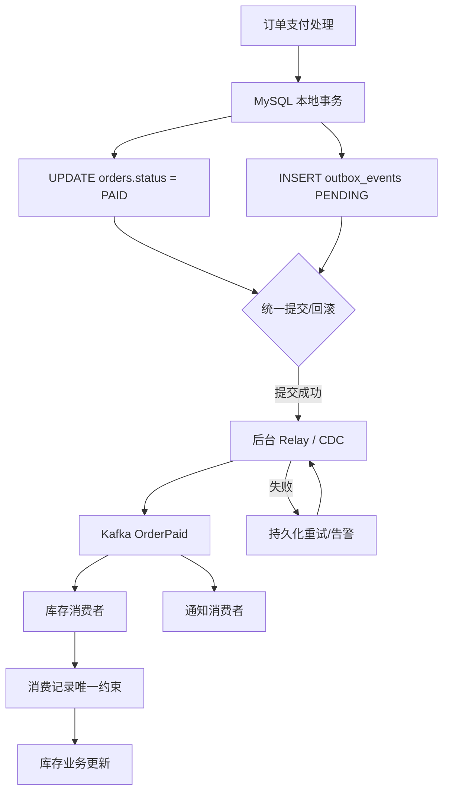
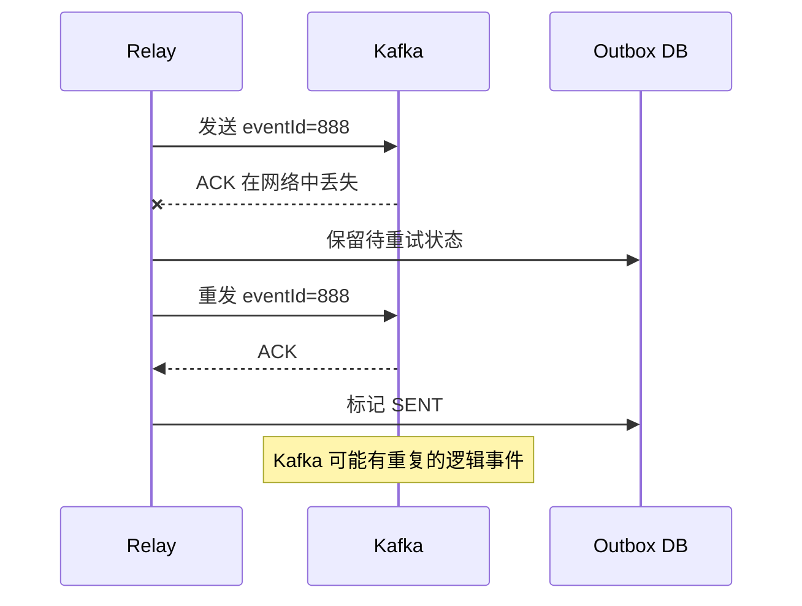

# 分布式事务与 Transactional Outbox

> 日期：2026-10-26 · 第 3 天 · 题号 07 · 方向：后端/分布式 · 难度：★★★★★

**状态：已完成；最终评分 70/100**

## 题目背景、作答与评审

订单支付成功后，订单服务更新 MySQL 中的订单状态，并向 Kafka 发送 `OrderPaid` 事件，供库存、通知、搜索索引等服务消费。

用户的**原始回答**、两轮追问及逐项点评见 [follow-ups.md](./follow-ups.md)。本页给出原理、完整设计、SQL/Java 示例、故障边界及方案对比。

## 一、问题本质：两个系统无法靠一个普通本地事务原子提交

```java
@Transactional
public void payOrder(Long orderId) {
    orderMapper.updateStatus(orderId, "PAID");
    kafkaTemplate.send("order-paid", orderId.toString());
}
```

普通 Spring `@Transactional` 在使用 `DataSourceTransactionManager` 等数据库事务管理器时管理的是数据库事务；不会自动把 Kafka 和 MySQL 组成一个原子提交单元。且 `KafkaTemplate.send()` 通常异步返回 Future，**方法调用没有抛异常 ≠ Kafka 已确认写入**。

| 结果 | 后果 |
| --- | --- |
| MySQL 成功、Kafka 失败 | 订单已 PAID，下游可能永远不知道 |
| Kafka 成功、MySQL 回滚 | 下游可能已执行支付成功业务，但订单未提交 |
| Kafka 写入成功、ACK 丢失 | 生产者不确定是否成功，重试可能重复 |
| Kafka 写入成功、进程在更新状态前崩溃 | 下次 relay 可能重复投递 |

即使先发送 Kafka 再提交 DB，或先提交 DB 再发送 Kafka，都存在无法消除的故障窗口。

**注意**：MySQL 事务回滚不能回滚第三方支付平台已真实扣款的行为。支付系统还需要支付状态机、回调幂等、对账及补偿。

## 二、Transactional Outbox 的核心

把“数据库业务更新 + Kafka 发送”拆成：

1. **本地原子事务**：更新 `orders`，同时插入 `outbox_events`。
2. **异步可靠投递**：后台 relay 从 Outbox 读取待发送事件，发往 Kafka，确认后标记成功。
3. **消费端幂等**：消费者以稳定的 `event_id` 去重，在自己的数据库事务中执行一次业务副作用。



关键保证：**同一个数据库的业务变更和事件记录要么一起提交，要么一起回滚**。这不等于跨 MySQL/Kafka 的 Exactly-once。

## 三、表结构与索引（MySQL 8 示例）

```sql
-- 业务订单表，示意字段
CREATE TABLE orders (
  id BIGINT PRIMARY KEY,
  status VARCHAR(20) NOT NULL,
  updated_at DATETIME(6) NOT NULL
) ENGINE=InnoDB;

-- 待投递事件
CREATE TABLE outbox_events (
  id BIGINT PRIMARY KEY,                  -- 全局稳定事件 ID
  aggregate_id BIGINT NOT NULL,           -- 例如 orderId
  event_type VARCHAR(100) NOT NULL,
  payload JSON NOT NULL,
  status VARCHAR(20) NOT NULL DEFAULT 'PENDING',
  retry_count INT NOT NULL DEFAULT 0,
  next_retry_at DATETIME(6) NOT NULL DEFAULT CURRENT_TIMESTAMP(6),
  lease_until DATETIME(6) NULL,           -- 多实例领取租约
  last_error TEXT NULL,
  created_at DATETIME(6) NOT NULL DEFAULT CURRENT_TIMESTAMP(6),
  updated_at DATETIME(6) NOT NULL DEFAULT CURRENT_TIMESTAMP(6),
  KEY idx_outbox_poll (status, next_retry_at, id),
  KEY idx_outbox_lease (status, lease_until)
) ENGINE=InnoDB;

-- 库存消费者自己的数据库表
CREATE TABLE processed_events (
  consumer_name VARCHAR(100) NOT NULL,
  event_id BIGINT NOT NULL,
  processed_at DATETIME(6) NOT NULL DEFAULT CURRENT_TIMESTAMP(6),
  PRIMARY KEY (consumer_name, event_id)
) ENGINE=InnoDB;
```

建议 `event_id` 使用全局唯一 ID（如 Snowflake/UUID 等）；`aggregate_id` 可用于 Kafka key，以帮助相同订单的事件落在同一分区、保留分区内顺序。

### 业务事务示意（Java）

```java
@Service
public class OrderPaymentService {
    private final OrderMapper orders;
    private final OutboxMapper outbox;

    public OrderPaymentService(OrderMapper orders, OutboxMapper outbox) {
        this.orders = orders;
        this.outbox = outbox;
    }

    @Transactional(rollbackFor = Exception.class)
    public void markPaid(long orderId, long eventId) {
        // 幂等条件更新：只有尚未支付的订单可转为 PAID
        int changed = orders.markPaidIfPending(orderId);
        if (changed == 0) {
            // 已支付或状态非法，需要按业务区分；不能无条件重复插入事件
            return;
        }

        // 与上面的订单状态变更在同一个 MySQL 事务中
        outbox.insertPending(
            eventId, orderId, "OrderPaid",
            "{\"eventId\":" + eventId + ",\"orderId\":" + orderId + "}"
        );
    }
}
```

这段是接口层面的示意，`OrderMapper`/`OutboxMapper` 需要对应的 MyBatis SQL 实现；`eventId` 应由调用方生成且稳定，真实代码应使用 JSON 序列化库。对已支付、未找到、状态非法等情况要分别处理。

MyBatis SQL 示例：

```sql
-- 订单状态只允许 PENDING -> PAID
UPDATE orders
SET status = 'PAID', updated_at = NOW(6)
WHERE id = :orderId AND status = 'PENDING';

-- 若 UPDATE 影响 1 行，在同一事务内插入事件
INSERT INTO outbox_events (
  id, aggregate_id, event_type, payload, status
) VALUES (
  :eventId, :orderId, 'OrderPaid', :payload, 'PENDING'
);
```

`INSERT` 报错导致事务回滚时，`UPDATE` 也回滚；事务提交后事件记录持久存在，即使进程崩溃也能由 relay 恢复。

## 四、Relay：如何可靠扫描并投递 Kafka

### 轮询方式（Polling Publisher）

多实例不能简单地 `SELECT PENDING` 然后各自发送，否则可能重复抢占。可在短事务中领取一批事件，使用 `FOR UPDATE SKIP LOCKED` 或原子状态更新与租约：

```sql
START TRANSACTION;

-- MySQL 8，跳过其他实例已锁定的事件
SELECT id
FROM outbox_events
WHERE status = 'PENDING'
  AND next_retry_at <= NOW(6)
ORDER BY next_retry_at, id
LIMIT 100
FOR UPDATE SKIP LOCKED;

-- 对刚领取的 id 集合更新为 SENDING，设置 lease_until
-- UPDATE outbox_events
-- SET status='SENDING', lease_until=DATE_ADD(NOW(6), INTERVAL 2 MINUTE)
-- WHERE id IN (...);

COMMIT;
```

之后在**数据库事务外**调用 Kafka 发送，等待 broker ACK，再更新状态为 `SENT`。不要在持有 DB 行锁时等待 Kafka 网络调用。租约过期后由恢复任务重新领取卡住的 `SENDING`；需要用领取令牌/fencing 或条件更新，防止旧 worker 覆盖新 worker 状态。

失败时更新 `retry_count`、`last_error`、`next_retry_at`，采用指数退避 + 随机抖动。达到上限可标记 `DEAD`、告警、人工修复后重试；**关键事件不能静默丢弃**。

### CDC 方式（Change Data Capture）

也可以由 Debezium 等 CDC 组件读取 MySQL binlog 中的 Outbox 变更，将事件发布到 Kafka。优点是避免业务应用主动轮询；代价是需要管理 CDC 连接器、binlog、事件路由、监控与恢复。CDC 也不应被理解为所有端到端副作用天然 Exactly-once。

## 五、为什么至少一次投递仍会重复

**ACK 丢失：**



**ACK 成功但标记 SENT 前崩溃**同样会导致重发。

Kafka 的生产者幂等性（`enable.idempotence`）可以抑制同一生产者会话内某些重试造成的重复写入，但不能消除 Outbox relay 崩溃重启、业务重新投递等所有逻辑重复。Kafka 事务的 Exactly-once 能力也有适用范围，不能直接把 MySQL 外部业务副作用纳入同一原子事务。

## 六、消费端幂等：唯一约束 + 同库事务

以库存服务为例：

```sql
START TRANSACTION;

-- 使用数据库唯一约束处理并发消费同一事件
INSERT IGNORE INTO processed_events (consumer_name, event_id)
VALUES ('inventory-service', 888);

-- 只有上一步 affected rows = 1 时才执行库存业务；
-- 如果 affected rows = 0，说明此前已经登记，直接跳过。
-- 示例业务 SQL（根据订单行项逐项处理）：
-- UPDATE inventory SET reserved = reserved + :qty
-- WHERE sku_id = :skuId;

COMMIT;
```

上述代码展示的是流程片段：真实应用需检查 `INSERT IGNORE` 的影响行数，且仅在插入成功时执行库存更新。MySQL `INSERT IGNORE` 可能将某些其他错误降级为警告，生产环境应核对错误类型；也可使用普通 `INSERT` 并专门捕获重复键异常。

**为什么必须同一事务？**

- 如果先写消费记录、后更新库存但库存失败，事务回滚使消费记录也撤销，下次可安全重试。
- 如果先更新库存、后写消费记录但两者不是一个事务，可能发生库存已扣减但记录没写入，下次重复扣减。
- 重复消息：已存在唯一键 → 跳过业务并正常确认，不应无限抛异常。
- Kafka offset 应在业务数据库事务**成功提交之后**确认；若数据库已提交但 offset 未确认导致再次消费，由幂等记录兜底。

### Java 消费者示意

```java
@Service
public class OrderPaidConsumer {
    private final ProcessedEventMapper processed;
    private final InventoryMapper inventory;

    @Transactional(rollbackFor = Exception.class)
    public void handle(OrderPaidEvent event) {
        // 原子尝试插入，唯一键冲突返回 false
        boolean firstTime = processed.insertIfAbsent(
            "inventory-service", event.eventId()
        );
        if (!firstTime) {
            return; // 重复事件视为已处理
        }

        inventory.applyOrderPaid(event.orderId());
    }
}
```

**Kafka Listener 层**应在 `handle()` 的数据库事务完成后提交/确认 offset；失败则让框架的重试或 DLT 策略介入。外部通知（邮件、HTTP）无法通过库存数据库事务回滚，需额外幂等键或子 Outbox。

## 七、消息顺序、死信、补偿与可观测性

- **顺序**：同一订单的事件用 `orderId` 作 Kafka key；如要求严格按业务顺序消费，需考虑 Outbox relay 多 worker 的并发发送、重试乱序，不能仅依赖 Kafka 分区顺序。
- **失败分类**：网络超时等暂时故障可重试；永久格式错误/不兼容事件可进入隔离区或 DLT，人工修复后重放。
- **补偿/对账**：定期核对订单 PAID 与 Outbox/下游处理结果，发现漏处理、长期 PENDING、异常库存后触发补偿。
- **监控**：Outbox 待发数量、最老待发时长、重试率、DEAD 数、Kafka 发送延迟、消费滞后、重复率、最终业务一致性。
- **容量治理**：SENT 历史归档与保留期、分区/索引维护、幂等记录 TTL 应覆盖 Kafka 消息重放及补偿窗口。
- **语义边界**：若 Kafka 永久不可用、消费者持续失败、数据库损坏或操作人员丢弃事件，不能无条件承诺“最终一定完成”。方案提供在可恢复故障和持续重试/人工干预前提下的最终一致性。

## 八、方案比较

| 方案 | 特点 | 主要问题 |
| --- | --- | --- |
| 直接更新 DB 后发 Kafka | 实现简单 | DB 成功而 Kafka 失败会丢事件 |
| Kafka 发成功后更新 DB | 实现简单 | DB 回滚时下游可能已消费 |
| `@Transactional` 包裹两者 | 仅管理指定事务资源 | 不自动获得跨系统原子性 |
| Transactional Outbox + Polling | 业务与事件原子入库、异步投递 | 额外表、轮询、至少一次语义 |
| Transactional Outbox + CDC | 通过 binlog 发布事件 | CDC 运维成本、仍需消费幂等 |
| XA/2PC | 协调多个支持 XA 的参与者 | 协调复杂、可用性与性能成本，Kafka/DB 场景需评估实际支持 |

## 面试时的精炼回答

> 我不会直接在 MySQL 事务中发送 Kafka 并假设它们原子提交。会采用 Transactional Outbox：在同一个数据库事务中更新订单状态并写入待发送事件，后台任务或 CDC 将事件可靠投递到 Kafka。由于 ACK 丢失或进程崩溃，消息可能重复，因此消费者以 eventId 建唯一索引，并在同一个本地事务中完成去重记录和业务更新。发送失败持久化重试、指数退避、超限告警和人工重放，同时监控积压、重试与端到端一致性。

## 参考资料

- [microservices.io — Transactional outbox](https://microservices.io/patterns/data/transactional-outbox)
- [microservices.io — Idempotent consumer](https://microservices.io/patterns/communication-style/idempotent-consumer.html)
- [Spring for Apache Kafka — Transactions](https://docs.spring.io/spring-kafka/reference/kafka/transactions.html)
- [Apache Kafka — Design / delivery semantics](https://kafka.apache.org/documentation/#semantics)
- [Debezium — Outbox Event Router](https://debezium.io/documentation/reference/stable/transformations/outbox-event-router.html)
- [MySQL 8 — Locking Reads](https://dev.mysql.com/doc/refman/8.0/en/innodb-locking-reads.html)
