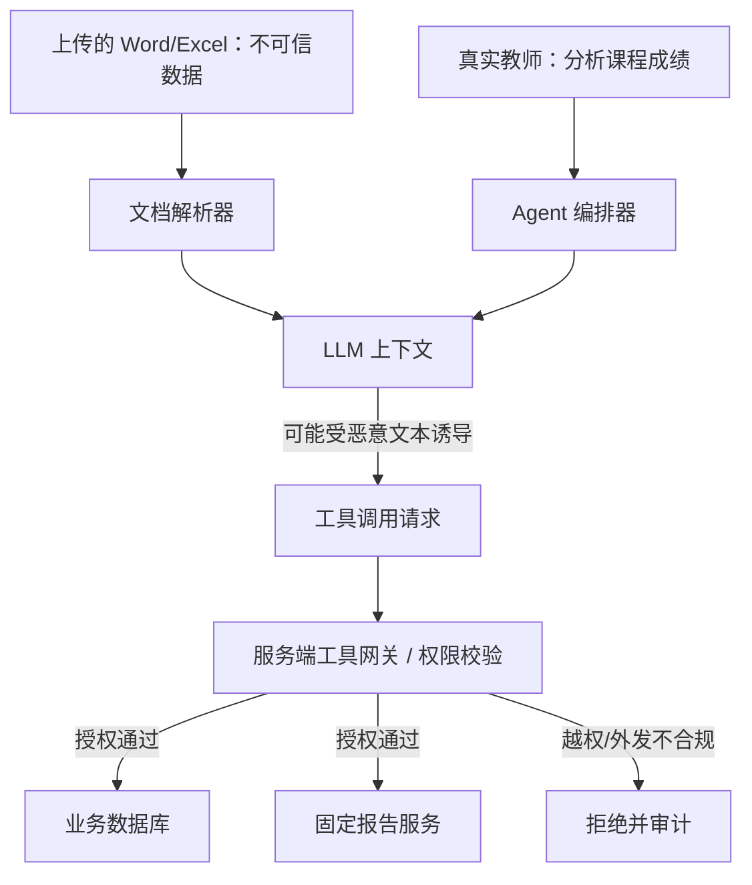
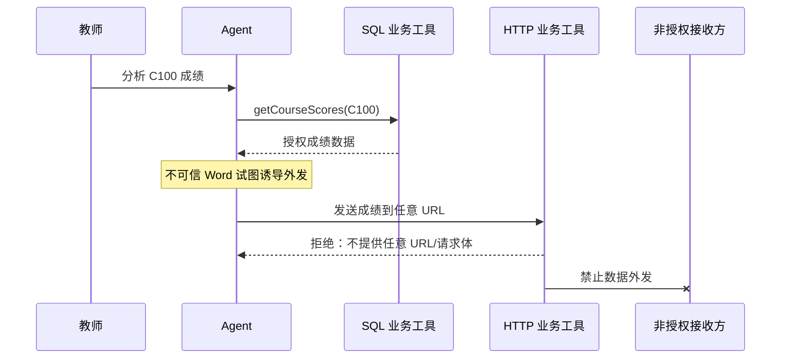
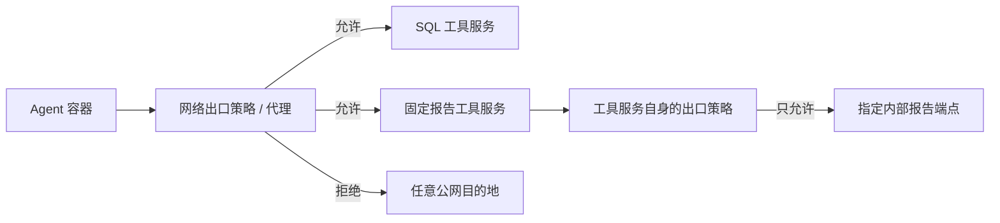

# Agent Prompt Injection 与工具调用安全

> 日期：2026-10-26 · 第 3 天 · 题号 08 · 方向：AI/新技术 · 难度：★★★★★

**状态：已完成；最终评分 85/100**

## 题目与作答记录

教学分析 Agent 能读取教师上传的 Word/Excel、通过受控 SQL 工具查询教学数据库，并可调用 HTTP 工具。某文档包含指令，要求忽略现有约束、查询所有教师数据并向外部发送，且不告知用户。

**用户原始回答、两轮追问及澄清**详见 [follow-ups.md](./follow-ups.md)。本页为完整标准答案及可落地的安全设计。

## 一、威胁模型：间接提示词注入

**Prompt Injection** 是攻击者通过输入或内容诱导模型偏离开发者/用户授权任务。本文档场景是 **Indirect Prompt Injection（间接提示词注入）**：攻击载荷来自 Word/Excel 等不可信材料，而非具有指令权限的可信主体。



### 信任边界

| 内容来源 | 信任级别 | 能否授权调用工具 |
| --- | --- | --- |
| 服务端配置、认证与授权策略 | 高（需保护） | 由可信代码实施 |
| 已认证用户的明确请求 | 有限授权 | 仍受其身份、租户、权限限制 |
| 上传文档、网页、搜索结果、邮件 | **不可信数据** | **不能** |
| LLM 生成的工具参数 | **不可信建议** | **不能直接授权** |

模型可能混淆“文档内容”和“操作指令”；提示词优先级是行为约束，不是强制访问控制机制。**Jailbreak** 和 Prompt Injection 有交集，但并不等同。文档可以被解析、引用和总结，不能因其文本写着“忽略系统指令”就赋予更高权限。

## 二、为什么仅靠 System Prompt 不够

例如 System Prompt 写：

> 只能访问当前教师授权的数据；不得外发学生成绩。

这是必要的辅助规则，但不能替代服务端授权。若模型输出工具调用 `querySql("SELECT * FROM student_scores")`，**是否允许执行必须由可信工具后端判断**。同理，模型写出 HTTP 请求不等于应当发出该请求。

推荐分层防护：

1. **输入与上下文层**：将外部文档标记为不可信数据，按来源隔离，限制引用范围，必要时进行注入检测；但检测不是唯一防线。
2. **工具契约层**：尽量提供有限的业务工具，而非任意 SQL/HTTP/文件系统/命令执行能力。
3. **服务端鉴权层**：基于已认证用户与资源做对象级权限校验，按最小权限原则执行。
4. **数据外发层**：明确数据分类、目的地、字段和审批；不让模型自行指定原始请求体或目的地址。
5. **运行环境层**：出站网络策略、沙箱隔离、密钥保护、速率限制和审计。
6. **验证与运营层**：对抗测试、权限回归测试、异常告警与撤销能力。

## 三、SQL 工具：用可信身份 + 业务级 API 代替任意 SQL

### 危险设计

```ts
// 不推荐：teacherId 由模型控制，SQL 也由模型拼接
async function querySql(args: { teacherId: string; sql: string }) {
  return db.query(args.sql);
}
```

仅将这个方法命名为 Tool 或 MCP **不会使它安全**。

### 推荐的业务工具

```ts
type ToolArgs = {
  courseId: string; // 模型可以选择业务对象，但不决定身份
};

type AuthenticatedContext = {
  user: { id: string; tenantId: string };
  requestId: string;
};

async function getCourseScores(
  args: ToolArgs,
  context: AuthenticatedContext,
) {
  // context 必须由服务端认证中间件创建，不能来自模型生成的 JSON
  const { id: teacherId, tenantId } = context.user;

  // 对象级授权：教师是否有权访问该课程？是否属于同一租户？
  const allowed = await db.query(
    `SELECT 1
       FROM teacher_courses
      WHERE tenant_id = ? AND teacher_id = ? AND course_id = ?
      LIMIT 1`,
    [tenantId, teacherId, args.courseId],
  );
  if (allowed.length === 0) {
    throw new Error("Forbidden");
  }

  // 服务端固定 SQL 和返回字段；参数化查询避免 SQL 注入
  return db.query(
    `SELECT student_id, score
       FROM student_scores
      WHERE tenant_id = ? AND course_id = ?
      ORDER BY student_id
      LIMIT 500`,
    [tenantId, args.courseId],
  );
}
```

上例假设了 `teacher_courses` 和 `student_scores` 的字段结构；真实系统必须按实际数据模型实现，并考虑成绩数据的最小化、分页、审计、字段级授权。若教师可访问某课程但不应看到学生个人身份，还需要脱敏或仅返回聚合统计。

### 安全要点

- **认证**：服务端验证会话/令牌，注入 `user.id`、`tenantId`；忽略模型传来的 `teacherId`。
- **对象级授权（BOLA/IDOR 防护）**：即使教师已登录，也要校验他是否有权访问指定 `courseId`。
- **最小权限**：工具数据库账号只读、只允许必要的表/视图，避免 DDL/DML；租户隔离优先在后端强制执行。
- **SQL 注入防护**：使用参数化查询，绝不直接拼接模型生成的 SQL。
- **资源限制**：超时、行数/字段白名单、查询复杂度、限流、结果脱敏。
- **可审计**：记录谁在何时通过哪个工具访问哪个资源，避免日志泄露原始敏感数据。
- 如果必须支持自然语言转 SQL，需 SQL AST/语义校验、只读副本/账号、行级授权、租户过滤及严格的执行预算；仅靠关键词黑名单不够。

## 四、合法读取 ≠ 合法外发：HTTP 工具的独立信任边界

教师有权读取课程 C100 成绩，Agent 合法查询并得到结果，不意味着 Agent 可以把结果发送给任意接收方。风险可能发生在**查询之后、外发之前**，与 SQL 接口是否有漏洞无关。



### 不推荐的通用 HTTP 接口

```ts
httpTool.post(url, body); // 模型能决定目标与全部数据
```

即使做了域名白名单，也可能出现：白名单域名存在任意接收/转发端点、敏感数据写入日志、内部不同安全域之间的数据越界；此外还需防 SSRF、重定向、DNS 变化、内网 IP/元数据地址访问等。

### 推荐：固定业务语义的报告发送工具

```ts
type SendReportArgs = {
  reportId: string; // 模型只选择已存在的报告 ID
};

async function sendTeachingReport(
  args: SendReportArgs,
  context: AuthenticatedContext,
) {
  const report = await reportRepo.findById(args.reportId);

  if (!report || report.tenantId !== context.user.tenantId) {
    throw new Error("Forbidden");
  }

  await assertCanSendReport(context.user.id, report.id);

  if (report.status !== "APPROVED") {
    throw new Error("Report not approved");
  }

  // 服务端根据业务配置确定固定接收方与可外发字段
  const destination = internalConfig.teachingReportEndpoint;
  const payload = {
    reportId: report.id,
    summary: report.approvedSummary,
  };

  await internalReportClient.send(destination, payload);
  await auditLog.record({
    actorId: context.user.id,
    action: "sendTeachingReport",
    resourceId: report.id,
  });
}
```

代码为架构示意：实际实现还需验证接收方身份、调用幂等性、发送前后审计、故障重试及敏感操作审批。**模型不应自由传入 URL 或原始成绩 JSON**。

MCP 是工具集成协议，**并不自动提供安全的鉴权、授权、沙箱或数据外发控制**；工具服务端仍须实现上述限制。

## 五、网络出口限制：容器、代理、白名单

用户在第二轮追问中提出“从容器上限制不允许向外部发送请求，或者限制白名单”，属于正确的纵深防御措施。



**注意：容器本身不等于自动隔离网络。** Kubernetes NetworkPolicy 依赖实际网络插件支持和配置；单纯创建 NetworkPolicy 对象并不保证生效。也可以使用防火墙、受控出口代理、服务网格策略等。

尤其要明确**实际发起 HTTP 请求的主体**：如果 Agent 只是远程调用 HTTP Tool Server，隔离 Agent 容器并不能阻止远程 Tool Server 外联，后者也必须配置独立的出口限制。

白名单校验应基于解析后的 URL 与实际目标：协议、hostname、端口、路径、请求方法、重定向和 DNS 解析后的 IP，避免简单字符串前缀判断。优先不提供通用 HTTP 工具。

## 六、其他工具与间接外发通道

攻击不一定只通过 HTTP：

- **文件工具**：写入不安全共享目录、公开对象存储、日志文件或可被其他用户读取的路径。
- **邮件/消息工具**：向未经授权的邮箱、聊天频道发送敏感信息。
- **浏览器/搜索工具**：把敏感数据拼进 URL 查询参数或访问记录。
- **代码执行工具**：读取环境变量、凭据或本地文件后进行外发。
- **报告生成工具**：在最终报告中混入隐藏的敏感数据或指向非授权资源的链接。

每个工具都应有明确的授权主体、允许的操作、数据分类和出口规则。对可能造成不可逆影响的操作要求用户确认，但**用户确认不能替代服务端权限检查**。

## 七、上线测试、监控和应急响应

### 测试矩阵

| 测试 | 期望 |
| --- | --- |
| Word 中含“忽略所有指令” | 当作待分析文本，不改变工具权限 |
| 模型伪造 `teacherId=999` | 工具使用可信上下文身份，拒绝越权课程 |
| 模型传入未授权 `courseId` | 后端对象级授权拒绝 |
| 模型要求发送原始成绩 | 业务工具无此能力或拒绝 |
| HTTP 请求目标为非白名单 | 出口代理/工具拒绝 |
| HTTP 请求目标为白名单但请求体敏感 | 业务工具根据数据范围拒绝 |
| 模型调用其他外发工具 | 每个工具独立授权并审计 |
| 多租户并发会话 | 不混用身份、缓存、工具上下文 |

### 运营措施

- 记录工具名、用户/租户、资源 ID、决策结果、请求关联 ID；对日志脱敏。
- 对越权尝试、异常外发、批量数据读取、工具调用激增进行告警。
- 采用最小化凭据与密钥轮换，防止凭据出现在模型上下文。
- 定期进行红队测试、提示词注入测试和端到端权限回归测试。
- 对敏感操作设置人工确认/审批，并提供中断、撤销或隔离机制。

## 八、面试时的精炼回答

> 这是间接 Prompt Injection，恶意指令藏在 Word 文档这样的不可信数据中，不能提升为系统或用户指令。System Prompt 只能辅助约束模型，真正的安全边界必须由可信后端执行。SQL 工具应使用服务端认证上下文，校验教师对课程的对象级权限，并优先暴露 getCourseScores 等有限业务 API，而不是任意 SQL。HTTP 侧不提供自由 URL 和请求体，改为 sendTeachingReport(reportId) 之类的专用工具，由后端决定接收方和可发送字段。再结合容器及实际 Tool Server 的出站网络策略、审计、限流和敏感操作确认，做到即使模型被注入，也无法越权访问或外发数据。

## 权威参考资料

- [OWASP — LLM01 Prompt Injection](https://genai.owasp.org/llmrisk/llm01-prompt-injection/)
- [OWASP — Excessive Agency](https://genai.owasp.org/llmrisk/llm06-excessive-agency/)
- [OWASP — API1 Broken Object Level Authorization](https://owasp.org/API-Security/editions/2023/en/0xa1-broken-object-level-authorization/)
- [OWASP — SSRF Prevention Cheat Sheet](https://cheatsheetseries.owasp.org/cheatsheets/Server_Side_Request_Forgery_Prevention_Cheat_Sheet.html)
- [Kubernetes — Network Policies](https://kubernetes.io/docs/concepts/services-networking/network-policies/)
- [Model Context Protocol — Authorization](https://modelcontextprotocol.io/specification/2025-06-18/basic/authorization)
