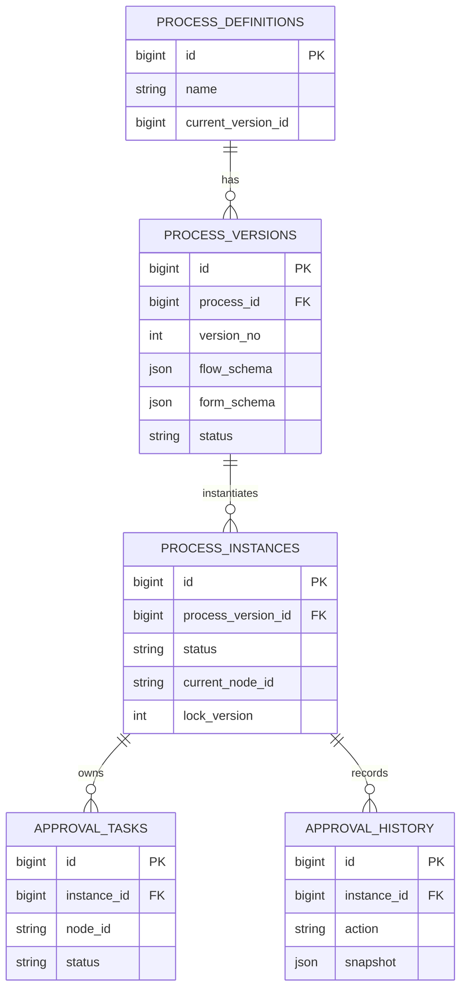
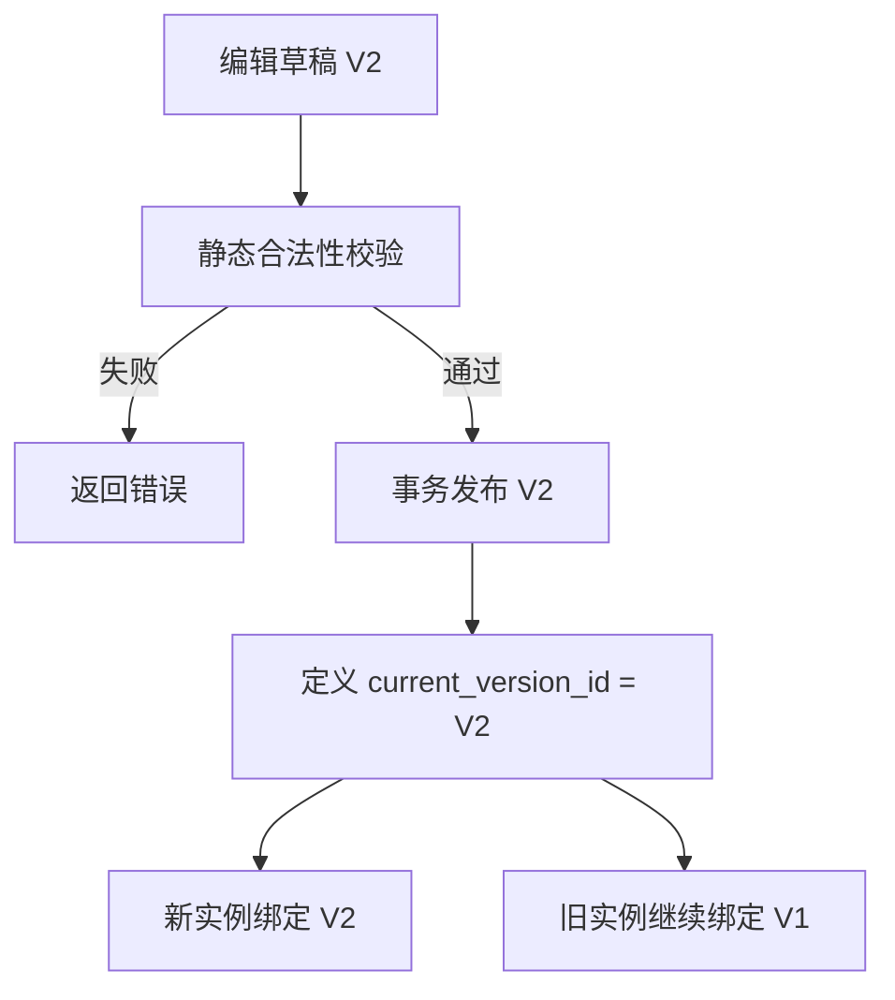
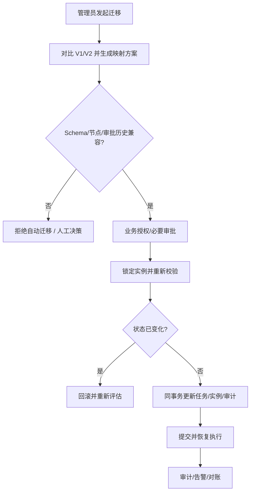

# 低代码审批流版本与历史兼容设计

> 日期：2026-10-26 · 第 3 天 · 题号 09 · 方向：场景/系统设计 · 难度：★★★★★

**状态：已完成；最终评分 75/100**

## 题目背景与答题记录

低代码审批平台支持条件分支、会签/或签、动态审批人、自定义表单。已有 10,000 个运行中实例，管理员删除节点、改变表单字段类型并发布新版本。如何兼容旧实例、历史数据、回滚和迁移？

用户**原始回答及两轮追问**保存在 [follow-ups.md](./follow-ups.md)。以下为完整标准答案、数据模型、并发控制和边界条件。

## 一、区分三个实体：定义、不可变版本、运行实例



- **流程定义**：逻辑模板，例如“请假审批”，拥有稳定的 `process_id`，保存当前发布版本指针。
- **流程版本**：V1/V2/V3，发布后不可变，完整保存节点、连线、条件、审批规则、表单 Schema；一份定义有多个版本。
- **流程实例**：张三提交的一次请假申请，绑定创建时的 `process_version_id`，保存运行状态、当前节点和表单值。
- **审批任务**：一个实例可产生多个待办（尤其是会签），不等同于实例。
- **审批历史**：独立的不可变审计记录，包含操作者、动作、时间、审批意见和必要的当时信息快照。

## 二、MySQL 数据结构示例

以下为核心字段示例，省略了租户、组织、创建时间等字段；生产中应补充 FK、索引及审计字段。

```sql
CREATE TABLE process_definitions (
  id BIGINT PRIMARY KEY,
  name VARCHAR(100) NOT NULL,
  current_version_id BIGINT NULL
) ENGINE=InnoDB;

CREATE TABLE process_versions (
  id BIGINT PRIMARY KEY,
  process_id BIGINT NOT NULL,
  version_no INT NOT NULL,
  status VARCHAR(20) NOT NULL, -- DRAFT/PUBLISHED/RETIRED
  flow_schema JSON NOT NULL,
  form_schema JSON NOT NULL,
  UNIQUE KEY uk_process_version (process_id, version_no)
) ENGINE=InnoDB;

CREATE TABLE process_instances (
  id BIGINT PRIMARY KEY,
  process_id BIGINT NOT NULL,
  process_version_id BIGINT NOT NULL,
  current_node_id VARCHAR(100) NOT NULL,
  status VARCHAR(20) NOT NULL, -- RUNNING/MIGRATING/SUSPENDED/COMPLETED
  lock_version INT NOT NULL DEFAULT 0,
  form_data JSON NOT NULL,
  KEY idx_version_status (process_version_id, status)
) ENGINE=InnoDB;

CREATE TABLE approval_tasks (
  id BIGINT PRIMARY KEY,
  instance_id BIGINT NOT NULL,
  node_id VARCHAR(100) NOT NULL,
  assignee_id BIGINT NOT NULL,
  status VARCHAR(40) NOT NULL, -- PENDING/COMPLETED/CANCELLED_BY_MIGRATION
  KEY idx_task_instance (instance_id, status)
) ENGINE=InnoDB;

CREATE TABLE approval_history (
  id BIGINT PRIMARY KEY,
  instance_id BIGINT NOT NULL,
  task_id BIGINT NULL,
  actor_id BIGINT NOT NULL,
  action VARCHAR(40) NOT NULL,
  detail_snapshot JSON NOT NULL,
  created_at DATETIME(6) NOT NULL DEFAULT CURRENT_TIMESTAMP(6)
) ENGINE=InnoDB;
```

**约束建议**：`current_version_id` 必须属于同一 `process_id` 且已发布；该约束可由服务端在事务内校验，也可通过适当的复合外键/唯一约束设计强化。发布版本禁止原地修改，编辑时从旧版复制出新草稿。运行实例与版本的关联不应在普通发布时被批量改写。

## 三、发布新版本：旧实例不自动切换



默认采用**实例版本固定（pinning）**：实例 #5001 以 V1 创建，就继续读取 V1 的定义与 Schema；V2 发布后新实例绑定 V2。这样避免运行中节点被删除、审批人规则变化、条件表达式不兼容等问题。

创建实例与读取当前发布版本应保持一致的事务视图，避免发布与创建并发时出现版本选择竞态。一般允许并发创建者最终选择发布前或发布后的**某个完整已发布版本**，但不能绑定草稿或混用两个版本配置。

## 四、历史表单 Schema 兼容

V1：`{"leaveDays":3}`；V2：`{"leaveDays":"3天"}`。用 V2 Schema 渲染 V1 实例可能造成类型校验失败、组件错误、条件表达式计算异常或历史语义改变。

正确流程：

1. 实例保存 `process_version_id` 与当时提交的 `form_data`。
2. 读取历史记录时加载**绑定版本的不可变表单 Schema**。
3. 使用兼容旧 Schema 的渲染器展示旧数据；必要时保留历史渲染组件/迁移适配器版本。
4. 审批轨迹、当时的审批人、部门、意见和规则计算结果独立持久化，避免组织架构后来变更导致历史被改写。
5. 若因法规或数据治理需要修正历史数据，保留变更审计，不得静默覆盖原记录。

仅保存 JSON Schema 不保证几年后仍可展示：前端组件协议、枚举含义、外部数据字典和渲染代码也可能变化，需有向后兼容与归档策略。

## 五、发布前的合法性校验

- **结构**：开始/结束节点是否存在且唯一（依产品语义）、节点 ID 唯一、连线引用有效、不可达节点、死循环/允许循环策略。
- **分支**：条件是否覆盖预期、优先级/默认分支是否明确、表达式语法及字段类型匹配。
- **会签/或签**：通过阈值、拒绝策略、重复审批人、并行任务收敛规则。
- **审批人**：静态/动态审批人能否解析、为空时如何降级、是否越权。
- **表单**：字段 ID、类型、必填约束、默认值、依赖关系、数据迁移兼容性。
- **运行时**：版本号单调、发布人权限、关联资源存在、通知/脚本等副作用安全。
- **测试**：典型路径模拟、边界条件、历史样例回放和规则表达式测试。

对于允许条件循环的引擎，不能一律把图中所有环判为非法；需依据业务语义和循环上限做约束。

## 六、发布回滚 ≠ 运行实例回滚

假设 V2 出严重问题：

```sql
-- 仅示意：应在事务内校验 V1 属于当前流程且为可用已发布版本
UPDATE process_definitions
SET current_version_id = :v1VersionId
WHERE id = :processId
  AND current_version_id = :v2VersionId;
```

- 新创建的实例改为绑定 V1。
- 已有 V1/V2 实例保持原绑定，**不可删除 V2**，否则会破坏实例运行和审计。
- 如果 V2 是严重安全/业务 Bug，不能无条件让 2,000 个 V2 实例继续执行。应先评估风险，必要时暂停受影响实例、禁止有害节点操作，再修复、补偿、迁移或人工处理。
- `current_version_id` 的 CAS 条件可防止管理员并发发布覆盖回滚；建议记录发布审计、操作者、原因、前后版本和影响范围。

## 七、运行中实例迁移：必须显式计划与状态映射

```text
V1: 开始 -> 主管审批 -> 部门经理审批 -> 结束
                               ^
                           当前待办

V2: 开始 -> 主管审批 -> 人事审批 -> 结束
```

不能只执行 `UPDATE process_instances SET process_version_id = :v2`。

**迁移前至少检查：**

1. 当前实例状态（RUNNING/SUSPENDED/COMPLETED）及是否存在正在执行的任务。
2. 旧节点到新节点的映射：当前“部门经理审批”删除后，是否允许映射到“人事审批”。
3. 表单 Schema 类型兼容：`number -> string` 需显式转换并保存迁移前原值；迁移后的条件表达式要重新验证。
4. 已完成审批、并行会签任务、动态审批人和业务副作用是否允许重算或撤销。
5. 新审批人是否有权限、是否存在、是否会形成重复审批或绕过必要审批。
6. 迁移策略是否经过业务方授权，能否回滚，是否有预演和影响评估。
7. 审计链路是否可追溯旧版本、旧节点、迁移原因和映射规则。

**任务处理**：可把旧待办改为 `CANCELLED_BY_MIGRATION`，创建新节点待办，保留已完成审批历史不变。若新旧节点语义等价，也可按明确策略保留原任务；不是所有迁移都必须重建任务。

## 八、并发控制：审批和迁移竞争同一实例锁

假设部门经理点击“通过”的同时，后台准备迁移实例。

### 悲观锁方案（MySQL InnoDB）

**审批操作：**

```sql
START TRANSACTION;

SELECT id, process_version_id, current_node_id, status
FROM process_instances
WHERE id = :instanceId
FOR UPDATE;

-- 服务端校验：status=RUNNING、版本/节点与任务一致、
-- 当前操作者有审批权，任务仍是 PENDING。
UPDATE approval_tasks
SET status = 'COMPLETED'
WHERE id = :taskId AND instance_id = :instanceId AND status = 'PENDING';

-- 只有 affected rows = 1 时继续：
-- INSERT approval_history ...;
-- 根据锁定版本的流程规则计算下一节点，INSERT 新待办；
-- UPDATE process_instances SET current_node_id = :nextNode, lock_version = lock_version+1 ...
COMMIT;
```

**迁移操作：**

```sql
START TRANSACTION;

-- 和审批操作锁定**同一实例行**，确保两个操作串行化
SELECT id, process_version_id, current_node_id, status
FROM process_instances
WHERE id = :instanceId
FOR UPDATE;

-- 重新校验 V1、当前节点及待办是否仍符合迁移计划；
-- 不符合则 ROLLBACK 并要求重新评估，不能继续旧计划。
-- UPDATE approval_tasks SET status='CANCELLED_BY_MIGRATION'
-- WHERE instance_id=:instanceId AND status='PENDING' AND node_id=:oldNode;
-- INSERT approval_tasks ... 新人事审批任务；
-- INSERT approval_history ... 迁移事件；
-- UPDATE process_instances SET process_version_id=:v2, current_node_id=:newNode,
--   lock_version=lock_version+1, status='RUNNING' WHERE id=:instanceId;
COMMIT;
```

注意：上述 SQL 是**事务骨架**，注释中的步骤需由业务代码在同一事务内完成，并严格检查受影响行数和状态。若审批先提交，迁移获得锁后应重新校验、重新制定映射；若迁移先提交，旧审批操作应发现任务已取消并拒绝推进。

**重要前提**：所有会修改同一实例状态/任务的路径（审批、撤回、迁移、超时任务、自动流转）都必须遵守同一加锁约定；只在迁移路径加锁并不能防止其他路径竞态。

### 乐观锁方案

```sql
UPDATE process_instances
SET process_version_id = :v2,
    current_node_id = :newNode,
    lock_version = lock_version + 1
WHERE id = :instanceId
  AND process_version_id = :v1
  AND current_node_id = :oldNode
  AND lock_version = :expectedLockVersion
  AND status = 'RUNNING';
```

影响行数为 0 表示已被并发操作修改，需要重新读取状态、重新验证迁移方案，不能直接无脑重试。实例状态更新、任务更新与审计仍必须处于同一事务中。对于复杂会签或多个任务，悲观锁通常更直观，乐观锁适合冲突较少的场景。

### 为什么“用了事务”不一定安全？

如果先在事务外读取当前节点，再分别在两个事务内更新任务，可能两个线程都根据旧节点创建新任务。数据库保证各自事务原子性，并不自动保证两个业务操作互斥。需要**共同的实例锁、CAS 或严格状态转换约束**。

### 幂等与故障恢复

- 重复点击审批可使用请求幂等键/任务状态条件更新，避免重复推进。
- 若迁移涉及发送通知、更新外部系统，可采用 Outbox 异步通知并确保消费者幂等。
- 数据库事务回滚时任务与实例状态一起回滚；提交成功但客户端超时后重试需识别已完成迁移。
- 迁移失败应保留原实例可恢复状态，并记录失败原因；避免永久卡在 `MIGRATING`。

## 九、迁移执行流程与监控



批量迁移 10,000 个实例应分批处理、限流、可暂停/恢复，并监控成功率、冲突率、卡住实例、重复任务和版本分布。不要在一个巨型事务中锁定所有实例。

## 十、方案对比

| 策略 | 优点 | 风险与适用范围 |
| --- | --- | --- |
| 旧实例始终绑定旧版本 | 简单、可审计、风险低 | 需长期维护旧版运行/渲染兼容 |
| 发布回滚只改 current_version_id | 快速阻止新实例进入问题版本 | 不能修复已创建的问题实例 |
| 自动批量迁移全部旧实例 | 版本统一 | 节点/状态/Schema 不兼容，风险高，不建议默认 |
| 兼容性预检 + 显式实例迁移 | 可控、可审计 | 需要状态映射、并发锁、人工介入和补偿 |
| 只更新实例 version_id | 实现最简单 | 可能产生悬空节点、错误审批和历史损坏，不可取 |

## 面试时的精炼回答

> 我会把流程定义、不可变流程版本和运行实例分开建模。发布新版本只更新定义上的当前版本指针，旧实例固定绑定旧版本。历史表单通过实例关联的旧版 Schema 和审计快照渲染。新版本故障时，先把新实例入口回滚到旧版，保留故障版本供已有实例和历史查询使用；对于有风险的在途实例要暂停并评估。运行中迁移需要对比节点、表单、规则和当前任务状态，生成显式映射方案，并通过实例行锁或乐观锁，在同一个事务内更新实例版本、待办与迁移审计，防止审批与迁移并发推进。

## 参考资料

- [Camunda 8 — Process instance migration](https://docs.camunda.io/docs/components/concepts/process-instance-migration/)
- [Camunda 7 — Process instance migration](https://docs.camunda.org/manual/latest/user-guide/process-engine/process-instance-migration/)
- [Flowable — User Guide](https://www.flowable.com/open-source/docs/userguide-5/)
- [MySQL 8 — InnoDB Locking Reads](https://dev.mysql.com/doc/refman/8.0/en/innodb-locking-reads.html)
- [MySQL 8 — Transaction Isolation Levels](https://dev.mysql.com/doc/refman/8.0/en/innodb-transaction-isolation-levels.html)
