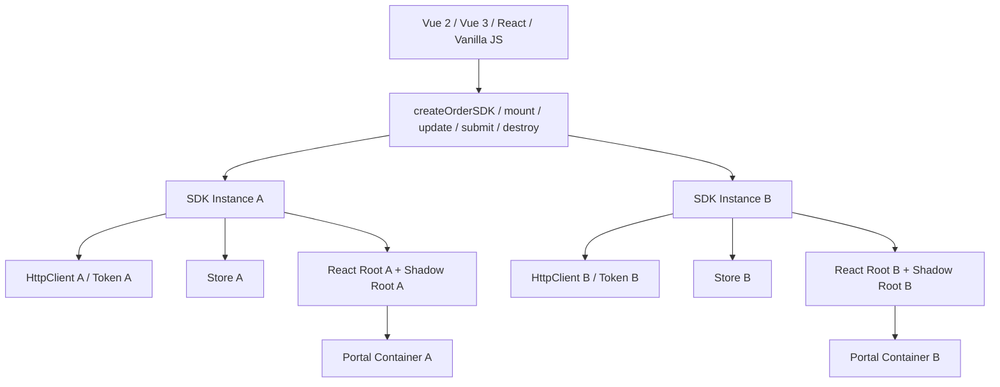
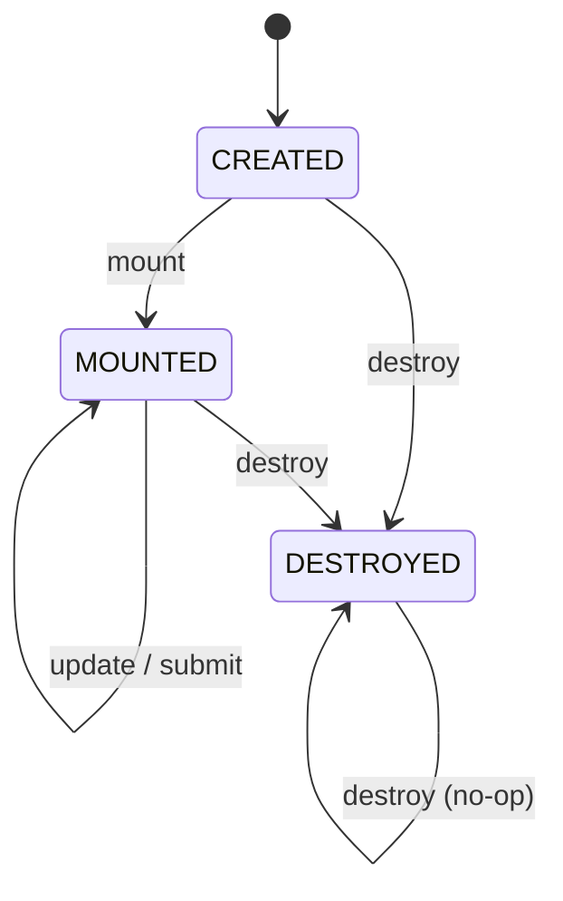
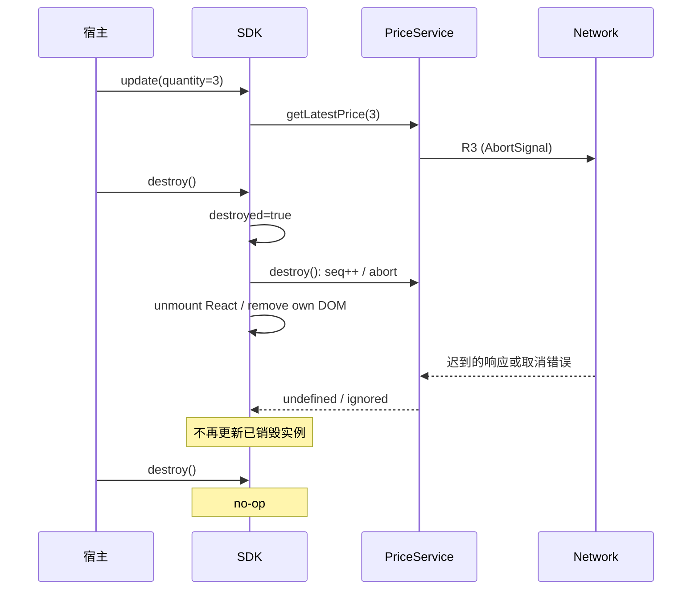

# 跨框架 SDK 多实例隔离与生命周期

> 日期：2026-10-26 · 第 3 天 · 题号 10 · 方向：场景/系统设计 · 难度：★★★★★

**状态：已完成 · 最终评分 78/100**

## 题目与真实作答

将 React 下单模块封装为 Vue 2/Vue 3/React/原生 JS 可接入的 SDK；同一页面有多个不同 Token 的实例；支持弹窗、异步计价、更新和随时销毁，样式不得污染宿主。

原始回答、两轮追问及逐项点评：**[follow-ups.md](./follow-ups.md)**。以下是完整参考答案，包含设计权衡、实现骨架和测试方案。

## 一、推荐架构：框架无关 API + React 内部渲染



### 对外 API

```ts
export interface OrderOptions {
  token: string;
  userId: string;
  quantity: number;
  onSuccess?: (result: OrderResult) => void;
  onError?: (error: Error) => void;
}

export interface OrderResult {
  orderId: string;
}

export interface OrderSDK {
  mount(container: HTMLElement): void;
  update(options: Partial<OrderOptions>): void;
  submit(): Promise<OrderResult>;
  destroy(): void;
}

export function createOrderSDK(options: OrderOptions): OrderSDK {
  return new OrderSDKImpl(options);
}
```

- **命令式 SDK**：对外只要求 DOM 容器和 JS API，内部 React 版本对宿主透明；实例化与 mount 分开，明确生命周期。
- **Web Components**：也可提供 `<order-widget>` 自定义元素适配层，适合标签式嵌入。Custom Elements 的 `connectedCallback`/`disconnectedCallback` 可转调 SDK 的挂载与卸载；复杂对象、事件与 React 版本兼容仍需适配。
- **打包分发**：优先 ESM，按需 UMD/IIFE 供脚本接入；`window.OrderSDK` 是分发入口，不是隔离手段。按项目需要明确 React 是否打包进 SDK、版本冲突、重复运行时体积、CSS 资源加载及 SSR 下仅在客户端 mount。

### 生命周期状态机



对于 `update`/`submit` 在 CREATED 状态是否可用、是否支持重复 mount、destroy 后是否可复活，必须有明确 API 契约；示例采用一次挂载、销毁不可复活的设计。

## 二、多实例隔离：资源所有权

每个实例独立持有：Token、用户/订单状态、React Root、Store、Axios/Fetch 客户端、ModalManager、Portal 容器、AbortController、事件监听器、定时器和订阅。共享纯函数、不可变常量、React 库代码通常没问题；**不能共享带身份信息的可变单例**。

### 错误：修改全局 Axios 默认 Token

```ts
import axios from "axios";

class BadSDK {
  constructor(token: string) {
    axios.defaults.headers.common.Authorization = `Bearer ${token}`;
  }
  getPrice() {
    return axios.get("/api/price");
  }
}

const a = new BadSDK("token-A");
const b = new BadSDK("token-B");
a.getPrice(); // 可能错误地携带 token-B
```

### 正确：每实例独立 HTTP Client

```ts
import axios, { type AxiosInstance } from "axios";

class OrderHttpClient {
  private readonly client: AxiosInstance;

  constructor(token: string) {
    this.client = axios.create({
      baseURL: "/api",
      headers: { Authorization: `Bearer ${token}` },
    });
  }

  updateToken(token: string) {
    this.client.defaults.headers.common.Authorization = `Bearer ${token}`;
  }

  async getPrice(quantity: number, signal?: AbortSignal): Promise<number> {
    const { data } = await this.client.get<{ price: number }>("/price", {
      params: { quantity },
      signal,
    });
    return data.price;
  }
}
```

共享 Axios **库**没问题，共享 `axios.defaults` 或模块级可变 Token 有问题。还需考虑 Cookie、LocalStorage、共享拦截器及同源身份状态可能造成的跨实例耦合。不要把错误 Token 交给后端“自行判断”，后端可能把它视为 B 的合法请求。

### Store 隔离

```tsx
// 伪代码：Store Factory 每次调用创建新 store
function createOrderStore() {
  return createStore<OrderState>()(() => ({ quantity: 1 }));
}

// 每个实例独立注入，而不是 import 一个模块级 globalStore
root.render(
  <OrderStoreProvider store={instanceStore}>
    <OrderApp />
  </OrderStoreProvider>
);
```

React `useState` 在不同组件树内天然独立，但导入同一个模块级 Zustand/Redux store 时仍然共享。实例级 Context Provider 不能修复被所有实例引用的同一个可变 Store。

## 三、Shadow DOM 与 Portal

Shadow DOM 封装 DOM 子树，普通外部 CSS 选择器不能直接匹配内部节点，内部样式也通常不匹配外部节点。它**不隔离** JS 全局变量、Token、网络请求、Cookie、window 事件监听器；CSS 继承属性、自定义属性、`::part` 等机制仍可跨越边界，不能将其视为安全沙箱。

```tsx
const host = document.createElement("div");
container.appendChild(host);
const shadowRoot = host.attachShadow({ mode: "open" });
const appContainer = document.createElement("div");
const modalContainer = document.createElement("div");
shadowRoot.append(appContainer, modalContainer);

// 样式需注入 shadowRoot，而不是只注入 document.head
const root = createRoot(appContainer);
root.render(<OrderApp portalContainer={modalContainer} />);

// OrderApp 内：
// createPortal(<OrderModal />, portalContainer);
```

**反例**：`createPortal(<OrderModal />, document.body)` 会把弹窗实际 DOM 放到 Shadow Root 外，失去该 Shadow Root 的普通 CSS 选择器隔离。React Context/React 事件树仍按 React 组件树运作，不能据此推断 CSS 也隔离。

推荐每个 SDK 实例持有独立 `ModalManager` 和 `modalContainer`，由 SDK 销毁时清理。第三方组件库需要配置 Portal 容器、CSS-in-JS 注入位置。共享 `document.body.style.overflow` 滚动锁、全局 Escape 监听和焦点管理时，使用协调器/引用计数，避免 A 关闭弹窗时错误恢复 B 仍需要的滚动锁。

## 四、异步计价竞态：latest request wins

场景：数量 1、2、3 对应 R1、R2、R3；响应按 R3、R1、R2 返回。如果直接每次 `setPrice`，最终错误显示数量 2 的报价。

**不推荐**通过互斥锁串行执行所有计价请求：最新报价会等待已经过期的请求。优先采用递增序号（或唯一请求 ID）过滤过期响应，并配合 AbortController 节省资源。

### 可复用的 TypeScript 服务实现

```ts
export class PriceService {
  private seq = 0;
  private active: AbortController | null = null;
  private destroyed = false;

  async getLatestPrice(quantity: number): Promise<number | undefined> {
    if (this.destroyed) throw new Error("SDK_DESTROYED");

    const mySeq = ++this.seq;
    this.active?.abort();
    const controller = new AbortController();
    this.active = controller;

    try {
      const response = await fetch(`/api/price?quantity=${quantity}`, {
        signal: controller.signal,
      });
      if (!response.ok) throw new Error(`HTTP ${response.status}`);

      const data: { price: number } = await response.json();

      // Abort 并不自动取消任意异步后续操作；提交前做逻辑校验
      if (this.destroyed || controller.signal.aborted || mySeq !== this.seq) {
        return undefined;
      }
      return data.price;
    } catch (error) {
      if (this.destroyed || controller.signal.aborted || mySeq !== this.seq) {
        return undefined; // 已失效请求的错误也不应覆盖最新 UI
      }
      throw error;
    } finally {
      if (this.active === controller) this.active = null;
    }
  }

  destroy(): void {
    if (this.destroyed) return;
    this.destroyed = true;
    this.seq++; // 使所有未完成的请求序号失效
    this.active?.abort();
    this.active = null;
  }
}
```

调用方收到 `undefined` 代表请求过期/已取消，不应更新 UI；若需要区分原因，可使用 `{status:"stale"|"aborted"|"ok"}` 的判别联合类型。提交价格前还需确认当前 SDK 未销毁。价格和数量应成对保存，避免最新数量配旧价格。对提交订单这类**有副作用**的请求，客户端 abort 不等于服务端撤销；还需服务端幂等键与订单状态查询。

### React Effect 的清理（只负责 Effect 自己创建的任务）

```tsx
useEffect(() => {
  const controller = new AbortController();
  let active = true;

  (async () => {
    try {
      const res = await fetch(`/api/price?quantity=${quantity}`, {
        signal: controller.signal,
      });
      if (!res.ok) throw new Error(`HTTP ${res.status}`);
      const data = await res.json();
      if (active && !controller.signal.aborted) setPrice(data.price);
    } catch (error) {
      if (active && !controller.signal.aborted) reportError(error);
    }
  })();

  return () => {
    active = false;
    controller.abort();
  };
}, [quantity]);
```

React Effect cleanup 会在依赖变更及组件卸载时执行；但 SDK 类直接调用的 `submit()` 或服务层任务**不一定**属于这个 Effect，不能只靠组件卸载处理所有异步任务。

## 五、幂等 destroy 与资源释放

```ts
import type { Root } from "react-dom/client";

class OrderSDKImpl {
  private destroyed = false;
  private root: Root | null = null;
  private host: HTMLElement | null = null;
  private priceService = new PriceService();
  private timers = new Set<ReturnType<typeof setTimeout>>();
  private cleanups: Array<() => void> = [];

  destroy(): void {
    if (this.destroyed) return;
    this.destroyed = true; // 先禁止后续异步提交

    this.priceService.destroy();
    for (const timer of this.timers) clearTimeout(timer);
    this.timers.clear();

    for (const cleanup of this.cleanups.splice(0)) cleanup();
    this.root?.unmount();
    this.root = null;

    this.host?.remove(); // 只移除 SDK 创建的节点，不能删除宿主容器
    this.host = null;
  }

  async updatePrice(quantity: number): Promise<void> {
    if (this.destroyed) throw new Error("SDK_DESTROYED");
    const price = await this.priceService.getLatestPrice(quantity);
    if (this.destroyed || price === undefined) return;
    // 在此将最新价格交给当前实例 Store / UI
  }
}
```

这是**生命周期骨架**，实际还需实现 `mount/update/submit`、事件回调、ModalManager 清理和错误传播。对公开方法定义销毁后行为（例如抛 `SDK_DESTROYED`），而不是让它们访问空引用。连续 `destroy()` 应 no-op；如清理函数可能抛错，生产中应设计尽力释放其他资源和错误报告机制。



## 六、方案对比

| 目标 | 推荐手段 | 常见错误 |
| --- | --- | --- |
| 跨框架 | 命令式 SDK + 可选 Web Component | 要求 Vue 宿主直接管理 React Hook |
| 多实例身份 | 实例级 HTTP Client / Token | 修改全局 Axios defaults |
| 状态隔离 | 实例级 Store Factory | 共享可变单例 Store |
| 样式隔离 | Shadow DOM + 内部样式注入 | 认为 Shadow DOM 是 JS 沙箱 |
| 弹窗隔离 | 每实例独立 Portal Container | 所有 Portal 指向 body |
| 计价竞态 | requestId/seq + abort | 无条件接受最后返回的响应 |
| 卸载清理 | destroyed guard + abort + unmount | 只 unmount，不管 SDK 层 Promise |
| 重复销毁 | 幂等状态机 | 第二次访问空 root 抛错 |

## 七、测试策略：跨框架、多实例、异步和资源泄漏

1. **框架矩阵**：Vue 2、Vue 3、React、原生 JS 各做最小宿主页面，验证 mount/update/submit/destroy、事件、打包和依赖版本。
2. **多实例认证**：同页挂 A/B，分别使用 Token A/B；模拟交错请求，断言请求头不会串扰。
3. **多实例状态/弹窗**：A 改数量不影响 B；A 开关弹窗不误删 B；Portal 必须位于各自 Shadow Root 内。
4. **CSS**：宿主设置通用 `button`、`div` 规则，确认 SDK 样式稳定；SDK 样式不影响宿主；验证 CSS 变量/继承行为。
5. **竞态**：用 MSW 或可控 Promise 强制 R3、R1、R2 顺序返回，最终只展示 R3。
6. **卸载**：请求 pending 时 destroy；迟到响应不得触发状态更新或事件；清除监听、计时器、Observer、React Root、SDK 自建 DOM。
7. **幂等**：连续 destroy 两次不抛错；destroy 后 update/submit 按契约拒绝；重新创建**新实例**正常。
8. **压力/泄漏**：循环 mount/destroy 多次，检查 DOM、事件监听器、定时器、请求及内存增长。
9. **边界**：token 更新、组件库 Portal、焦点、滚动锁、SSR hydration 边界、网络超时、取消与业务错误区分。

## 八、面试 2 分钟回答

> 我会对外提供与宿主框架无关的命令式 SDK，内部用 React Root 渲染，可额外封装 Web Components 适配层。每个 SDK 实例独立持有认证上下文、Axios Client、Store、React Root、ModalManager、Shadow Root 和异步资源，避免全局可变单例导致 Token、状态和弹窗串扰。Shadow DOM 解决大部分 DOM/CSS 选择器隔离，但不隔离 JS、网络和 Cookie；Portal 要挂载在当前实例的 Shadow Root 内。异步计价采用递增请求序号的 latest-request-wins，并用 AbortController 取消旧请求；销毁时先标记 destroyed，再取消请求、卸载 React、移除监听和自建 DOM，异步回调提交前二次检查，destroy 幂等。最后在 Vue 2/3、React 和原生 JS 宿主中进行多实例、竞态、卸载和泄漏测试。

## 参考资料（官方）

- [MDN — Web Components](https://developer.mozilla.org/en-US/docs/Web/API/Web_components)
- [MDN — Using Shadow DOM](https://developer.mozilla.org/en-US/docs/Web/API/Web_components/Using_shadow_DOM)
- [MDN — AbortController](https://developer.mozilla.org/en-US/docs/Web/API/AbortController)
- [React — createRoot](https://react.dev/reference/react-dom/client/createRoot)
- [React — createPortal](https://react.dev/reference/react-dom/createPortal)
- [React — useEffect](https://react.dev/reference/react/useEffect)
- [Axios — Creating an instance](https://axios-http.com/docs/instance)
- [Axios — Cancellation](https://axios-http.com/docs/cancellation)
